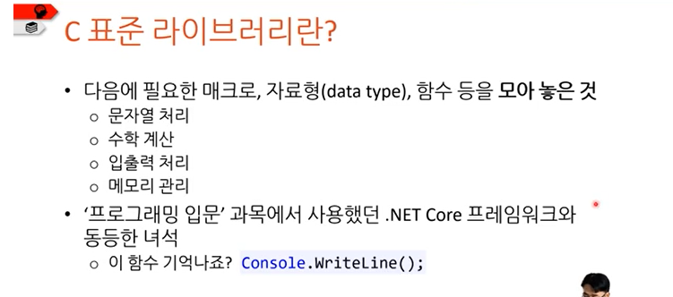
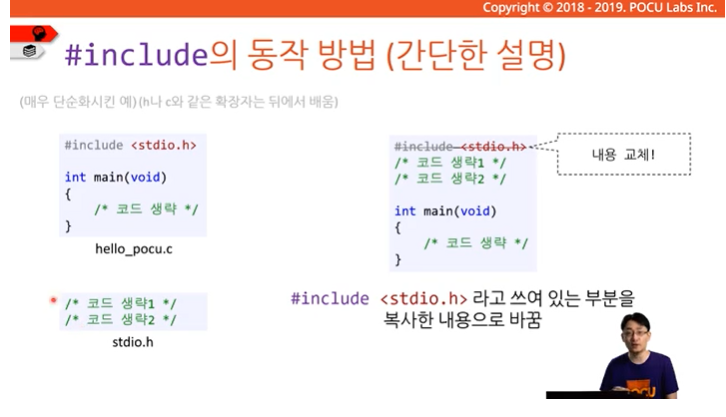

# "#include <stdio.h>"

> 작성: 2024-01-31 · [노션 원본](https://app.notion.com/p/b500b485cd2b4b62a38c50c776faa03e)

# #include \<stdio.h>

#include의 동작 방법

#include \<stdio.h>

- 전처리기이다.
- C의 표준 라이브러리이다.
  
- 표준 입력과 출력을 담당(**Standard** I**nput and** O**utput 의 약자**)

c에서 컴파일하는 과정은 텍스트를 복붙하는 방식이다.



```c
#include <stdio.h>

```
