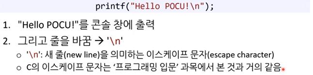
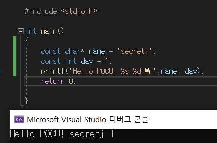

# printf() 함수

> 작성: 2024-01-13 · [노션 원본](https://app.notion.com/p/ccabff4f9164415b966374dac678d697)

- printf(”Hello, %s\\n”, name); **%s부분에 name에 해당하는 값**을 출력해줘 라는 의미
- printf(”%d + %d\\n”, num1, num2); **%d는 정수를 문자열로 포맷**해서 해당하는 순서대로 넣어준다.
- \\n은 줄바꿈
- 실습

