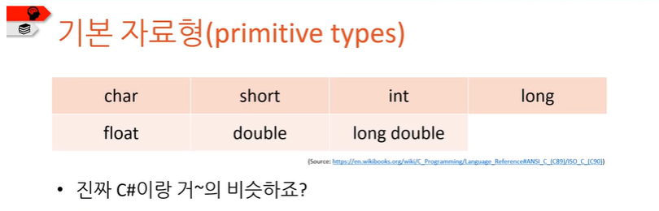
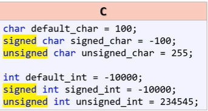
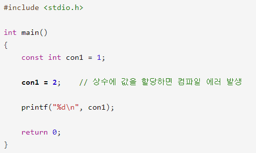

# 자료형

📄 [char형](06-자료형/01-char형.md)

📄 [short형](06-자료형/02-short형.md)

📄 [int형, long형](06-자료형/03-int형,%20long형.md)

📄 [float형, double형, long double형](06-자료형/04-float형,%20double형,%20long%20double형.md)

📄 [자료형 CODE](06-자료형/05-자료형%20CODE.md)

# **unsigned(부호없음), signed(부호있음)**

**: C는 부호가 없을 때 unsigned라는 단어를 자료형 이름 앞에 넣어줘야 한다.  ex) unsigned char, unsigned int  생략하면 ‘부호 있음(signed)가 기본임 부호가 있음을 명확하게 보여주기 위해 붙이기도 함.** 

# const(변함없음)

:상수에 값을 할당한 뒤 컴파일해보면 컴파일 에러가 발생합니다.   즉, const를 붙여서 상수가 되면 더 이상 값을 할당할 수 없습니다. 완전 고정된 상태죠. 다른 값을 사용하려면 새 상수를 선언해야 합니다.
