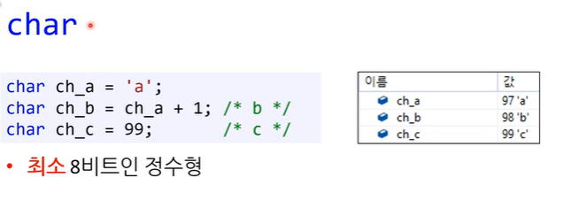
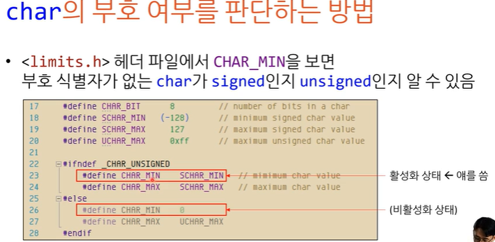
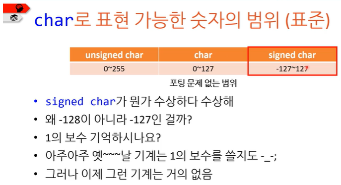

# char형

: char은 최소 8비트인 **정수형**

표준은 8비트 이상이라고 만 정의함...

⇒ char를 100만 비트로 해도 표준에 맞다(?)

즉, 컴파일러에 따라 char의 비트 수는 다르다.

- char은 이 **기기에서 가장 작은 단위**다. : C언어에서 byte라는 단위가 몇 비트인지는  기기의 CHAR\_BIT에 따라 다르다. ⇒ CHAR\_BIT가 16bit로 이루어져 있으면 그 기기의 1byte=16bit인 것 !
- char도 정수형이기 때문에 signed(부호있음)과 unsigned(부호없음)이 있다. ⇒컴파일러마다 기본값이 다르다. 

- 포팅에 문제가 없는 범위는 -127인 것 ! ⇒but, 표준은 표준이고 안전하게 생각해도 되는 범위는 **(signed)-128\~127, (unsigned) 0\~255** 이다.
