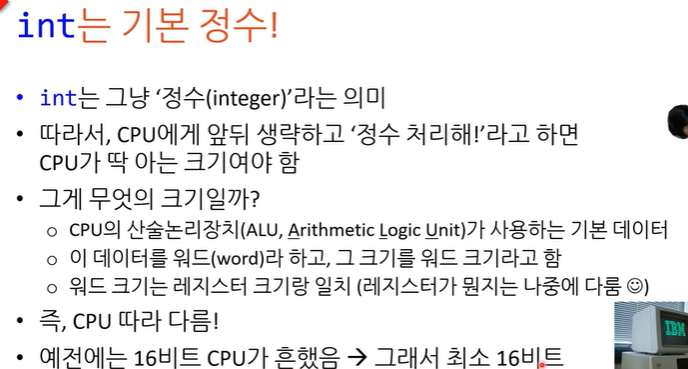
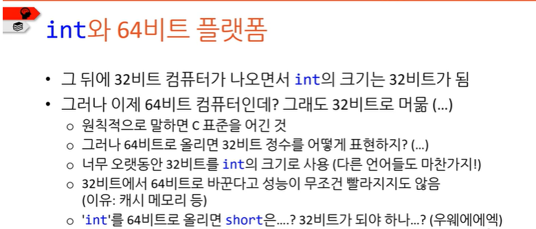
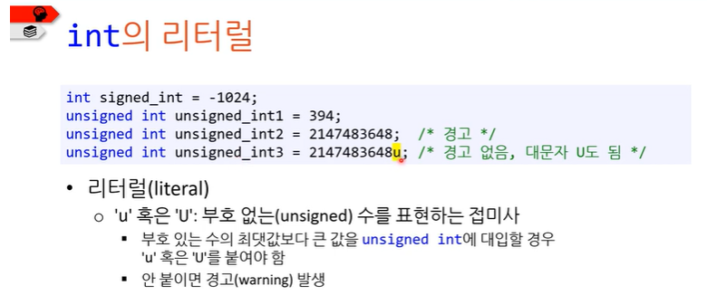
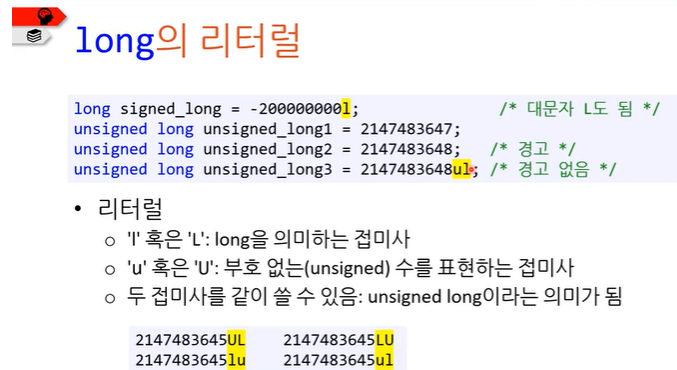

# int형, long형

> [노션 원본](https://app.notion.com/p/5384a9a8c2ff41a7abfa3e19ac8fc7a8)

# int형

C89 **표준에 int형은 최소 16비트 그리고 short 크기 이상의 정수형이다.**(다른 곳에선 32비트 ⇒ 다르다.)

### 표준에 상관없이 안전한 범위는 32비트!

**unsigned형일때 부호있는 수의 최댓값보다 큰 값이 들어갈 경우 u를 붙여줘야 경고가 발생하지 않는다.**

# long형

### int가 16비트일 때 그것보다 2배 큰 자료형이 필요했다.

따라서 C89의 **long형의 표준은 최소 32비트이고 int이상의 크기**를 말한다.

표준에 상관없이 안전하게 생각해도 되는 범위는 int와 같다.

**unsigned(부호없음)일때 long형은 뒤에 ul혹은 lu를 붙여줘야한다.**

⇒1다음에 l이 들어오면 헷갈려서 대문자로LU를 하거나 ul을 사용하라고 권장한다.
