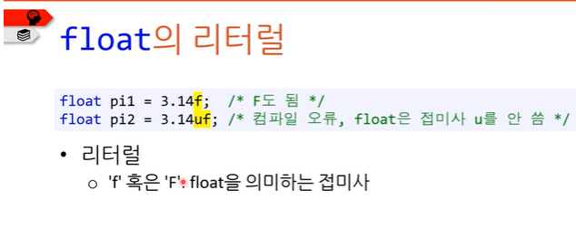
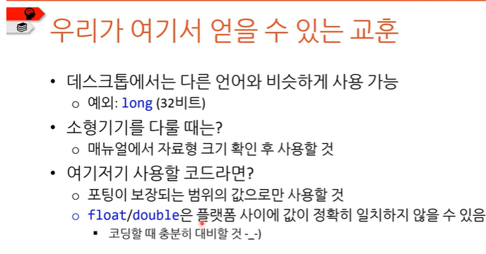

# float형, double형, long double형

# float형

- 크기는 char 이상이기만 하면 된다.
- unsigned 형 없다.
- 표준에 상관없이 안전하게 사용되는 범위는 32비트

# double형

- 크기는 float 이상이기만 하면 됨.
- unsigned 형 없다.
- 표준에 상관없이 안전하게 사용되는 범위는 64비트

# long double형

- double보다 정밀도가 높다.
- double이상의 크기면 됨
- unsigned형 없음

