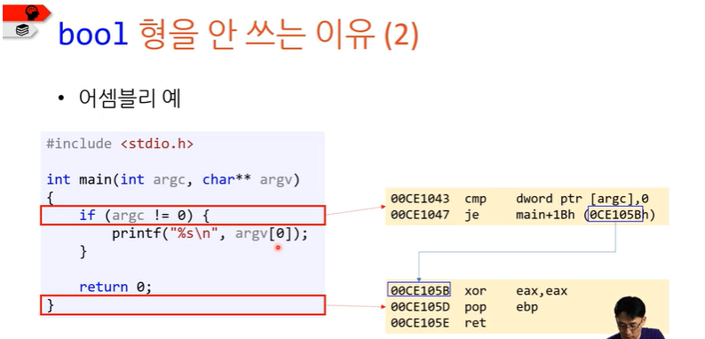

# bool형

> 작성: 2024-01-13 · [노션 원본](https://app.notion.com/p/2e6fe12018be43ffbe4a66ddbd0a63b3)

## bool형을 잘 안 쓰는 이유

- 정수로 대신 쓸 수 있음
- 이면 false, 0이 아니면 true

//c에서 컴파일하면 어셈블리어로 어떻게 표현되는 지 볼 수 있다.



## 어셈블리어 읽는 법

- 00CE1043:  어셈블리어의 주소
- 1열 ⇒ dword ptr(포인터) \[argc\](argc의 주소)를 0과 비교해라
- 2열 ⇒ je(점프: 0과 같으면 점프해라)
- 3열 ⇒ xor연산 eax(반환 값을 저장하는 레지스터)

## 참, 거짓을 반환해야 할 때

c에서 참 거짓을 반환해야 하는 함수의 경우 보통 이렇게 함

- 거짓일 때는 0을 반환
- 참일 때는 1을 반환

```c
int is_student(const int id){
	if(/*조건:is_student()==1, is_student!=0 이런식 */){
			return 1;
}

return 0;
}
```
