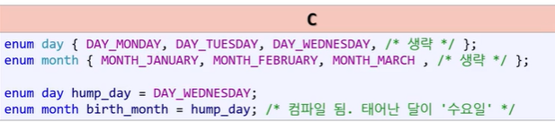

# 열거형(enum)



int와 비슷하게 작동하는데 보기 쉽고 구별하기 쉽게 작성하는 게 좋다.

**실습 코드**

```c
#include <stdio.h>

enum champ {
	CHAMP_ZEN,
	CHAMP_JAX,
	CHAMP_VAYNE,
	CHAMP_LULU,
	CHAMP_LEESIN

};

enum role {
	ROLE_TOP,
	ROLE_MID,
	ROLE_JUNGLE,
	ROLE_BOTTOM,
	ROLE_SUPPORTER
};

int main(void)
{
	enum champ my_champ = CHAMP_VAYNE;
	enum role my_role = ROLE_BOTTOM;

	printf("my_champ : %d\n", my_champ);
	printf("my_role : %d\n", my_role);
	printf("\n");

	return 0;
}
```
