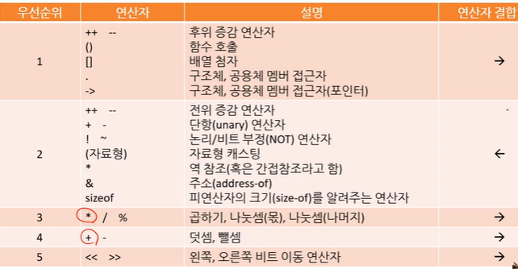
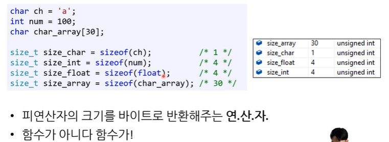
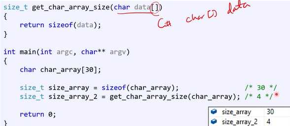
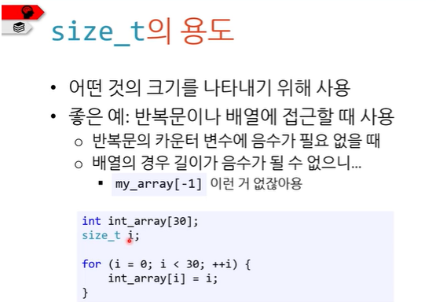
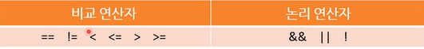

# 연산자

> 작성: 2024-01-13 · [노션 원본](https://app.notion.com/p/0263c25aac60412ebb51f39d99517454)

## 연산자 우선순위



```c
예를 들어
f()+g()*h()++가 있으면
1.함수 호출
2.증감 연산
3. *
4. + 순으로 진행
```

## C에서 새로 만나는 연산자

- sizeof()
- 역 참조 연산자 \*
- 주소 연산자 &
- 구조체와 공용체 멤버 접근자 .과 - >

### sizeof()



- 피연산자의 **크기를 byte크기로 반환**해준다 !!
- 함수가 아니고 연산자다 !   ⇒ 그렇기 때문에 **컴파일 중에 평가**됨 !
- **char형을 넣으면 반드시 1이 반환 (char= 1byte)**
- 반환하는 값은 부호 없는 정수형의 상수로 size\_t형
- 배열의 경우, 함수 인자로 받을 경우 다른 결과가 나온다.



### size\_t

- 부호 없는 정수형이나 실제 데이터형은 아니다.
- 32bit unsigned형으로 거의 나옴
- 배열을 만들면 그 배열의 바이트 크기를 얻을 수 있다고 명시함

⇒ 즉, **size\_t의 크기는 최소한 배열을 다 담을 수** 있어야 함 고로

최소 16비트는 담을 수 있는 크기(<ins>2\^16-1=65535bit</ins>) !

**용도**



배열에 접근할 때 카운트하는 용도가 대표적인 예

⇒ 왜? 부호 없는 정수의 크기기 때문에 !

- string에서 indexOf() 함수는 문자를 못 찾으면 -1을 반환했는데

size\_t를 가지고도 마찬가지 일을 할 수 있다 ⇒ -1은 size\_t의 최댓값으로 표현함!

//C에서는 예외같은 건 없다. 예외없이 튼실하게 만들어야 한다.

## 역 참조 연산자 \*

- \*의 피연산자가 하나면 역 참조 연산자
- 포인터형 변수에만 사용 가능
- 주소 연산자와 더불어 메모리를 들었다 놨다 하는 연산자

```c
int num1 = *p; /*이게 역 참조 연산자다*/
```

포인터랑 관련된 연산자이다 !

자세한 내용은 포인터를 배우면서 같이 배울 예정..

## 주소 연산자 &

```c
int num =10;
int *p = & num;
```

- 피연산자가 하나일 때는 주소 연산자
- 어떤 변수의 메모리 주소를 반환

이것도 포인터와 함께 자세히 다룰 예정..

## 구조체와 공용체 멤버 접근자 . 과 - >

**.연산자**

- c에는 클래스가 없으므로 함수 호출에 쓸 수 없다.
- 단, 구조체와 공용체는 있으니 그들의 멤버변수에 접근할 때 사용

\- >연산자

- 2개의 연산자 ‘. ’과  ‘\*’을  합친 것
- 구조체와 공용체의 멤버변수에 접근할 때 사용

## 비교 연산자와 논리 연산자, 조건 연산자

다 아는 것들이니 pass



**조건 연산자**

```c
/*삼항 연산자*/
int num1 =10;
int num2 =56;
int min = num1 < num2 ? num1 :num2;
/*간단한 if|else조건문대신*/
```
