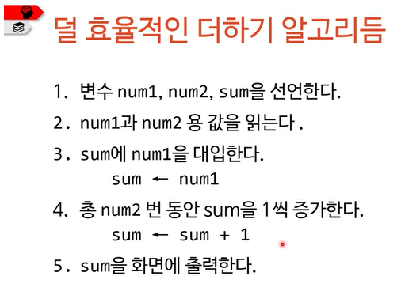

# 프로그래머와 알고리듬

> 작성: 2021-12-31 · 태그: pocu · [노션 원본](https://app.notion.com/p/98c2784960884a3c9b1dd13860e15b03)

### 알고리듬 공부의 목표

- 실제 우리가 생활을 하다가 문제를 발견하고 그것을 해결하는 과정
- 새로운 것을 해결할 능력을 갖추어야 함
- 하나를 배우면 그것을 응용해서 새로운 것을 만들 수 있게 공부할 것!
- 어떤 프로그래밍 언어로도 알고리듬을 구현할 수 있어야한다.

```java
public int add(int num1, int num2){
	int result = num1 + num2 ;
	return result;
}
은 알고리듬인가 ? yes
```

## 훌륭한 알고리듬이 갖춰야 할 자질

- 거의 모든 언어에 공통되는 연산만 사용하기
  - 사칙 연산, 비트 연산, 반복문, 조건문 등
- 결국 하드웨어와 기계어/어셈블리어 수준에서 지원하는 것들
- 고수준 언어 중에는 C에서 지원하는 것 정도(단, 포인터 연산 제외)
- 포팅이 어려운 컴퓨터 코드를 포함하면 안 됨

## 알고리듬의 효율성

- 자원의 효율적 사용을 뜻함
- 자원(resource)
  - 시간: CPU 속도 등
  - 공간/용량 : 메모리 사용량등

  ⇒ 즉, 시간과 공간을 효율적으로 사용해야 한다.

- 시간과 공간은 종종 상반 관계 <br>⇒ 메모리를 좀 더 써서 시간을 줄이던가 시간을 좀 더 써서 메모리를 줄일 것인가
- 자원을 많이 사용할수록 그 알고리듬이 복잡하다고 말한다.
  - 시간 복잡도(time complexity)
  - 공간 복잡도(space complexity)

  ⇒ 알고리듬 복잡도를 표현하는 방법 중 하나 : 빅오(Big-O) 표기법



```java

public static int add(int num1, int num2){
	int sum = num1;
	for (int i=0; i<num2; ++i){
		++sum;
	}

	return sum;
}  /*효율적이지 못한 코드 => for문이 한번 돌 때마다 명령어가 한번 돔
	  시간 복잡도 O(N) , 거기다 num2가 음수일 때 오류발생한다.*/

public int add(int num1, int num2){
	return num1 + num2;
} //효율적인 코드  => 시간 복잡도 O(1)
```

```java
/*비효율적이나 올바른 알고리듬*/
public static int add(int num1, int num2){
	int sum = num1;

	for(int i = num2; i<0; ++i ){
		--sum;
	}

	for(int i = 0; i<num2; ++i){
		++sum;
	}

	return sum;
}

int sum = Calculator.add(1, -2);
System.out. println(sum);
```
