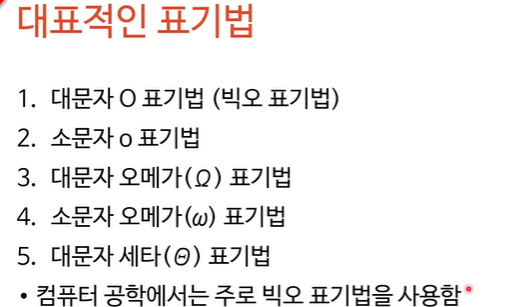
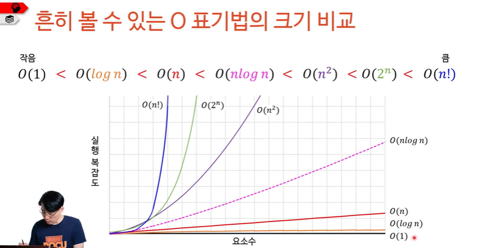
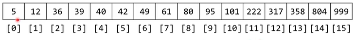
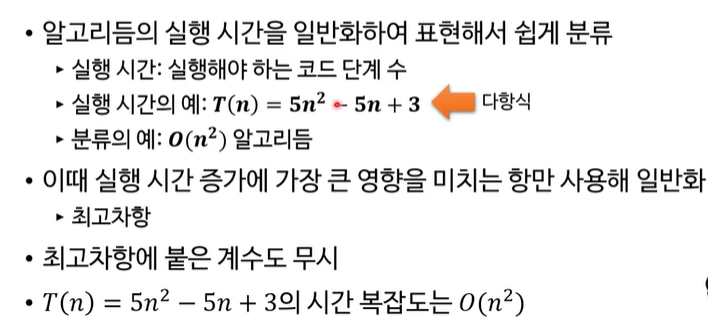

# 빅오 표기법

> 작성: 2022-01-02 · 태그: pocu · [노션 원본](https://app.notion.com/p/e28b0ae52010460a9dcfcc3216d1bb91)



## 컴퓨터 공학에서의 빅오 표기법

- 이름에서 알 수 있듯이 대문자 O를 이용해 표기
- 주로 알고리듬을 분류하기 위해 사용
  - O(1), O(log n), O(nlog n)등
- O의 의미는 ‘order of the function’(대략 그 함수 정도)

### 어떤 기준으로 분류하나요?

- **입력 데이터가 많아짐에 따라** 시간 복잡도(실행 시간) / 필요한 공간(공간 복잡도) 가 얼마나 늘어나는지 측정
- 즉, **입력이 증가함에 따른 시간 및 공간의 증가량**을 의미





- O(1 )
  - 입력 데이터의 크기 N에 상관없이 언제나 **일정한 시간**이 걸림

    - num\[3\]+ num\[6\] 이나 num\[5\]+num\[8\]에 걸리는 시간은 같음

- O(n)
  -  입력 데이터의 크기 N에 비례하는 시간이 걸림

    - 배열의 크기가 8이라고 할 때, 배열끼리 모두 더해라 하면 8번 더해야하기때문에 시간은 8이됨. ⇒ 시간과 정비례

- O(n\^2)
  - 입력 데이터 크기 N의 제곱에 비례하는 시간이 걸림
    - 예시로는 구구단표를 들 수 있다. → x축과 y축을 곱해서 표로 나타낼 때
- O(log n) → 2진 탐색할 때 사용함
  - O(1)과 O(n) 사이
    - 그래프가 점점 갈수록 평평해짐
      - 위의 정렬된 배열에서 222를 찾는 다고 했을 때, 중간 지점을 찍어서 80을 찍었다고 하면 222보다 80은 작기때문에 좌측을 버리고 또 중간을 찍고 한쪽을 버리는 식으로 검색 속도를 반으로 줄이는 형태
- O(nlog n)
  - O(n)과 O(n\^2)의 사이

  

### ‘대략 그정도’의 의미



→다항식에서 시간 증가에 가장 큰 영향을 미치는 최고차항만 일반화해서 시간복잡도로 따짐

### 퀴즈: 다음 함수의 시간 복잡도는?

```java
public void doSomething(int n){
			for(int i=0; i<n; ++i){
				for(int j=0; j<n/2; ++j){
							/*무언가의 코드 O(1)*/
			}
		}
	}
```

답은  O(n\^2)
