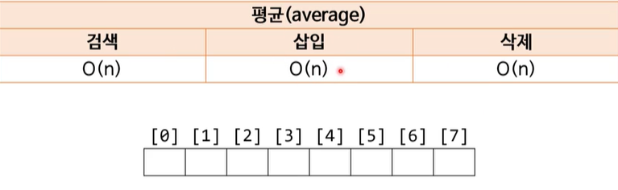
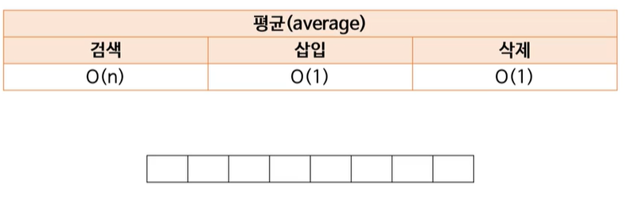
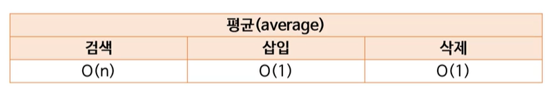
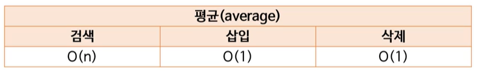
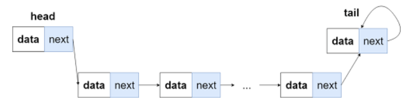
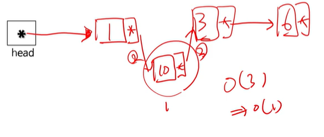
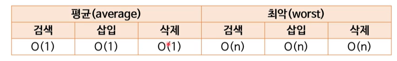
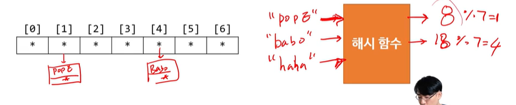
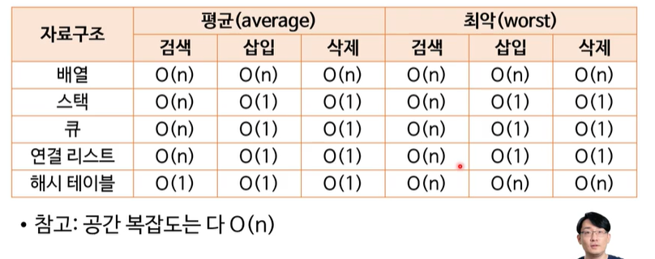

# 시간 복잡도에 따른 기초 자료구조

> 작성: 2022-01-03 · 태그: pocu · [노션 원본](https://app.notion.com/p/c195cfde43f74644a8e2ed502c41928f)

- 배열
- 스택
- 큐
- 연결 리스트
- 해시 테이블, 해시 맵

### 1.배열

- 일반적으로 배열의 순서를 바꾸지 않을 때
  - 제일 마지막에 삽입했을 때는 O(1)이 맞다.
  - 하지만 중간에 삽입하고 싶으면 다른 배열을 미루고 삽입해야 하기 때문에 평균은 O(n)이다.
  - 삭제도 마찬가지로 삭제 후 뒤의 값을 끌어와야 하기 때문에 O(n)
- 배열의 순서를 유지하지 않아도 되면
  - O(1)임

### 2. 스택

- 쌓는다고 생각하면 됨
- 배열에 그냥 넣고 빼는 거랑 다를 게 없음
- 검색은 다 찾아봐야 하니까 O(n)

### 3. 큐

- 제일 먼저 들어온 것부터 뽑아감 (줄 선다고 생각하면 됨)
- 다 뽑은 다음에 찾아가는 구조기 때문에 검색만 O(n)

### 4. 연결 리스트(Linked List)

- 노드를 연결 시킨 자료구조

  - 노드란 데이터를 갖고 있는 데이터의 묶음

  

  제일 앞의 노드는 헤드(head), 제일 끝 노드는 테일(tail) 
- 장점은 리스트의 길이가 가변적이다→배열의 단점 커버 가능

  - 데이터가 자주 추가되거나 가변적으로 자주 변하게 될 프로그램이라면  연결 리스트를 쓰는 것이 좋다. ⇒  주로 데이터의 변경이나 탐색을 위한 프로그램은 배열이 낫다.

  

- 왜 삽입이 O(1)이냐
  

1과 3 사이에 10을 삽입한다고 했을 때,

10을 만들고 1과 3을 연결해주면 끝이니  총 3번의 명령이 들어간다. =O(3) 시간 복잡도는 계수를 무시하니 O(1)이 된다. 

단, 컴퓨터에서 노드를 생성하는 과정이 느리다. 그래서 시간 복잡도가 적다고 해서 연결 리스트가 배열보다 무조건 빠른 건 아니다.  → 데이터의 양이 엄청 많아질 때 사용하면 더 빠르다.

### 5. 해시 테이블

**해시 테이블의 원리**

- (KEY,VALUE)로 데이터를 저장하는 자료구조. 빠르게 데이터를 검색할 수 있다. 이유는 내부적으로 배열(버킷)을 사용하여 데이터를 저장하기 때문이다.
- 해시 테이블은 각각의 KEY값에 **해시함수**를 적용해 배열의 고유한 index를 생성하고, 이 index를 활용해 값을 저장하거나 검색하게 된다.
- 여기서 실제 값이 저장되는 장소를 버킷 또는 슬롯이라고 한다.

**시간 복잡도**

- 해시함수를 통해 한번에 계산되기 때문에 평균적으로 O(1)이 된다.

- 최악은 해시 테이블의 배열에 한 곳에 모든 데이터가 들어갔을 때 연결 리스트기 때문에 O(n)이 됨

### 6. 해시 맵

- **키(KEY)- 값(VALUE)쌍을 저장**하는 자료 구조
  - 예 : “박진형”-29
- 저장 및 검색
  - 해시 테이블을 이용하여 키를 저장
  - 값은 그 키와 같은 위치에 저장
  - 검색도 **키를 이용해서 저장된 위치를 찾는 게** 전부
- 키는 위치 검색용
- 그 외엔 해시 테이블과 다른 게 없음

## 자료구조의 시간 복잡도 정리

