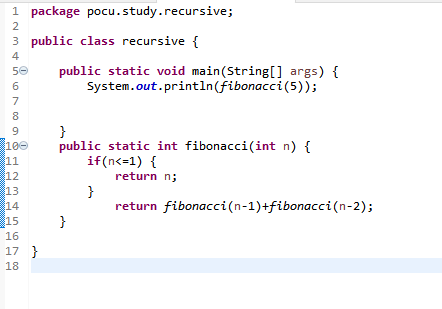
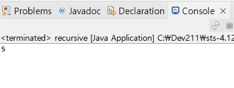
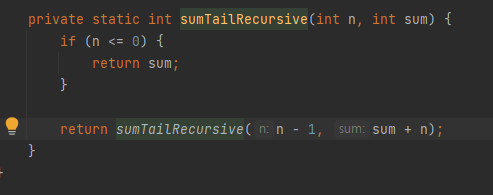

# 재귀(recursive)함수

> 작성: 2022-01-08 · 태그: pocu · [노션 원본](https://app.notion.com/p/55fa956b0be649869c5eb3a3fc49ff72)

## 재귀 함수 정의

: 함수가 직접 또는 간접적으로 자신을 호출하는 프로세스

### 예제 1

피보나치 수열을 재귀 함수로 작성

```java

public static int Fibonacci(int n){
		if(n<=1){
				return n;
		}
				return Fibonacci(n-1) + Fibonacci(n-2);
		}
}
```

1 1 2 3 5 8 13 ...

이런 식으로 N=(N-1)+(N-2)이 계속해서 나오는 수열





아래는 반복문으로 만든 피보나치 수열

```java
public static int fibonacci(int number){
		if(number<=1){
				return number;
		}
		int fib = 1;
		int prev = 1;

		for(int i = 2; i<number; ++i){
				int temp = fib;
				fib += prev;
				prev = temp;
		}

		return fib;
}
```

## 재귀 함수의 장단점

**장점**

- 가독성이 좋음
- 코드가 짧음
- 각 단계의 변수 상태가 자동 저장됨
  - 함수의 스택 프레임 덕분
- 코드 검증도 쉬움

**단점**

- 재귀적 문제 분석/설계가 안 직관적
- 맹목적인 믿음이 필요
  - 수학적 귀납법을 이해하면 믿음이 생김
- 스택 오버플로 발생 가능
  - 재귀 함수 호출이 너무 깊은 경우
- 함수 호출에 따른 과부하(모든 함수 호출에는 성능 저하가 일어난다.)

### 그럼 성능 문제가 있으니 재귀 함수를 안써야하나요?

아니요 !

- 재귀 함수가 반복문보다 가독성이 훨씬 좋다 !
- 그러나 다음과 같을 경우 반복문으로 변환하는 게 좋다

  - 스택 오버플로가 날 가능성이 있는 경우
  - 성능 문제가 일어날 가능성이 큰 경우
  - 성능 문제가 확인된 경우
- 모든 재귀 함수는 반복문으로 작성 가능하다

  - 복잡한 경우 스택 등의 데이터 구조를 사용해야 한다.

## 그런데 말입니다. 단점이 없는 재귀도 있습니다.

### 꼬리 호출(tail call)

: 함수 코드 제일 마지막에서 다른 함수를 호출하는 경우

→ 그 후에 실행하는 명령어가 없다.

예제

```java
public int calculateSignature(int[] data), int multiplier){
		int[] tempData = new int[data.length];
		for(int i = 0; i< data.length; ++i){
			tempData[i] = data[i] * multiplier;
	}

	return accumulate(tempData);
}
```

**스택 프레임이 존재하는 이유** - 함수에서 사용 중인 변수 값을 유지하기 위해 - 타 함수 호출 후 반환되면 스택에 저장했던 값을 되돌려 사용

근데

- 꼬리 호출의 경우는 타 함수로부터 반환 후 더 이상 연산이 없다
  - 곧바로 호출자로 반환함

따라서 스택 프레임에 저장해 놓은 변수 값을 재사용하지 않는다.

이런 경우에 컴파일러가 스택 프레임을 따로 안 만드는 최적화를 하기도 함

- 꼬리 호출 제거(tail call elimination)
- 꼬리 호출 최적화(tail call optimization)

### 꼬리 재귀(tail recursion)

- 꼬리 호출의 특수한 경우
- 마지막에 호출하는 함수(꼬리 호출)가 자기 자신(재귀)
- 꼬리 호출과 똑같은 최적화가 적용됨

### **예제 2**

팩토리얼 재귀 함수

```java
int factorialRecursive(int n){
	if (n <= 1){
		return 1;
	}

	return n * factorialRecursive(n-1);
}
```

Q : 위 코드는 꼬리 재귀일까?

A : NO  마지막에 있다고 꼭 꼬리 재귀가 아니고 다시 호출을 하지 않아야 꼬리 재귀 함수

```java
int factorial(int n){
		return factorialRecursive(n, 1);
}

int factorialRecursive(int n, int fac) {
		if(n<=1){
			return fac;
		}

		return factorialRecursive(n - 1, n*fac);
}
```

이게 팩토리얼을 꼬리 재귀 함수로 작성한 코드

- 일반 재귀 함수보다 덜 직관적이다
- 가장 사용하는 큰 이유는 최적화를 위해서
- 하지만 꼬리 호출 최적화를 지원 안 하는 언어라면?
  - 안 돼도 충분한 의미가 있음
  - 꼬리 재귀는 반복문으로 쉽게 변경 가능 !

## 재귀 함수로 총합 구하기


