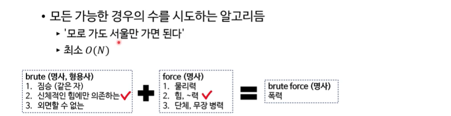
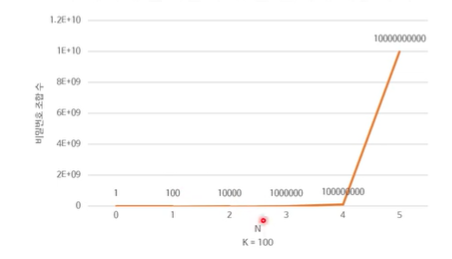
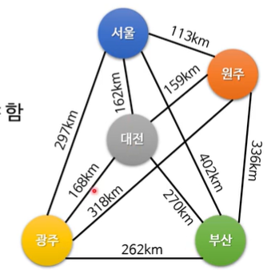
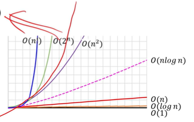

# 주먹구구식 알고리듬

### 주먹구구식(brute-force) 알고리듬

- 좋은 알고리듬의 조건 중 ‘효율성’을 고려하지 않은 알고리듬
  - 문제에 따라 더 효율적인 알고리듬이 없는 경우도 있음
- 보통 가장 직관적인 문제 해결법
  - 예: 숫자를 이용한 계산과 단순한 알고리듬 다수
  - 주먹구구식 알고리듬을 쉽게 구현할 실력이 돼야 함(굳이 알고리듬 공부라고 할게 아니라 당연히 할 줄 알아야 한다,,,,)

### 주먹구구 알고리듬의 예

- 배열에서 어떤 값의 첫 번째/마지막 색인 찾기
- 배열에 들어있는 정수들의 합 또는 평균 구하기
- 배열에서 최솟값이나 최댓값 찾기
- char\[ \]에 저장된 문자열 뒤집기(사본 생성 금지)
- 그 외 다수

→ 모두 O(N) 알고리듬 ! 모두 1분 안에 작성할 수 있어야 하는 것들 !

### 주먹구구 알고리듬과 시간 복잡도

- O(N)보다 시간 복잡도가 높은 알고리듬들이 많음
- O(N\^3)정도부터 최적화를 고려하는 경우가 많음
  - N이 작으면 상관없음
- 컴퓨터에서 실행하기에는 너무 느린 알고리듬들도 많음
  - 알려진 최적화 방법이 없는 것들도 존재
  - 반드시 나쁜 일은 아님
  - 보안 분야가 이에 많이 의존

### 주먹구구식 비밀번호 깨기

1. 비밀번호 규칙에 맞는 새로운 비밀번호를 하나 만든다
2. 그 비밀번호가 올바른 비밀번호인지 시도해본다
3. 올바르지 않다면 1번 단계로 돌아간다.

→ 시간 복잡도는 O(K\^N) - N : 비밀번호 자릿수 - K : 각 자리에 들어갈 수 있는 문자 수 - N과 K의 상한은 ? N : 계속 늘릴 수 있음, K : 상식적으로 100자 미만  자릿수 하나에 횟수가 기하급수적으로 늘어나는 것을 볼 수 있음

### 주먹구구식 외판원 문제

- 줄여서 TSP라고 부름
- 여러 도시를 방문해야 하는 외판원
- 각 도시를 최소 한 번씩 방문해야 함
- 가장 짧은 거리를 이동해서 다음을 완료해야 함
  - 한 도시에서 시작
  - 모든 도시를 방문
  - 원래 도시로 돌아옴
  - 이동 방법은 운전

  

  1. 시작할 도시를 고른다.
  2. 모든 방문 순서 목록들을 만든다(모든 경우의 수)
  3. 각 목록의 총 이동거리를 계산한다.
  4. 그 결과 중 총 이동거리가 가장 짧은 목록을 선택한다.

  → 시간 복잡도는 경우의 수 O(N!)   ⇒ 엄청 느리다.

  

## 기하급수적 증가 알고리듬의 문제점

- N이 커질수록 문제를 푸는 속도가 매우 느려짐
- 실무에 사용하기 어려운 경우가 많음
- 기하급수적 증가(exponential growth)
  - 지수 시간(exponential time)

  
