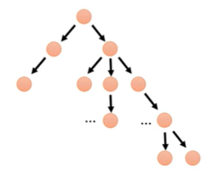
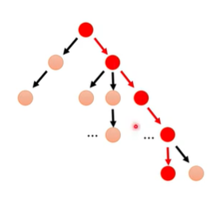
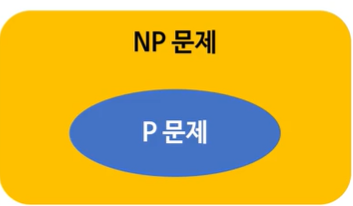
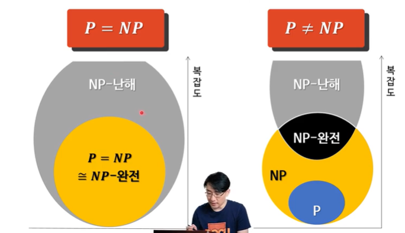

# P vs NP 문제

> 작성: 2022-01-08 · 태그: pocu · [노션 원본](https://app.notion.com/p/c55217b6dee848d782db98e65a8c42f1)

## P 분류 (P class)

- 판정 문제들을 분류하는 방법 중 하나
  - 판정 문제 : 입력 값에 대해 예/아니오 답을 내릴 수 있는 문제
- 결정론적 튜링 기계에서 다항식 시간 안에 풀 수 잇는 모든 문제를 포함

### 결정론적 튜링 기계?

- 튜링 기계 : 무언가를 계산하는 기계를 대표하는 가상의 장치
  - 일반적인 컴퓨터 알고리듬을 수행할 수 있음
- 결정론적 튜링 기계란?
  - 어떤 명령어 실행 뒤, 다음 실행할 명령어가 확정됨
  - 코어 하나에서 명령어를 순서대로 실행한다 생각할 것
  - 즉, 코어 하나에서 실행되는 다항식 시간 알고리듬이 있는 문제는 P (우리가 작성하는 프로그램)

## NP 분류 (NP class)

- NP : 비결정적 다항식 시간
  - **NOT P가 아님 !**

비결정론적 튜링 기계?

- 어떤 명령어 실행 뒤, 다음 실행할 명령어가 확정되지 않음
- 여러 개의 다음 명령어를 병렬적으로 실행하는 기계라고 생각



### 결정론적 튜링 기계에서의 NP문제

- 일단 답이 있으면 그 답이 맞는지를 다항식 시간 안에 검증할 수 있음
- 푸는 데는 지수 시간이 걸릴 수도 있음
  - 그래도 다항식 시간 안에 검증 가능

### 랜덤 접근 기계는 결정론적 튜링 기계다

- 랜덤 접근 기계 : 레지스터를 갖춘 CPU 1개

> **다항식 시간**

: 단순히 다룰 수 있는 시간 내에 해결이 가능하다는 말

이에 반대되는 말은 지수 시간으로 시간내 해결 불가능한 다루기 힘든 경우를 말함

### P? NP? 예제

```java
public static boolean hasGreater(int[] nums, int k){
		for(int i = 0; i< nums.length; ++i){
			if(nums[i] > k){
				return true;
			}
		}
		return false;
}
```

Q : 위 함수는 P인가요 NP인가요 ?

A : 둘 다 맞음 ;;

→ P면 NP가 된다 ㅎㅎ 왜?





이럼 P잖아 ㅋ

### P vs NP? 문제 ⇒ P =NP vs P≠NP? 가 맞는 표현

- P 또는 NP냐를 논하는 문제가 아님
- P와 NP가 같은지 아닌지를 논하는 문제



해결하면 그림이 완전 달라짐

NP-완전 문제 중에 하나라도 다항식 시간 안에 풀면 됨
