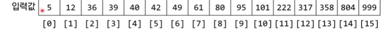
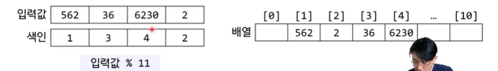
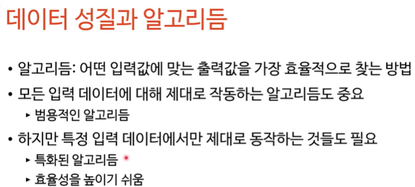
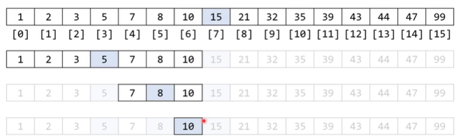
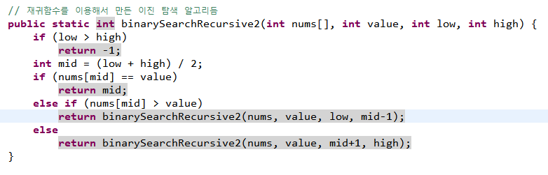

# 탐색 알고리듬

> 작성: 2022-01-08 · 태그: pocu · [노션 원본](https://app.notion.com/p/efb108ccc90d45c993fae04eee9037b6)

: 어떤 데이터 구조 안에 저장되어 있는 정보를 구해오는 알고리듬

- 매우 다양한 것이 여기에 포함됨
  - 배열에서 제일 큰 값 찾기
  - 데이터베이스에서 레코드 하나 읽어오기
  - 배낭 문제등

- 모두 모아서 한 군데서 배우기에는 너무 여기저기 존재하기에 여기저기서 배울거임

### 대표적인 탐색 알고리듬

- **선형 탐색 알고리듬 O(N)**

N만큼의 용량이 필요하다.

- **해시 맵을 이용한 탐색 O(1)**

N보다 큰 용량이 필요하다.

둘다 매우 범용적인 알고리듬이다

- 모든 데이터에 사용 가능
- 속도와 용량 사이의 밸런스 → 용량은 같은데 O(N)보다 빠를 수 있다면?

⇒데이터의 성질에 따라 가능

## 이진 탐색

1. 가운데 위치를 확인( (가장 작은 값+가장 큰값) / 2 )
2. 찾고자 하는 수가 가운데 위치의 수보다 큰지 작은지 확인
3. 확인한 범위에서 위와 반복해서 찾는다.

4번만에 찾음 !

시간 복잡도 O(log n) ⇒ O(1)은 아님 배열이 커지면, 그렇다고 O(n)보다 작기 위해 쓰는 거기 때문에 사이 값 O(log n)

- **정렬 된 배열에서 어떤 값의 위치를 찾는 알고리듬이다.**
- 한 단계 진행할 때마다 탐색범위를 절반으로 줄인다.
- 분할 정복 알고리듬 중 하나
  - 정복이라 하기에는 모든 문제 영역을 방문하진 않음
- 재귀 함수로 쉽게 작성 가능
  

  찾고자 하는 값이 중간 값보다 작으면 high대신에 중간에서 하나 아래 배열을 넣고

  찾고자 하는 값이 중간 값보다 크면 low 대신에 중간보다 하나 큰 값을 넣고 반복,,
