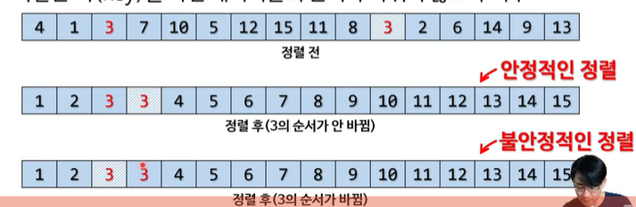
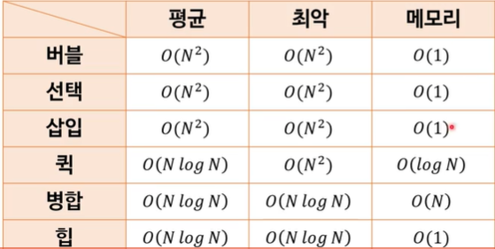

# 정렬 알고리듬

: 목록 안에 저장된 요소들을 특정한 순서대로 재배치하는 알고리듬

- **흔히 사용하는 순서** : 숫자 순서(아스키 문자순서등), 사전 순서
- **다양한 정렬 알고리듬이 존재**
  - 시간 복잡도 차이
  - 메모리 사용량 차이
  - 안정성(stability) 차이
    - **안정성 ? : 똑같은 키(key)를 가진 데이터들의 순서가 바뀌지 않느냐 여부**
      - sort(), stableSolt()

    
  - 직렬 vs 병렬(멀티 스레드 관련) 차이 → 여기서 학습할 내용은 직렬  알고리듬

### 대표적인 정렬 알고리듬

- 버블 정렬 → 언제라도 구현할 수 있어야 함(주먹구구식)
- 선택 정렬 → 쉽다
- 삽입 정렬
- 퀵 정렬 → 언제라도 설명할 수 있어야 함(어떤 식으로 도는 지 구조는 알아야 함), 자주 쓰임
- 병합 정렬 → 이해하는 정도면 충분
- 힙 정렬 → 이해하는 정도면 충분

**아무리 빨라도 O(N log N)**이다 !

→ 표만 보면 병합과 힙이 언제나 빨라 보이지만 실제성능과는 다르다

메모리 할당/해제는 공짜가 아니다 → 퀵 정렬은 할당과 삭제가 완전 개빠르다.

그래서 실무에서 많이 씀!

퀵 정렬에서 왠만해서는 최악이 나오지 않고 퀵이 힙보다 계수가 작기때문에 평균치는 항상 빠르다.

### 버블 정렬

- 가장 간단한 정렬 알고리듬 중 하나
  - 기본중에 기본
  - 스스로 이 알고리듬을 고안하지 못해도 됨
  - 하지만 한번 이해하면 언제라도 작성 가능해야 함
- 이웃 요소 둘을 비교해서 올바른 순서로 고치는 과정을 반복
- 한번 목록을 순회할 때마다 가장 큰 값이 제일 위로 올라감
  - 기포가 수면으로 떠오르는 모습을 닮았다고 해서 버블 정렬
  - 큰 기포일수록 수면에 더 빨리 떠오름

공간 복잡도 : O(1) , 추가되지 않기 때문에

시간 복잡도 : O(N\^2), for문 2개 중첩해서 만들면 대부분 O(N\^2)

안정성 유지됨
