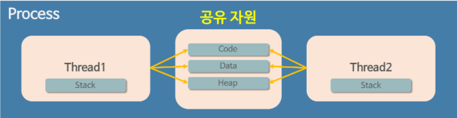

# 프로세스와 스레드 차이

이 차이를 알기 위해서는 프로그램부터 짚고 넘어가야 한다.

## 프로그램?

:**<ins> 파일이 저장 장치에 저장되어 있지만 메모리에는 올라가 있지 않은 정적인 상태</ins>**

즉, 메모리 할당이 안된 그냥 코드 뭉치를 프로그램이라고 한다.

여기서 **메모리를 할당받으면** 동적인 상태가 되서 이를 **프로세스**라고 한다.

## 프로세스?

:  **<ins>운영체제로부터 시스템 자원을 할당받는 작업의 단위</ins>**

### 할당받는 시스템 자원의 예

- CPU 시간
- 운영되기 위해 필요한 주소 공간
- Code, Data, Stack, Heap 구조로 되어 있는 독립된 메모리 영역

### **특징**

- 프로세스는 최소 1개의 스레드를 가지고 있다.
- 각 프로세스는 별도의 주소 공간에서 실행되며, 다른 프로세스의 변수나 자료구조에 접근할 수 없다.
- 한 프로세스가 다른 프로세스의 자원에 접근하려면 프로세스 간의 통신이 필요하다.(소켓등)

자 그렇기 때문에 프로그램이 점점 복잡해져서 프로세스 하나만을 가지고 프로그램을 실행하기에는 벅차게 되었는데, 프로세스를 여러 개 만들면 되지 않을까 생각이 들지만 운영체제는 안정성을 위해 프로세스마다 자신에게 할당된 메모리 내의 정보에만 접근할 수 있도록 제약(접근 제한자같은 느낌?)을 두고 있고, 이를 벗어나는 정보에 접근하려면 오류가 발생한다 !

→ 그래서 더 작은 실행 단위 개념이 필요했고 그게 **스레드**다 !

## 스레드?

:  **<ins>프로세스가 할당받은 자원을 이용하는 실행의 단위</ins>**

## **특징**

- 스레드는 프로세스 내에서 각각 Stack만 따로 할당받고 Code, Data, Heap 영역은 공유한다.

스레드는 위에서 언급한 프로세스의 한계를 해결하기 위해 만들어진 개념이기 때문에 스레드의 특성은 스레드 간 메모리를 공유하며 작동한다.

→ 스레드끼리 프로세스의 자원을 공유하며 프로세스 실행 흐름의 일부가 되는 것 !

### 프로세스와 스레드의 중요한 차이

: 만약 한 프로세스를 실행하다가 오류가 발생해서 프로세스가 강제 종료되다면 다른 프로세스에는 영향을 주지않는다. **왜? 프로세스끼리는 자원공유를 하지 않기 때문이다.**

하지만 스레드는 다르다. 한 스레드가 오류가 발생하면 같은 프로세스내의 모든 스레드가 강제로 종료된다. 왜? 스레드간에 자원을 공유하기 때문에 !

Reperence : [https://velog.io/@raejoonee/프로세스와-스레드의-차이#그래서-면접에서-물어보면-뭐라고-대답할까](https://velog.io/@raejoonee/%ED%94%84%EB%A1%9C%EC%84%B8%EC%8A%A4%EC%99%80-%EC%8A%A4%EB%A0%88%EB%93%9C%EC%9D%98-%EC%B0%A8%EC%9D%B4#%EA%B7%B8%EB%9E%98%EC%84%9C-%EB%A9%B4%EC%A0%91%EC%97%90%EC%84%9C-%EB%AC%BC%EC%96%B4%EB%B3%B4%EB%A9%B4-%EB%AD%90%EB%9D%BC%EA%B3%A0-%EB%8C%80%EB%8B%B5%ED%95%A0%EA%B9%8C)
