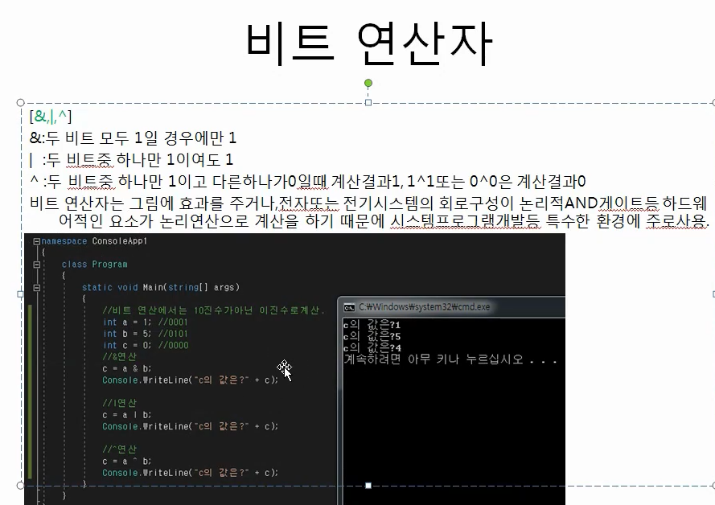

# 연산자

> 작성: 2022-01-20 · 태그: c# · [노션 원본](https://app.notion.com/p/10c2057ef48a46af8e3cb35af6be9339)

## 비트 연산자



```cs
//비트 연산자
            int a1 = 3; //0011
            int a2 = 5; //0101

            int b1 = a1 & a2;   //0001
            int b2 = a1 | a2;   //0111
            int b3 = a1 ^ a2;   //0110

            Console.WriteLine(b1);
            Console.WriteLine(b2);
            Console.WriteLine(b3);
```


## 쉬프트 연산

```cs
					int a1 = 3; //0011
            int a2 = 5; //0101

            int b1 = a1 & a2;   //0001
            int b2 = a1 | a2;   //0111
            int b3 = a1 ^ a2;   //0110

            Console.WriteLine(b1<<1);
            Console.WriteLine(b2<<1);
            Console.WriteLine(b3>>2);
```


**비트를 이동시킨다!**

0001을 왼쪽으로 한칸 이동하면 0010 =2

0111을 왼쪽으로 한칸 이동하면 1110=14

0110을 우측으로 두칸 이동하면 0001=1
