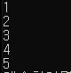

# 배열

### foreach

: ARRAY안에 있는 모든 것을 꺼내서 사용한다.

```cs
int[] array1={1,2,3,4,5}

foreach(int i in array1)
            {
                Console.WriteLine(i);
            }
```



요런식으로 배열 하나하나 호출해서 앞에 선언한 변수에 담음
