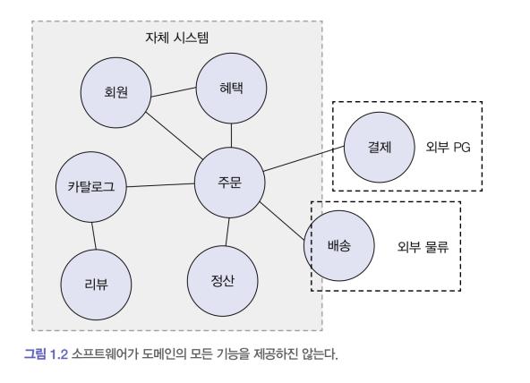
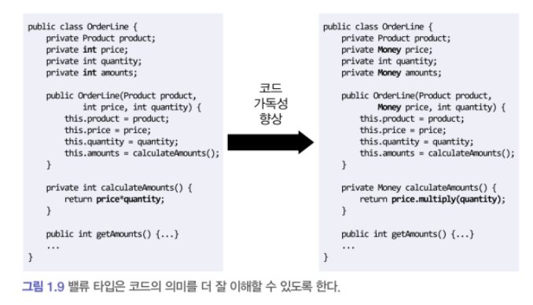

# 1장. 도메인 모델 시작하기

🔎 목차

## 📔 1.1 도메인이란?

: **소프트웨어로 해결하고자 하는 문제 영역을 도메인이라고 한다.**<br> 우리 서비스에서 예로 들면 <br>그룹웨어 → 메일/게시판 등 → 메일 쓰기 등→ 승인 메일/일반 메일 등



📌 **도메인의 특성**

1. 도메인은 하위 도메인을 가질 수 있다.
2. 한 한위 도메인은 다른 하위 도메인과 연동하여 비로소 완전한 기능을 제공할 수 있다.<br>→ 고객이 물건을 구매하면 주문, 결제, 배송, 혜택 하위 도메인의 기능이 엮인다.
3. 특정 도메인을 위한 소프트웨어라고 해서 제공해야 할 모든 기능을 직접 구현하는 것은 아니다.<br>→ 위 그림에서 결제와 배송은 외부 시스템을 이용해 처리하는 것을 볼 수 있다.<br>→ 우리 서비스와 연관지으면 메일쓰기를 할 때, 글 내용에는 외부 텍스트 에디터를 사용하고 있고<br>   이와 연관된 기능은 직접 구현하지 않는다.
4. 도메인마다 하위 도메인은 고정된 것은 아니다.<br>→ 우리 서비스는 기업/공공기관을 주 대상으로 하는 서비스이기 때문에<br>게시판의 주 목적은 공지용도로 쓰일 때가 많다.  그렇기때문에 신고 기능이나 추천 기능은 구현되어있지 않다.

## 📔 1.2 도메인 전문가와 개발자 간 지식 공유

: 개발을 위해서는 도메인에 대한 어느정도의 전문 지식은 필요하다.<br>그래야 요구사항을 올바르게 이해할 수 있고, 요청자가 원하는 방향으로 개발이 진행될 수 있다.<br>→ 요청자가 무슨 이유로 이 기능이 필요한 것이고, 어떤 방향으로 개발되어야하는 지 알기 위해선 도메인에 대한 지식이 개발자에게도 필요하다.

## 📔 1.3 도메인 모델

:  **도메인 모델은 특정 도메인을 개념적으로 표현한 것**<br><br> 도메인 모델을 표현할 때 표기법은 중요하지 않다. 도메인을 이해하기 가장 좋은 형태로 표현하는 것이 중요하다.

도메인의 각 하위 도메인이 다루는 영역은 서로 다르기 때문에 같은 용어라도 의미가 달라질 수 있다. <br>예시로 들면 상품이라는 용어에서도 <br>1. 카탈로그 상품 2. 배송중인 상품<br>두 상품에서 같은 모델을 사용하게 된다면 각 도메인에서의 상품을 제대로 이해하는 데 방해가 될 것이다.

→ 모델의 각 구성요소는 특정 도메인에 한정할 때, 비로소 의미가 완전해지기 때문에<br>**각 하위 도메인마다 별도로 모델을 만들어야 한다.**<br>(member모델 하나로 주문/회원관리/게시판/배송 등 회원정보가 필요한 모든 하위도메인에서 사용해선 안된다.)

## 📔 1.4 도메인 모델 패턴

: 도메인 모델은 아키텍처 상의 도메인 계층을 객체 지향 기법으로 구현하는 패턴을 말한다.<br><br>책에서는 주문 모델을 예시로 사용했다.

```java
public class Order {
	private OrderState state;
	private ShippingInfo shippingInfo;

	public void changeShippingInfo(ShippingInfo newShippingInfo){
		if (!state.isShippingChangegeable()) { // 상태변경이 불가한 경우
			throw new IllegalStateException("can't change shipping in " + state);
		}
		this.shippingInfo = newShiipingInfo;
	}

public enum OrderState {
	... OrderState의 값이 될 수 있는 필드들 ...
	public bool isShippingChangegeable(){
	... 주문 대기 중, 상품 준비 중의 orderState는 TRUE를 반환하는 코드
	}
}
```

이렇게 OrderState의 열거형 함수에서 상태 변경에 대한 코드를 작성할 수 있고,<br>OrderState의 상태변경에 대한 여부 판단은 Order에서 할 수도 있다.<br>상태를 변경하기 위한 조건으로 다른 정보가 또 필요하다면 OrderState의 값으로만 구현이 불가하기 때문에 Order에서 구현되어야할 것 이다.

<br> **이렇게 모델의 핵심 규칙을 정의할 때에는 해당 모델 내에서 구현되어야 규칙이 변경되거나 확장되어야할 때, 다른 코드에 영향을 최소화할 수 있다.**

## 📔 1.5 도메인 모델 도출

: 도메인을 이해한 바탕을 통해 모델의 초안을 만들어야 비로소 코드를 작성할 수 있다.<br>

> 📌 **문서화** <br>: 코드를 보면서 도메인을 깊게 이해하게 되므로 코드 자체도 문서화의 대상이 된다.<br>도메인 지식이 잘 묻어나도록 코드를 작성하지 않으면 코드의 동작과정은 알 수 있어도<br>도메인 관점에서 왜 그렇게 작성했는 지 이해하는 데 도움이 되지 않는다.<br>코드가 도메인을 잘 표현해야 가독성이 증가하고 문서로서의 의미를 코드가 가질 수 있다.

## 📔 1.6 엔티티와 밸류

: 모델은 크게 엔티티와 밸류로 구분할 수 있다. 엔티티와 밸류를 제대로 구분해야 도메인을 올바르게 구현할 수 있다.

- **엔티티****는** 엔티티 객체마다 고유의 식별자를 가진다.
  - DB auto increase를 통한 SEQ
    - 자동 증가 컬럼은 테이블에 데이터를 삽입해야 비로소 식별자를 알 수있다.<br>→ 엔티티 객체를 생성할 때 식별자를 전달할 수 없다.
  - UUID : 각 언어별 UUID 생성함수로 보통 작성된다.
  - 특정 규칙에 따라 생성 (카드 번호, 주문 번호등)
  - 직접 입력 방식
- **밸류 타입**
  

  위에 예시에서 보이는 Money가 밸류 타입이다.

  Money라는 타입으로 price와 amounts는 돈과 관련된 데이터라는 것을 알 수 있다.

  코드 가독성 향상에 도움이 될 뿐만 아니라 <br>밸류 타입을 위한 기능을 Money class에 구현할 수도 있다.<br>(amounts가 price를 가공하여 대입되는 데이터라면 Money클래스안에 메소드를 구현할 수 있다.)<br>

  - **밸류 타입의 불변**

  ```java
  public class Money {
  	private int value;
  
  	public Money add(Money money){
  		return new Money(this.value + money.value);
  	}
  	// value를 변경할 수 있는 메소드 없음
  }
  ```

  위 처럼 데이터 변경 기능을 제공하지 않는 타입을 **불변** 이라 한다.

  → 불변으로 구현하는 가장 중요한 이유는 안전한 코드 작성이다.<br>

  ```java
  Money price = new Money(1000);
  OrderLine line = new OrderLine(product, price, 2);
  price.setValue(2000);
  ```

  만약 Money에 setValue와 같은 메소드로 값을 변경할 수 있다면,<br>위에 코드에서 line에 있는 price까지 변경될 것이다. (참조 투명성 문제)

  이러한 문제를 방지하려면 OrderLine을 생성할 때, <br>price에 들어갈 value를 파라미터로 받아서  new OrderLine(product, 2000, 2)<br>OrderLine의 생성자에서 Money 객체를 생성하는 방법이 있다.

- **엔티티 식별자와 밸류 타입**
  - 필드의 밸류타입을 지정해서 필드의 의미가 들어나도록 코드 작성하는 것이 좋다.

  ```java
  public class Order {
  	private int id;        // 무슨 id일까?
  
  	private OrderNo id;    // 아 ~ 주문 번호구나
  }
  ```

  > 실제로 회사 코드를 개발하다가 userId와 id라는 필드가 한 모델에 있었는데,<br>디버깅해보니 하나는 mailtest 하나는 시퀀스 번호였다. <br>필드명으로 구분 짓기 어려운 경우 밸류 타입으로 지정해놔도 괜찮을 것 같다.

  
- **도메인 모델에 set 메소드 넣지 않기**
  : set 메서드의 습관적인 사용은 도메인의 핵심 개념이나 의도를 코드에서 사라지게 한다.

  빈 객체를 생성하고 setter를 통해 객체의 데이터를 set해주면 문제가 아주 많다.

  ```java
  Order order = new Order(); //빈 객체
  // set 메서드로 필요한 모든 값을 전달해야한다.
  order.setOrderLine(lines);
  order.setShippingInfo(shippingInfo);
  
  // 주문자를 설정하지 않은 상태에서 주문 완료 처리
  order.setState(OrderState.PREPARING);
  ... //다른 값 set
  ```

  따라서 책에서는 생성자 파라미터를 통해 데이터를 전달하여 생성하는 방식을 추천하고 있다.

  ```java
  // Order의 생성자
  public Order(Orderer orderer, List<OrderLine> orderLines,
   ShippingInfo shippingInfo, OrderState state){
  	setOrderer(orderer);
  	setOrderLines(orderLines);
  	... // 다른 값 설정
  }
  
  // 여기서의 set은 private이라 외부에서 객체를 수정하도록 할 수 없고
  // 오직 클래스 내부에서만 접근이 가능하다.
  private void setOrderer(Orderer orderer){
  	if(orderer == null) throw new Exception();
  	this.orderer = orderer;
  }
  ... // 다른 값 검증을 위한 메소드들 ..
  ```

  > 참고 내용
  >
  > > ⚠️ 노션에서만 보이는 블록(alias)이라 옮기지 못했어요. [노션 원본](https://app.notion.com/p/c1bb033ccec7415ea0158653947d577b#e43d7618243946aaa9cf24260e7542b5)

## 📔 1.7 도메인 용어와 유비쿼터스 언어

: 코드를 작성할 때 도메인에서 사용하는 용어는 매우 중요하다.

> 의미를 해석해야하는 부담을 주지말자

```java
// ?? .. 어떤 값이지?
public enum OrderState {
	STEP1, STEP2, STEP3
}

// 결제 대기 상태구나 ~
public enum OrderState {
	PAYMENT_WAITING, PREPARING, SHIPPED
}
```

- **유비 쿼터스 언어****란 ?**<br>: 전문가, 관계자, 개발자가 도메인에서 공통의 언어를 만들고 이를 대화, 문서, 도메인 모델, 코드 등 모든 곳에서 같은 용어를 사용한다.<br>이렇게 통일시키면 용어의 모호함을 줄일 수 있고, 도메인과 코드 사이에서 불필요한 해석 과정을 줄일 수 있다.
  > 회사 코드에서<br>게시판 용량을 표현하는데, 어떤 곳은 capacity 다른 곳은 boardSize으로 표현되어있고,<br>게시판의 권한을 표기할 때에도, capacity로 표현하고 있다.<br>코드를 해석하다가 capacity가 나오면 문맥을 파악해야하는 시간이 소요된다.

  도메인 용어를 표현할 때, 어떤 단어가 가장 알맞는 지 고민하는 시간을 아까워하지 말자
