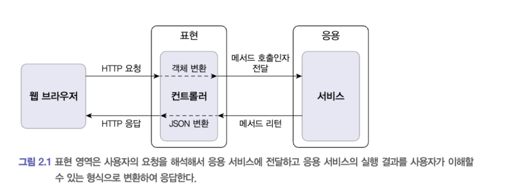
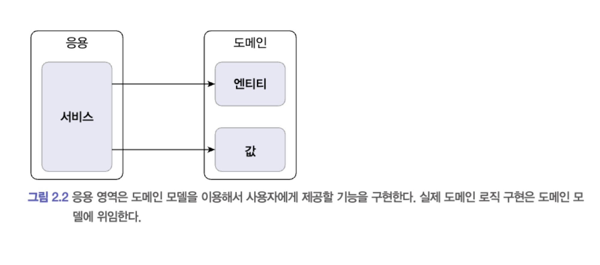
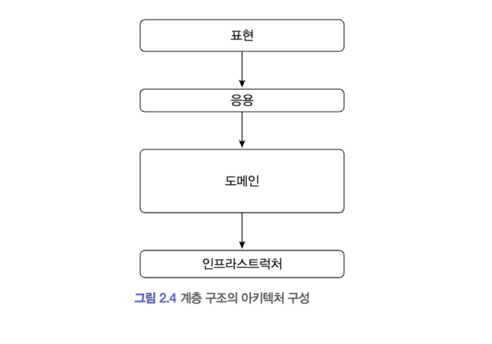
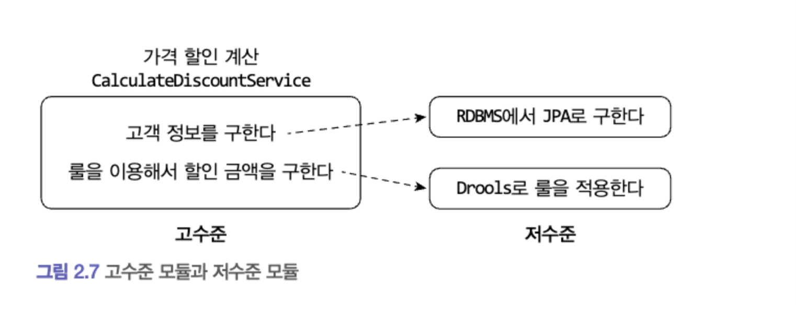
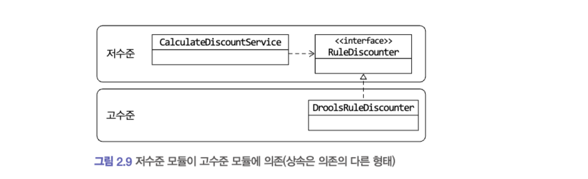
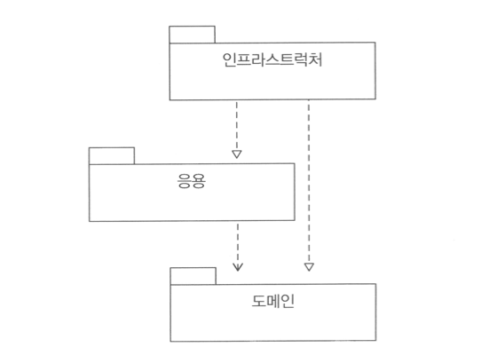
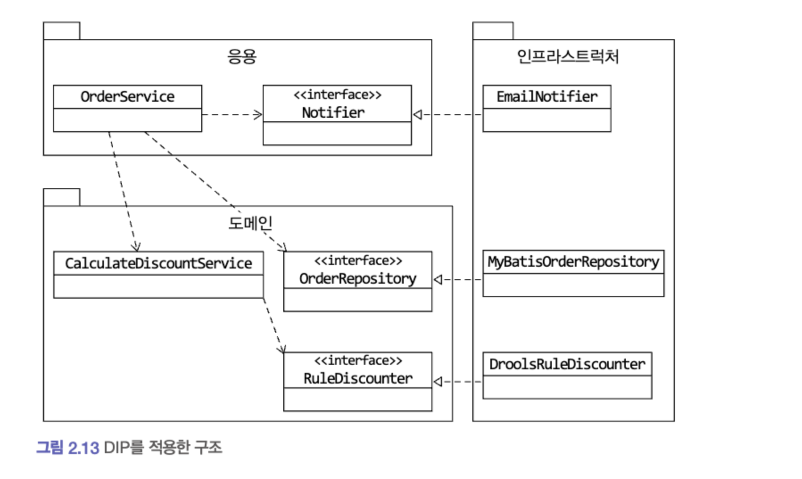
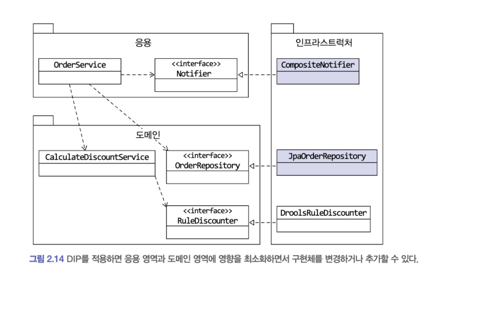
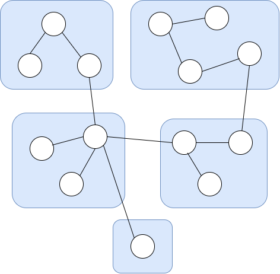
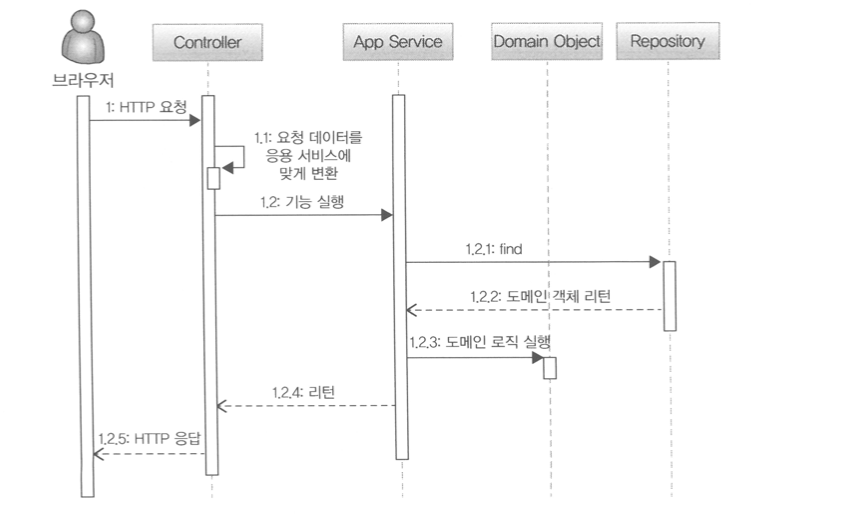

# 2장. 아키텍처 개요

### 🔎 목차

## 📔 2.1 네 개의 영역

- 표현(presentation layer)
  - 응용 영역이 필요로 하는 형식으로 변환해서 응용 영역에 전달.(request)
  - 응용 서비스가 리턴한 결과를 JSON형식으로 변환해서 HTTP 응답으로 웹 브라우저에 전송.
- 응용(application layer)
  - 사용자에게 제공해야 할 기능(주문 등록, 주문 취소 …)을 구현
  - 기능을 구현하기 위해 **도메인 영역의 도메인 모델을 사용**한다. ⇒ **주로 도메인 모델에 로직 수행을 위임한다.**

  ```java
  public class CancelOrderService {
  
  	@Transactional
  	public void cancelOrder(String orderId) {
  		Order order = findOrderById(orderId);
  		if (order == null) throw new OrderNotFoundException(orderId);
  		order.cancel
  	}
  
  }
  ```



- 도메인(domain layer)
  - 도메인의 핵심 로직을 구현
  - ex) ‘배송지 변경’, ‘결제 완료’, ‘주문 총액 계산’



- 인프라스트럭처(infrastructure layer)
  - **논리적 개념이라기 보단 실제 처리를 담당한다.**
  - RDBMS 연동
  - 메세징 큐를 통한 메세지 전달
  - 몽고DB, 레디스 등의 데이터 연동 처리

## 📔 2.2 계층 구조 아키텍처



위 아키텍처를 통해 확인해야 할 사항

- 상위 계층에서 하위 계층으로의 의존만 존재하며 그 반대는 존재하지 않음.
- 위 아키텍처를 엄격하게 적용하면 상위 계층은 반드시 바로 아래 계층만 의존해야하지만, 경우에 따라서는 응용영역이 인프라스트럭처 영역에 직접 의존하기도 한다.
- **핵심 : 표현, 응용, 도메인 계층이 상세 구현 기술을 다루는 인프라스트럭처 계층에 종속된다.**

응용 영역이 인프라스트럭처 영역에 종속되는 경우

```java
public class CaculateDiscountService {
	private DroolsRuleEngine ruleEngine;

	public CalculateDiscountService() {
		ruleEngine = new DroolsRuleEngin();
	}

	public Money caculateDiscount(List<OrderLine> orderLines, String customerId) {
		Customer customer = findCustomer(customerId);

		Mutablemoney money = new MutableMoney(0);
		List<?> facts = Arrays.asList(customer, money);
		facts.addAll(orderLines);
		ruleEngine.evalute("discountCalculation", facts);
		return money.toImmutableMoney();
	}
}

// RuleEngine에 종속적이어서 생기는 문제
// 문제1(테스트의 어려움) : CalculateDiscountService만 테스트 불가
// 문제2(기능 확장의 어려움) : 구현 방식을 변경하기 어려움 => Drools가 아닌 다른 구현 기술을 사용하려면 코드의 많은 부분을 고쳐야 한다.
```

<details>
<summary>**📔 2.3 DIP(Dependency Inversion Principle, 의존성 역전 원칙)**</summary>



- 가격 할인을 계산하기 위해서는

  - 1\. 고객 정보를 구하고
  - 2\. 그 고객 정보와 룰을 이용해서 할인 금액을 구해야 한다.
- 하지만 고수준 모듈이 저수준 모듈을 사용하면서 의존 관계가 생겨 앞에서 얘기했던 두 가지 문제가 발생한다.

  - 구현 변경의 어려움
  - 테스트의 어려움

**DIP는 기존 방향의(고수준 모듈 ⇒ 저수준 모듈) 의존 관계를 역방향(저수준 모듈 ⇒ 고수준 모듈)으로 바꾼다. (추상화된 인터페이스를 통해)**

인터페이스를 활용한 DIP 구현 (이전 코드 : [링크](https://app.notion.com/p/0919862d0d3d46fca4f21970fa45278d))

```java
public interface RuleDiscounter {
	Money applyRules(Customer customer, List<OrderLine> orderLines);
}
```

```java
public class CacluateDiscountService {
	private RuleDiscounter ruleDiscounter;

	public CaculateDiscountService(RuleDiscounter ruleDiscounter) {
		this.ruleDiscounter = ruleDiscounter;
	}

	public Money caclulateDiscount(List<OrderLine> orderLines, String customerId) {
		Customer customer = findCustomer(customerId);
		return ruleDiscounter.applyRules( customer, orderLines);
	}
}

// Drools에 의존하는 코드가 없다.
// 실제 계산 로직을 구현한 객체(Drools 혹은 자바로 직접 구현)는 생성자를 통해서 전달 받는다.
// Drools를 직접 구현한 구현체에 대한 예제 코드는 생략. (고려할 필요 없음)
```



**DIP를 통해 테스트의 어려움, 구현 교체의 어려움 해결**

객체 생성 및 주입 코드 (컨트롤러에서 구현됨)

```java
// 계산 구현체가 Drools인 경우
RuleDiscounter ruleDiscounter = new DroolsRuleDiscounter();

CaculateDiscountService disService = new CalculateDiscountService(ruleDiscounter);
```

```java
RuleDiscounter ruleDiscounter = new SimpleRuleDiscounter();

CaculateDiscountService disService = new CalculateDiscountService(ruleDiscounter);
```

### 2.3.2 DIP와 아키텍처

DIP를 적용한 아키텍처 구조 : 기존 계층 구조의 역순



</details>

**인프라스트럭처 영역이 응용 영역과 도메인 영역에 의존하는 구조가 된다.**

**⇒ 인프라스트럭처가 위치한 클래스가 도메인과 응용 영역에 대한 영향을 주지 않거나 최소화하여 구현 기술을 변경하는 것이 가능하다.**

아래 예제

1. 통지 방식을 email전송방식에서 ⇒ email or SMS 전송방식으로 변경
2. Mybatis → JPA 로 변경





<details>
<summary>**📔 2.4 도메인 영역의 주요 구성요소**</summary>

- 엔티티(ENTITY)
  - 고유 식별자를 갖고, 자신의 라이프 사이클을 갖는다.
  - 해당 데이터와 관련된 기능을 함께 제공한다.
- 밸류(VALUE)
  - 개념적으로 하나인 값을 표현할 때 사용한다.
- 애그리거트(AGGREGATE)
  - 엔티티와 벨류 객체를 개념적으로 하나로 묶은 것.
- 리포지터리(REPOSITORY)
  - 도메인 모델의 영속성을 처리
- 도메인 서비스(DOMAIN SERVICE)
  - 특정 엔티티에 속하지 않는 도메인 로직을 제공

### 2.4.1 엔티티와 밸류

- DB 테이블의 엔티티와 도메인 모델의 엔티티의 차이점
  - 도메인 모델의 엔티티는 데이터와 함께 기능을 제공한다.
  - 도메인 모델의 엔티티는 두 개 이상의 데이터가 개념적으로 하나인 경우 밸류 타입을 이용하여 표현할 수 있다.
- **밸류는 불변으로 구현! ⇒ 밸류 타입의 데이터를 변경할 때는 객체 자체를 완전히 교체한다.**

### 2.4.2 애그리거트

관련 엔티티와 밸류를 하나로 묶은 군집.



- 복잡한 도메인 모델을 관리하는 데 도움이 된다.
- 애그리거트는 **“루트 엔티티”**를 갖는다.
  - 애그리거트를 사용하는 코드는 애그리거트 루트가 제공하는 기능을 실행
  - 루트를 통해 다른 밸류에 접근 가능
  - 애그리거트 루트를 통해 다른 밸류들을 캡슐화함

### 2.4.3 리포지터리

- 애그리거트 단위로 도메인 객체를 저장하고 조회함.

</details>

## 📔 2.5 요청 처리 흐름


