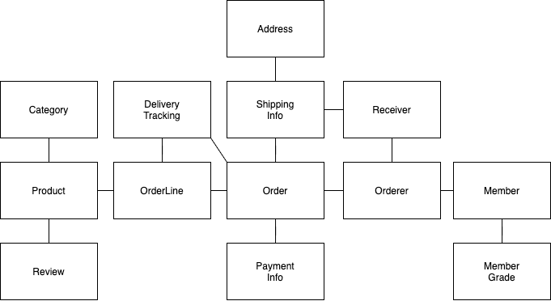
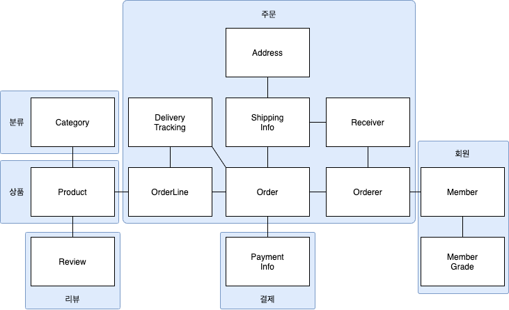
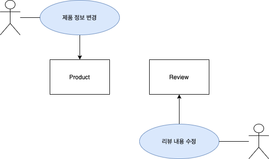
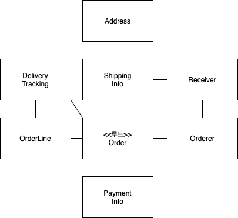
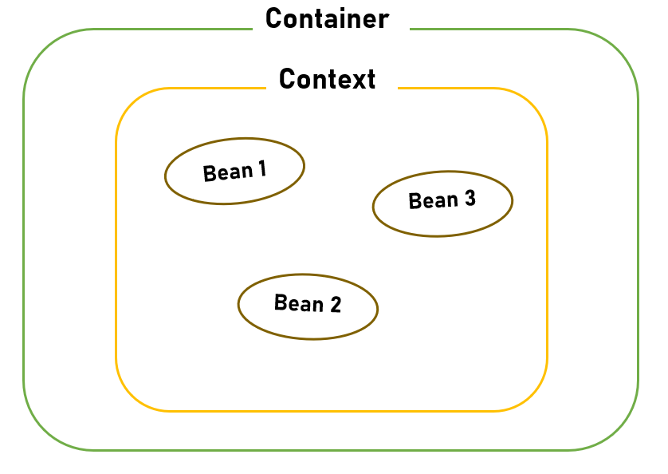
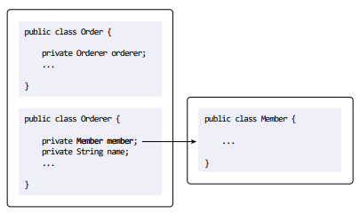
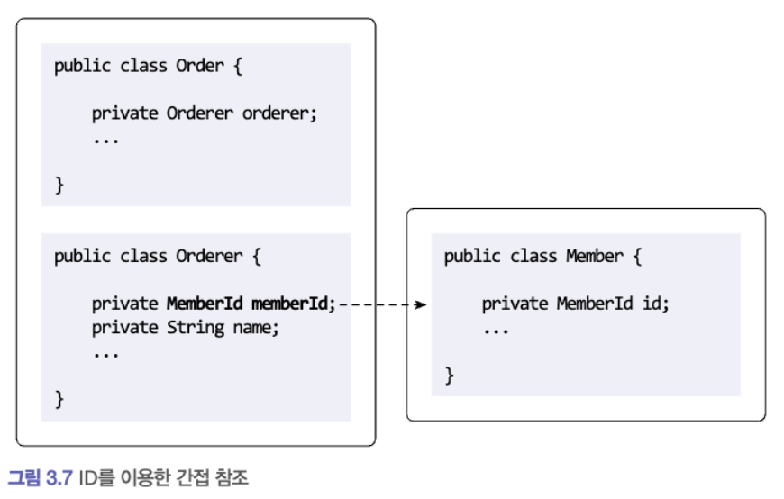
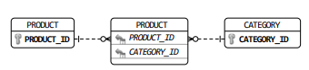

# 3장. 애그리거트

목차

# 📔 3.1 애그리거트

애그리거트란?

- 관련된 객체들을 하나의 군으로 묶어주는 개념이라고 합니다.

애그리거트가 나온 배경

- 백 개 이상의 테이블을 한 장의 ERD에 모두 표시하면 개별 테이블 간의 관계를 파악하느라 큰 틀에서 데이터 구조를 이해하는 데 어려움을 겪게 됩니다.
- 도메인 객체 모델이 복잡해지면 개별 구성요소 위주로 모델을 이해하게 되고 전반적인 구조나 큰 수준에서 도메인 간의 관계를 파악하기 어려운 집니다.

<details>
<summary>애그리거트로 구분하지 않은 모델</summary>



</details>

<details>
<summary>애그리거트로 구분한 모델</summary>



</details>

결론

- 애그리거트 개념을 적용하면 주요 도메인 요소 간의 관계를 파악하기 쉬워진다.
  - 코드를 추가/수정 할 때 애그리거트가 객체 관계에 대해서 판단할 수 있는 근거가 된다.
- 애그리거트 단위로 일관성을 관리하기 때문에, 애그리거트는 복잡한 도메인을 단순한 구조로 만들어준다.
  - 복잡도가 낮아지는 만큼 도메인 기능을 확장하고 변경하는 데 필요한 개발 시간도 줄어든다.

장점 : **기능 확장, 유지보수 시 개발 시간 단축**

---

**경계를 설정할 때 유의 할 점**

흔히 ‘A가 B를 갖는다’ 로 설계할 수 있는 요구사항 이 있다면 한 애그리거트로 묶으면 된다고 생각하기 쉽다.

주문의 경우는 해당 경우가 타당해보이지만, 상품 리뷰를 생각하면 꼭 그런 것 만은 아니다.



그림에서 볼 수 있듯이 상품과 리뷰는 함께 생성되거나 변경되지 않고 변경 주체도 다르기 때문에 서로 다른 애그리거트로 분리해야한다.

**처음 도메인 모델을 만들기 시작하면 큰 애그리거트로 보이는 것들이 많지만 경험이 생기고 도메인 규칙을 제대로 이해할수록 애그리거트의 실제 크기는 줄어든다고 합니다.**

# 📔 3.2 애그리거트 루트

**애그리거트 전체를 관리하고 책임을 지는 엔티티가 애그리거트의 루트이다.**



<details>
<summary>**3.2.1 도메인 규칙과 일관성**</summary>

단순히 애그리거트에 속한 객체를 포함하는 것으로 끝나는 것은 아니다.

애그리거트 루트의 핵심 역할

- **애그리거트 루트가 제공하는 메서드**는 도메인 규칙에 따라 **애그리거트에 속한 객체의 일관성이 깨지지 않도록 구현**해야 한다.

일관성 깨지지 않도록? ( 말이 좀 어렵다. )

책에서 설명하는 일관성이 깨지지 않도록 하는게 뭐냐면…

**애그리거트 루트**가 아닌 **다른 객체가** 애그리거트에 속한 객체를 직접 변경하면 안된다.  ( 이것도 어려움 )

```java
ShippingInfo si = order.getShippingInfo();
si.setAddress(newAddress);
```

쉽게 코드로 살펴 보면 주문 상태에 상관없이 배송지 주소를 변경할 수 있는데 이는 **업무 규칙**을 무시하고

DB 테이블에서 직접 데이터를 수정하는 것과 같은 결과를 만든다.

즉, 판매자가 이미 배송을 했고, 구매자가 배송지를 변경한 경우가 되어서 해당 경우는 일관성이 깨지게 되는거라고 생각하면 됩니다.

위 코드에서 발전시켜서 OrderService에 업무 규칙을 추가한다고 해보자

```java
ShippingInfo si = order.getShippingInfo();

// 도메인 로직으로 빼면 좋겠죠?
if (state != OrderState.PAYMENT && state != OrderState.PREPARING) {
	throw new IllegalArgmentException();
}
si.setAddress(newAddress);
```

이렇게 되면 위와 같은 동일한 검사로직을 여러 응용 서비스에서 중복으로 구현 할 가능성이 높아저 유지보수가 어려운 진다.

**그래서 옳바른 코드를 작성하는 방법은?**

불필요한 중복을 피하고 애그리거트 루트를 통해서만 도메인 로직을 구현하게 만들려면 도메인 모델에 대해 다음의 두 가지를 습관적으로 적용해야 한다.

- 단순히 필드를 변경하는 set 메서드를 (public)공개 범위로 만들지 않는다.
- 벨류 타입은 불변으로 구현한다.

```java
public Order {
    private ShippingInfo shippingInfo;
    public void changeshippingInfo(ShippingInfo newShippingInfo) {
        verifyNotYetShipped();
        setShippingInfo(newShippingInfo);
    }
    //  set 메서드의 접근 허용 범위는 private이다.
    private void setShippingInfo(ShippingInfo newShippingInfo) {
        //  밸류가 불변이면, 새로운 객체를 할당해서 값을 변경해야 한다.
        //  불변이므로 this.shippingInfo.setAddress(newShippedInfo.getAddress())와 같은 코드를 사용할 수 없다.
        this.shippingInfo = newShippingInfo;
    }
	private void verifyNotYetShipped() {
		// 업무 규칙
	}
}
```

</details>

<details>
<summary>**3.2.2 애그리거트 루트의 기능 구현**</summary>

애그리거트 루트는 애그리거트 내부의 다른 객체를 조합해서 기능을 구현한다.

그런데 여기서도 조심해야할 점이 있다.

```java
public class Order {
	private OrderLines orderLines;

	public void changeOrderLines(List<OrderLine> newlines) {
		orderLines.changeOrderLines(newLines);
		this.totalAmounts = orderLines.getTotalAmounts();
	}
```

```java
public class OrderLines {
	private List<OrderLine> lines;

	public Money getTotalAmounts() { ...구현 }
	public void changeOrderLines(List<OrderLine> newLines) {
		this.lines = newLines;
	}
}
```

```java
// Service Layer

OrderLines lines = order.getOrderLines();

// 외부에서 애그리거트 내부 상태 변경!
// order의 totalAmounts 값이 OrderLines가 일치하지 않게 됨
lines.changeOrderLines(newOrderLines);
```

결론, changeOrderLines 메서드의 접근 제한자 protected로 변경

php에서의 접근 제한자는 java에서와 조금 다름

**php**

```txt
public     접근을 제한이 없음
private    같은 클래스안에서만 액세스 가능
protected  같은 클래스 및 자식클래스에서 액세스 가능
```

- php에서는 접근 제한자를 작성하지 않으면 public

**java**

```txt
public     접근을 제한이 없음
private    같은 클래스안에서만 액세스 가능
protected  같은 클래스 및 자식클래스에서 액세스 가능, 동일 패키지 내에서만 가능
default    동일 패키지 내에서만 가능
```

- java에서는 접근 제한자를 작성하지 않으면 defalut

</details>

<details>
<summary>**3.2.3 트랜잭션 범위**</summary>

**한 트랜잭션에서는 하나의 애그리거트만 수정해야 한다.**

그러니까 아래같은 코드는 안된다!

```java
public class Order {
	private Orderer orderer;

	public void shipTo(ShippingInfo newShippingInfo,
				boolean useNewShippingAddrAsMemberAddr) {

		verifyNotYetShipped();
		setShippingInfo(newShippingInfo);

		if(useNewShippingAddrAsMemberAddr) {
			// Member 도메인의 상태를 변경하고 있는데 다른 애그리거트의 상태를 변경하면 안된다.
			orderer.getMember().changeAddress(newShippingInfo.getAddress());
		}
	}
}
```

why?

- 두 개 이상의 애그리거트를 수정하면 트랜잭션 충돌 발생 가능성이 높아져 처리량이 떨어진다.
- 잠금 범위를 작게해서 **처리량을 늘린다.**

그럼에도…

한 트랜잭션에서 두 개 이상의 애그리거트를 수정해야 한다면, 애그리거트에서 다른 애그리거트를 직접 수정하는 것이 아니라, **응용 서비스에서 여러 애그리거트를 수정**하도록 구현해야 한다.

도메인 이벤트를 사용하면 한 트랜잭션에서 한 개의 애그리거트를 수정하면서도 동기나 비동기로 다른 애그리거트의 상태를 변경하는 코드를 작성할 수 있다. ( 10장에서 배워보자 )

</details>

# 📔 3.3 리포지터리와 애그리거트

<details>
<summary>DAO와 Repository</summary>

Repository := DAO (비슷함)

이 둘은 거의 같다고 생각해도 무방

좀 더 깊이있게 차이를 설명하면, Repotiroy는 엔티티 객체를 보관하고 관리하는 저장소이고, DAO는 데이터에 접근하도록 DB접근 관련 로직을 모아둔 객체입니다.

</details>

<details>
<summary>Repository를 만들때 고려 사항</summary>

Order와 OrderLine을 물리적으로 각각 별도의 DB테이블에 저장한다고 해서 Order와 OrderLine을 위한 리포지터리를 각각 만들지 않는다.

**즉, OrderRepository 하나만 만들면 된다.**

**Repository는 완전한 Entity를 제공해야 한다.**

```java
// 리포지터리는 완전한 order를 제공해야 한다.
Order order = orderRepository.findById(orderId);

// order가 온전한 애그리거트가 아니면
// 기능 실행 도중 NullPointException과 같은 문제가 발생한다.
order.cancel();
```

NullPointException이 발생할 수 있는 경우는 예를 들어 주문을 취소하는데, 주문 목록이 조회되지 않아서 어떤 주문들을 취소해야하는지 알 수 없을때 발생할 수 있을 것이다.

</details>

<details>
<summary>@Component?</summary>

Spring Context에 Bean으로 등록하는 어노테이션



</details>

<details>
<summary>@Entity?</summary>

JPA를 사용해 테이블과 매핑할 클래스에 붙여주는 어노테이션이다.

</details>

# 📔 3.4 ID를 이용한 애그리거트 참조

한 객체가 다른 객체를 참조하는 것처럼 애그리거트도 다른 애그리거트를 참조한다.



ORM 기술 덕에 애그리거트 루트에 대한 참조는 쉽게 구현할 수 있고 필드(get 메서드)를 이용한 애그리거트 참조를 사용하면 다른 애그리거트의 데이터를 쉽게 조회할 수 있다. ( ORM을 못… )

하지만 필드를 이용한 애그리거트 참조는 다음 문제를 발생시킬수 있다고 합니다.

- 편한 탐색 오용
  - 한 애그리거트 내부에서 대른 애그리거트 객체에 접근할 수 있다면 다른 애그리거트의 상태를 쉽게 변경할 수 있게된다.
- 성능에 대한 고민
  - JPA를 사용하면 지연 로딩과 즉시로딩
- 확장 어려움
  - 기능을 분리하려고 한다고 하면  데이터베이스가 다른경우도 생긴다.
  - 위 경우 처럼 시스템이 분리됨에 따라 JPA같은 단일 기술을 사용하기 어렵다.

**그래서 ID를 이용하여 간접 참조 하는 것이다.**



**외부 애그리거트를 직접 참조하지 않기 때문에 한 애그리거트에서 다른 애그리거트의 상태를 변경할 수 없게 되는 것이다.**

애그리거트별로 다른 구현 기술을 사용하는 것도 가능해진다.

- 주문 애그리거트는 RDBMS 저장
- 상품 애그리거트는 NoSQL에 저장 (조회 성능 중요)

<details>
<summary>**3.4.1 ID를 이용한 참조와 조회 성능**</summary>

<details>
<summary>N+1 문제</summary>

```java
Customer customer = customerRepository.findById(ordererId);
List<Order> orders = orderRepository.findByOrderer(ordererId);
List<OrderView> dtos = orders.stream()
    .map(order->{
	    ProductId prodId = order.getOrderLines().get(0).getProductId();
	    //각 주문마다 첫 번째 주문 상품 정보 로딩을 위한 쿼리 실행
	    Product product = productRepository.findById(prodId);
	    return new OrderView(order, customer, product);
    }).collect(toList());
```

주문 목록을 읽어오기 위한 1번의 쿼리와 주문별로 각 상품을 읽어오기 위한 N번의 쿼리가 실행된다.

위 문제가 발생하면 성능이 떨어지는건 당연…

</details>

N+1 해당 문제를 발생시키지 않게 하기 위해서 그래서 조회 전용 쿼리를 따로 사용한다.

“11장의 CQRS에서 더 자세한 조회 전용 모델에 대한 내용을 살펴보면 된다.”

</details>

# 📔 3.5 애그리거트 간 집합 연관

참조 : [링크](https://app.notion.com/p/df2478bcc4bc45f1af9be76d11642f97)

1:N (일대다) 연관 관계는 컬렉션을 이용한 연관이다. 예를 들어 카테고리와 상품이 각각 1:N 관계일 때, 카테고리 입장에서 상품들을 조회하기 위해서는 다음과 같이 구현해야 한다.

```java
public class Category {
	private Set<Product> products;

	public List<Product> getProducts(int page, int size) {
		List<Product> sortedProducts = sortById(products);
		return sortedProducts.subList((page - 1) * size, page * size);
	}
	...
}
```

만약 product 개수가 수만 개 정도로 많다면, 이 코드를 실행할 때마다 실행속도가 급격하게 느려진다.

> 카테고리에 대한 레포지토리에서 특정 카테고리에 포함된 모든 상품을 조회해야 하므로, 페이징처리는 애플리케이션단에서 해야한다. (Out Of Memory 발생 위험)

따라서, 카테고리와 상품 관계에서는 개념적으로 애그리거트간에 1:N 연관이 있더라도 이런 성능 문제 때문에, 애그리거트 간의 1:N 연관을 실제 구현에 반영하지 않는다.

반대로 상품입장에서 카테고리와의 관계는 N:1 연관이다. 이를 구현 모델에 반영하면, Product에 Category 연관을 추가하고 조회할 수 있다.

```java
public class Product {
	...
	private CategoryId categoryId;
	...
}
```

카테고리에 속한 상품 목록을 제공하는 응용 서비스는 ProductRepository를 이용해서 조회한다.

```java
public class ProductListService {

	public Page<product> getProductOfCategory(Long categoryId, int page, int size) {
		Category category = categoryRepository.findById(categoryId);

		List<Product> products = productRepository.findByCategoryId(category.getId(), page, size);
		int totalCount = productRepository.countByCategoryId(category.getId());

		return new Page(page, size, totalCount, products);
	}
}
```

M:N (다대다) 연관을 구현하기 위해서는 **조인 테이블을 사용**한다. 상품과 카테고리의 다대다 연관은 다음과 같이 조인 테이블을 구현한다.



개념적으로는 **다대다 연관**이 존재하지만, 상품입장에서 카테고리로의 집합 연관(다대일)만 존재하면 되기 때문에 실제 구현에서는 상품에서 카테고리로의 **단방향 연관만 적용**하면 된다.

```java
public class Product {
	...
	@ElementCollection
	@CollectionTable(name = "product_category",
					joinColumns = @joinColumn(name = "product_id))
	private Set<CategoryId> categoryIds;
	...
}
```

# 📔 3.6 애그리거트를 팩토리로 사용하기

참조 : [링크](https://app.notion.com/p/df2478bcc4bc45f1af9be76d11642f97)

고객이 특정 상점을 여러 번 신고해서 해당 상점이 더 이상 물건을 등록하지 못하도록 차단한 상태하고 가정한다.

상품 등록 기능을 구현한 응용 서비스는 다음과 같이 구현할 수 있다.

```java
public class RegisterProductService {
	public ProductId registerNewProduct(NewProductRequest req) {
		Store store = storeRepository.findById(req.getStoreId());

		if (store.isBlocked()) { // 응용 서비스에서 검증 로직을 수행하고 있음.
			throw new StoreBlockedException();
		}

		ProductId id = productRepository.nextId();
		Product product = new Product(id, store.getId(), ...);
		productRepository.save(product);
		return id;
	}
	...
}
```

이 코드는 Product를 <ins>생성가능한지 판단</ins>하는 코드와 Product를 <ins>생성하는 코드</ins>가 분리되어 있다.

(중요한 도메인 로직 처리가 응용 서비스에 노출)

Store가 Product를 생성할 수 있는지를 판단하고 Product를 생성하는 것은 **논리적으로 하나의 도메인 기능**이나, 이 도메인 기능을 응용 서비스에서 구현하고 있다.

이 기능을 Store 애그리거트에 구현할 수 있음.

```java
public class Store {
	public Product createProduct(ProductId newProductId, ...) {
		if (isBlocked()) throw new StoreBlockedException();

		return new Product(newProductId, getId(), ...)
	}
}
```

Store 애그리거트의 createProduct 메소드는 Product 애그리거트를 생성하는 팩토리 역할을 한다.

**애그리거트를 팩토리로 사용할 때 장점**

- Product 생성 가능 여부를 확인하는 도메인 로직을 변경해도 도메인 영역의 Store만 변경하면 되고 응용 서비스는 영향을 받지 않는다. (도메인 응집도가 높아짐)

위 처럼 애그리거트가 갖고 있는 데이터를 이용해, 다른 애그리거트를 생성해야 한다면 애그리거트 팩토리 메서드를 구현하는 것을 고려하면 된다.

만약, Store 애그리거트가 Product 애그리거트를 생성할 때 많은 정보를 알아야 한다면, Store 애그리거트에서 Product 애그리거트를 직접 생성하지 않고 다른 팩토리에 위임하는 방법도 있음.

```java
public class Store {
	public Product createProduct(ProductId newProductId, ProductInfo pi) {
		if (isBlocked()) throw new StoreBlockedException();

		return ProductFactory.create(newProductId, getId(), pi);
	}
}
```

다른 팩토리에 위임했지만, 차단 상태의 상품을 만들수 없다는 도메인 로직은 한곳에 계속 위치한다.
