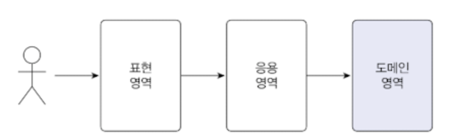
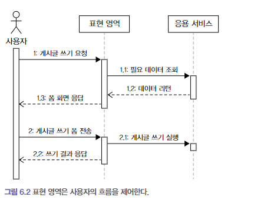
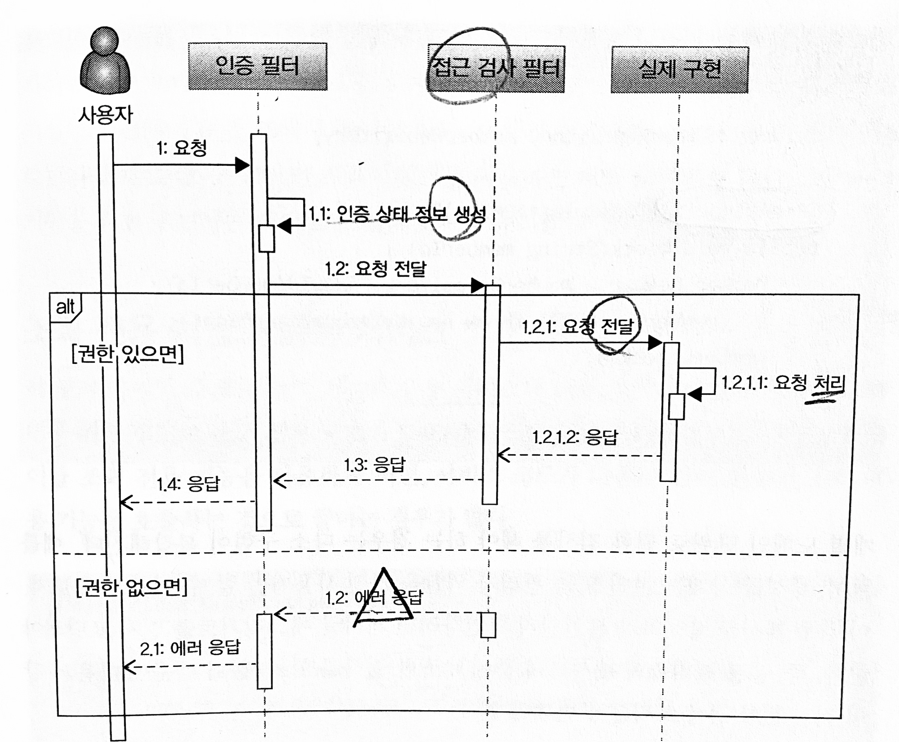

# 6장. 응용 서비스와 표현 영역

> 작성: 2024-01-31 · 태그: DDD · [노션 원본](https://app.notion.com/p/82e84c2669774668a62850b22cda09b3)

🔎 목차

## 📔 6.1 표현 영역과 응용 영역



**표현 영역**

- 사용자의 요청(Request)을 해석

**응용 영역**

- 기능 구현

“응용 서비스의 메서드가 요구하는 파라미터와 표현 영역이 사용자로부터 전달받은 데이터는 형식이 일치하지 않기 때문에 표현 영역은 응용 서비스가 요구하는 형식으로 사용자 요청을 변환한다.”

- “응용 서비스의 메서드가 요구하는 파라미터” ⇒ DTO
- “표현 영역이 사용자로부터 전달받은 데이터” ⇒ JSON

```java
@PostMapping("/member/join")
public ModelAndView join(HttpServletRequest request) {
	String email = request.getParameter("email");
	String password = request.getParameter("password");
	// 사용자 요청을 응용 서비스에 맞게 변환
	JoinRequest joinReq = new JoinRequest(email, password);
	// 변환한 객체(데이터)를 이용해서 응용 서비스 실행
	joinService.join(joinReq);
}
```

## 📔 6.2 응용 서비스의 역할

응용 서비스는 도메인 영역과 표현 영역을 연결해주는 창구 역할을 한다.

```java
public Result doSomeFunc(SomeReq req) {
	// 1. 리포지터리 애그리거트를 구한다.
	SomeAgg agg = someAggRepository.findById(req.getId());
	checkNull(agg);

	// 2. 애그리거트의 도메인 기능을 실행한다.
	agg.doFunc(req.getValue());

	// 3. 결과를 리턴한다.
	return createSuccessResult(agg);
}
```

새로운 애그리거트를 생성하는 응용 서비스

```java
public Result doSomeCreation(CreateSomeReq req) {
	// 1. 데이터 중복 등 데이터가 유효한지 검사한다.
	validate(req);

	// 2. 애그리거트를 생성한다.
	SomeAgg newAgg = createSome(req);

	// 3. 리포지터리에 애그리거트를 저장한다.
	someAggRepository.save(newAgg);

	// 4. 결과를 리턴한다.
	return createSuccessResult(newAgg);
}
```

응용 서비스가 복잡하다면 응용 서비스에서 도메인 로직의 일부를 구현하고 있을 가능성이 높다.

응용 서비스의 주요 역할

1. 트랜잭션 처리
2. 접근 제어
3. 이벤트 처리

### 6.2.1 도메인 로직 넣지 않기

“도메인 로직은 도메인 영역에 위치하고 응용 서비스는 도메인 로직을 구현하지 않는다.”

예제) 암호 변경 기능

잘못된 코드

```java
public class ChangePasswordService {

	public void changePassword(String memberId, String oldPw, String newPw) {
		Member member = memberRepository.findById(memberId);
		checkMemberExists(member);

		// db상의 비밀번호와 사용자가 입력한 이전 비밀번호(oldPw)가 일치하는지 확인
		if (!passwordEncoder.matches(oldPw, member.getPassword()) {
			throw new BadPasswordException();
		}
		member.setPassword(newPw);
	}
}
```

문제점

- set메서드 사용 ⇒ 데이터 무결성 위배 가능성 존재
- 도메인 로직(비밀번호 검증 부분)이 응용 영역에 존재 ⇒ 코드 응집성 약화 ⇒ 유지보수 비용 증대, 코드 중복 가능성 상승

개선된 코드

```java
public class ChangePasswordService {

	public void changePassword(String memberId, String oldPw, String newPw){
		Member member = memberRepository.findById(memberId);
		checkMemberExists(member);
		member.changePassword(oldPw, newPw);
	}
...
}
```

- 위 코드의 문제점 제거

Member 애그리거트

```java
public class Member {

	public void changePassword(String oldPw, String newPw) {
		if (!matchPassword(oldPw)) throw new BadPasswordException();
	}

	// 현재 암호와 일치하는지 검사하는 도메인 로직
	public boolean matchPassword(String pwd) {
		return passwordEncoder.matches(pwd);
	}

	private void setPassword(String newPw) {
		if (isEmpty(newPw)) throw new IllegalArgumentException("no new password");
		this.password = newPw;
	}
}
```

도메인 로직을 도메인(애그리거트)에 위임하지 않았을 때 생길 수 있는 문제점

```java
public class DeactivationService {

	public void deactivate(String memberId, Strin pwd) {
		Member member = memberRepository.findById(memberId);
		checkMemberExists(member);

		//if(!passwordEncoder.matches(oldPw, member.getPassword()) {
		//	throw new BadPasswordException();
		//}
		if(!member.matchPassword(pwd)) {
			throw new BadPasswordException();
		}
		member.deactivate();
	}
}
```

도메인 로직이 응용 서비스에 출현하면서 발생하는 두 문제

1. 응집성 상승
2. 코드 중복

⇒ 도메인 영역에 위임하여 해결

## 📔 6.3 응용 서비스의 구현

이 절의 주요 내용

1. 응용 서비스를 구현할 때 고려사항
2. 트랜잭션과 같은 구현 기술의 연동에 대해 고찰

### 6.3.1 응용 서비스의 크기

응용 서비스의 크기를 정의하는 방법

1. 한 응용 서비스 클래스에 회원 도메인의 모든 기능 구현하기.
   1. 장점 : 동일 로직을 함수화 하여 코드 중복 제거
   2. 단점 : 한 서비스 클래스의 크기(코드 줄 수)가 커진다.
2. 구분되는 기능별로 응용 서비스 클래스를 따로 구현하기
   1. 장점 : 코드가 복잡해 지지 않음(코드 품질 유지), 각 클래스별로 필요한 의존 객체만 포함
   2. 단점 : 코드 중복 가능성 (해결 방법 : 별도 클래스에 로직을 구현해서 중복 방지)

2번으로 서비스의 크기를 정의 했을 때, 중복을 줄이기 위한 별도 클래스 예시

```java
// 각 응용 서비스에서 공통되는 로직을 별도 클래스로 구현
public final class MemberServiceHelper {
	public static Member findExistingMember(MemberRepository repo, String memberId) {
		Member member = memberRepository.findById(memberId);
		if (member == null)
			throw new NoMemberException(memberId);
		return member;
	}
}

// 공통 로직을 제공하는 메서드를 응용 서비스에서 사용
import static com.myshop.member.application.MemberServiceHelper.*;

public class ChangePassword {
	private MemberRepository memberRepository;

	public void changePassword(String memberId, String curPw, String newPw) {
		Member member = findExistingMember(memberRepository, memberId);
		member.changePassword(curPw, newPw);
	}
}
```

php 코드인 경우

```php
use com\myshop\member\application\MemberServiceHelper;
...

public class ChangePassword {
	private MemberDao $memberDao;

	public void changePassword(String $memberId, String $curPw, String $newPw) {
		$member = MemberServiceHelper::findExistingMember($this->memberDao, $memberId);
		$member.changePassword($curPw, $newPw);
	}
}
```

### 6.3.2 응용 서비스의 인터페이스와 클래스

인터페이스가 필요한 상황

- 구현 클래스가 여러 개인 경우
- TDD(테스트 주도 개발)을 즐겨하는 경우 (Mockito와 같은 테스트 도구를 사용하여 대역객체를 만들면 인터페이스 필요 x)

### 6.3.3 메서드 파라미터와 값 리턴

응용 영역에서 표현 영역으로 값 리턴 방법

1. 식별자 리턴 or 필요한 값만 리턴(DTO로)
   1. 추천!
2. 애그리거트 리턴
   1. 문제점 : 도메인 로직을 표현 영역에서 할 수 있게 된다.

### 6.3.4 표현 영역에 의존하지 않기

```php
@Controller
@RequestMapping("/member/changePassword")
public class memberPasswordController {

	@PostMapping
	public String submit (httpServletRequest request) {
		try {
			// 응용 서비스가 표현 영역을 의존하는 경우
			changePasswordService.changePassword(request);
		} catch(NoMemberException ex) {
			// 알맞은 익셉션 처리 및 응답
		}
	}
}

// httpServletRequest 참고 사항
- 파라미터, HTTP헤더, 세션 및 쿠키, 등등 HTTP 정보들
- PHP 의 경우는 $_REQUEST, $_GET, $_POST, $_COOKIE 의 슈퍼 글러벌 변수를 사용하기 때문에
httpServletRequest와 같은 클래스는 존재X
```

```php
public class AuthenticationService {
	public void authenticate(HttpServletRequest request) {
		String id = request.getParameter("id");
		String password = request.getParameter("password");
		if (checkIdPasswordMatching(id, password)) {
			// 응용 서비스에서 표현 영역의 상태 처리
			HttpSession session = request.getSession();
			session.setAttribute("auth", Authentication(id));
		}
	}
}
```

문제

- 표현 영역의 응집도가 깨짐.

## 📔 6.4 표현 영역

책임

- 사용자에게 화면(흐름) 제공



- 사용자 요청을 응용 서비스에 전달하고 결과를 리턴한다.
  - 표현 영역은 사용자의 요청 데이터를 응용 서비스가 요구하는 형식으로 변환하고 응용 서비스의 결과를 사용자에게 응답할 수 있는 형식으로 변환한다. (DTO로 변환해서 service에 넘기고 DTO로 받아와서 응답하는 것.)
  - Spring의 경우 ModelAttribute를 통해 바로 DTO같은 객체 생성해서 넘길 수 있음

```php
@Controller
@RequestMapping("/user")
public class UserController {

    @Autowired
    private UserService userService;

    @RequestMapping(value = "/register", method = RequestMethod.POST)
    public String registerUser(@ModelAttribute User user) {
        // 컨트롤러에서 받아온 User 객체를 서비스로 전달
        userService.processRegistration(user);

        // 비즈니스 로직 수행 후, 적절한 뷰로 리다이렉트 또는 포워드
        return "registrationSuccess";
    }
}
```

- 사용자의 세션을 관리한다.

## 📔 6.5 값 검증

- 값 검증은 **표현 영역**과 **응용 서비스** 두 곳에서 모두 수행할 수 있다.
- 원칙적으로는 모든 값에 대한 검증은 응용서비스에서 처리한다.

응용 서비스에서 값 검증(형식검사 + 논리적 오류)을 모두 처리한 경우

```php
pulbic class JoinService {
	@Transactional
	pulbic void join(JoinRequest joinReq) {
		// 값의 형식 검사
		checkEmpty(joinReq.getId(), "id");
		checkEmpty(joinReq.getName(), "name");
		checkEmpty(joinReq.getPassword(), "password");
		if (joinReq.getPassword().equals(joinReq.getConfirmPassword()))
			throw new InvalidPropertyException("confirmPassword");

		// 로직 검사
		checkDuplicateId(joinReq.getId());
		...
	}
}

private void checkEmpty(String value, String propertyName) {
	if (value == null || value.isEmpty())
		throw new EmptyPropertyException(propertyName);
}

private void checkDuplicateId(String id) {
	int count = memberRepository.countsById(id);
	if (count > 0) throw new DuplicateIdException(); // 이 로직은 우리는 DAO에서 함
}
```

응용 서비스 코드가 위와 같은 경우 컨트롤러에서는 서비스에서 던진 에러를 Errors클래스를 사용하여 받는다.

```php
@Controller
pulbic class Controller {
	@PostMapping("/member/join")
	public String join(JoinRequest, joinRequest, Errors errors) {
		try {
			joinService.join(joinRequest);
			return successView;
		} catch (EmptyPropertyException ex) {
			// 표현 영역은 잘못 입력한 값이 존재하면 이를 사용자에게 알려주고
			// 폼을 다시 입력할 수 있도록 하기 위해 관련 기능 사용
			errors.rejectValue(ex.getPropertyName(), "invalid");
			return formView;
		} catch(InvalidPropertyException ex) {
			errors.rejectValue(ex.getPropertyName(), "invalid");
			return formView;
		} catch(DuplicateIdException ex) {
			errors.rejectValue(ex.getPropertyName(), "duplicate");
			return formView;
		}
	}
}
```

위 컨트롤러와 서비스 코드의 경우 아래 문제점을 가지고 있다.

- 각 값 각각 마다 익셉션을 던지고 있다. (하나씩 처리) ⇒ 사용자는 3개의 값을 잘못 입력해도 1개만 잘못 입력한 것으로 보인다. ⇒ 모든 항목에 대한 에러를 보여줘야 한다.

해결책 ⇒ 에러 코드를 모아 하나의 익셉션으로 발생시킨다.

```php
@Transactional
public placeOrder(OrderRequest orderRequest) {
	List<ValidationError> errors = new ArrayList<>();
	if (orderRequest == null)
		errors.add(ValidationError.of("empty");
	} else {
		if (orderRequest.getOrdererMemberId() == null)
			errors.add(ValidationError.of("ordererMemberId", "empty"));
		if (orderRequest.getOrderProducts() == null)
			errors.add(ValidationError.of("orderProducts", "empty"));
		if (orderRequest.getOrderProducts().isEmpty())
			errors.add(ValidationError.of("orderProducts",, "empty");
	}
	// 응용 서비스가 입력 오류를 하나의 익셉션으로 모아서 발생
	if (!errors.isEmpty()) throw new ValidationErrorException(errors);
	-
}
```

```php
@PostMapping("/orders/order")
public String order(@ModelAttribute("orderReq") OrderRequest orderRequest,
									BindingResult bindingResult,
									ModelMap modeMap) {
	User user = (User) SecurityContextHolder.getContext()
							.getAuthentication().getPrincipal();
	orderRequest.setOrdererMemberId(MemberId.of(user.getUsername()));
	try {
		OrderNo orderNo = placeOrderService.placeOrder(orderRequest);
	} catch (ValidationErrorException e) {
		// 응용 서비스가 발생시킨 검증 에러 목록을
		// 뷰에서 사용할 형태로 변환
		e.getErrors().forEach(err -> {
			if (err.hasName()) {
				bindingResult.rejectValue(err.getName(), err.getCode());
			} else {
				bindingResult.reject(err.getCode());
			}
		});
		populateProductsModel(orderRequest, modelMap);
		return "order/confirm";
	}
}
```

표현 영역에서 필수 값 검증 + Validator 인터페이스 이용(현재 자사 방식)

```php
@Controller
pulbic class Controller {
	@PostMapping("/member/join");
	public String join(JoinRequest joinRequest, Errors errors) {
		// 값 검증
		new JoinRequestValidator().validate(joinRequest, errors);
		if (errors.hasError()) return formView;

		try {
			joinService.join(joinRequest);
			return successView;
		} catch(DuplicateIdException ex) {
			// 응용 서비스에서 넘어온 논리적 오류 예외
			errors.rejectValue(ex.getPropertyName(), "duplicate");
			return formView;
		}
	}
}
```

## 📔 6.6 권한 검사

- 표현 영역 (URL을 통한 권한 검사 및 접근 제어)
  - 인증된 사용자인지 아닌지? 검증 (before Filter로 검증)
    - ex ) 회원 정보 변경을 처리하는 URL로 들어오는 경우
    - URL을 처리하는 컨트롤러에 웹 요청을 전달하기 전에 인증 여부 검사
    - 인증된 사용자가 아닌 경우 로그인 화면으로 리다이렉트



- 응용 서비스

ex) 스프링 시큐리티의 AOP(Aspect Oriented Programming)를 활용하여 에너테이션으로 서비스 메서드에 대한 권한 검사를 실행

```php
public class BlockMemberService {

	private MemberRepository memberRepository;

	@PreAuthorize("hasRole('ADMIN')")
	public void block(String memberId) {
		Member member = memberRepository.findById(memberId);
		if (member == null) throw new NoMemberException();
		member.block();
	}
}
```

- 도메인

도메인 객체 단위로 권한 검사를 해야하는 경우

ex) 게시글 삭제는 본인 또는 관리자 역할을 가진 사용자만 할 수 있다.

- 게시글 작성자가 본인인지 or 관리자인지 확인

```php
public class DeleteArticleService {

	public void delete(String userId, Long articleId) {
		Article article = articleRepository.findById(articleId);
		checkArticleExistence(article);
		// permissionService는 도메인 서비스로 추정
		permissionService.checkDeletePermission(userId, article);
		article.markDeleted();
	}
}
```
