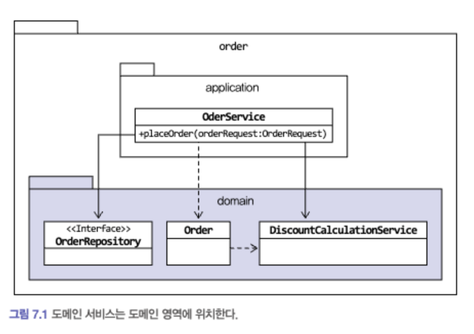
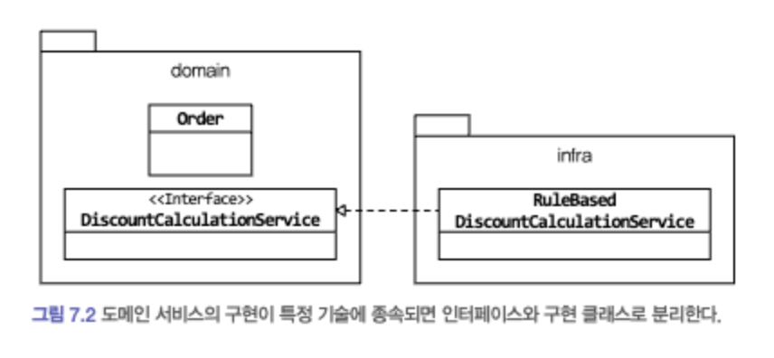

# 7장. 도메인 서비스

> 작성: 2025-11-12 · 태그: DDD · [노션 원본](https://app.notion.com/p/9f4b64333a7b4d868dfdd03e0e4adc4c)

목차

# 7.1 여러 애그리거트가 필요한 기능

메인 영역의 코드를 작성하다 보면, 한 애그리거트로 기능을 구현할 수 없을 때가 있다. 대표적인 예가 결제 금액 계산 로직이다.

- 상품 애그리거트 : 구매하는 상품의 가격이 필요, 상품에 따라 배송비가 추가되기도 함
- 주문 애그리거트 : 상품별로 구매 개수가 필요하다.
- 할인 쿠폰 애그리거트 : 쿠폰별로 지정한 할인 금액이나 비율에 따라 주문 총 금액을 할인한다. 할인 쿠폰을 조건에 따라 중복 사용할 수 있다거나 지정한 카테고리의 상품에만 적용할 수 있다는 제약 조건이 있다면 할인 계산이 복잡해진다.
- 회원 애그리거트 : 회원 등급에 따라 추가 할인이 가능하다.

위 상황에서 실제 결제 금액을 계산해야하는 주체는 어떤 애그리거트일까?

**생각해 볼 수 있는 방법은 주문 애그리거트가 필요한 데이터를 모두 가지도록 한 뒤 할인 금액 계산 책임을 주문 애그리거트에 할당하는 것이다.**

```java
public class Order {
    private Orderer orderer;
    private List<OrderLine> orderLine;
    private List<Coupon> userCoupons;
  
    private Money caculatePayAmounts() {
        Money totalAmounts = calculateTotalAmounts();
        // 쿠폰별로 할인 금액을 구한다.
        Money discount =
                coupons.stream()
                        .map(coupon -> calculateDiscount(coupon))
                        .reduce(Money(0), (v1, v2) -> v1.add(v2));
        // 회원에 따른 추가 할인을 구한다.
        Money memnershipDiscount =
                calculateDiscount(orderer.getMember().getGrade());
        //실제 결제 금액 계산
        return totalAmounts.minus(discount).minus(memnershipDiscount);
    }
  
    private Money calculateDiscount(Coupon coupon) {
        // orderLines의 각 상품에 대해 쿠폰을 적용해서 할인 금액 계산하는 로직
        // 쿠폰의 적용 조건 등을 확인하는 코드
        // 정책에 따라 복잡한 if-else와 계산 코드
    }
  
    private Money calculateTotalAmounts(MemberGrade grade) {
        // 등급에 따라 할인 금액 계산
    }
}
```

여기서 예를 들어 특별 감사 세일로 전 품목에 대해 한 달간 2% 추가 할인 하기로 했다고 해보자.

이 할인 정책은 주문 애그리거트가 갖고 있는 구성요소와는 관련이없음에도 불구하고 결제 금액 계산 책임이 주문 애그리거트에 있다는 이유로 주문 애그리거트의 코드를 수정해야한다.

이렇게 한 애그리거트에 넣기 애매한 도메인 기능을 억지로 특정 애그리거트에 구현하면 안된다.

- 코드 길이가 길어짐
- 외부에 대한 의존이 높아지게 되면서 코드를 복잡하게 만듦
- 애그리거트의 범위를 넘어서는 도메인 개념이 애그리거트에 숨어들어 명시적으로 드러나지 않게 된다.

그래서 별도 서비스로 구현해야한다.

# 7.2 도메인 서비스

도메인 서비스는 도메인 영역에 위치한 도메인 로직을 표현할 때 사용한다. 주로 아래 상황에서 도메인 서비스를 사용한다.

- 계산 로직 : 여러 애그리거트가 필요한 계산 로직이나, 한 애그리거트에 넣기에는 다소 복잡한 계산 로직
- 외부 시스템 연동이 필요한 도메인 로직 : 구현하기 위해 타 시스템을 사용해야 하는 도메인 로직

## 7.2.1 계산 로직과 도메인 서비스

위 코드를 Service에서 구현

```java

public class DiscountCalculationService {
  
    public Money calculateDiscountAmount(List<OrderLine> orderlines,
														            List<Coupon> coupons,
														            MemberGrade grade)
		{
        Money couponDiscount = coupons.stream()
                .map(coupon -> calculateDiscount(coupon))
                .reduce(Money(0), (v1, v2) -> v1.add(v2));
  
        Money membershipDiscount =
                calculateDiscount(orderer.getMember().getGrade());
  
        return couponDiscount.add(membershipDiscount);
    }
  
    private Money calculateDiscount(Coupon coupon) {
        ...
    }
  
    private Money calculateDiscount(MemberGrade grade) {
        ...
    }
}
```

할인 계산 서비스를 사용하는 주체는 애그리거트가 될 수도 있고 응용 서비스가 될 수도 있다.

DiscountCalculationService를 아래와 같이 애그리거트의 결제 금액 계산 기능에 전달하면 사용 주체는 애그리거트가 된다.

```java
public class Order {
	public void caculateAmounts(DiscountCalculationService disCalSvc,
															MemberGrade grade)
	{
        Money totalAmounts = calculateTotalAmounts();
				disCalSvc.calculateDiscountAmount(this.orderLines, this.coupons, grade);
				tihs.paymentAmounts = totalAmounts.minus(discountAmounts);
	}
}
```

도메인 서비스 객체를 애그리거트에 주입하지 않기

- 아래와 같은 코드를 사용하지 말자

```java
public class Order {

	@Autowired
	private DiscountCalculationService discountCalculationService;

	...
}
```

1. Order가 제공하는 모든 기능에서 해당 서비스가 필요한것이 아니다.
2. 도메인 객체에서 필드는 데이터를 담는 역할을 하고 모델에서 중요한 구성요소이다.
3. Order 객체를 DB에 보관할 때 다른 필드와는 달리 저장 대상이 아니다.

**특정 기능이 응용 서비스인지 도메인 서비스인지 감을 잡기 어려울 때는 해당 로직이 애그리거트의 상태를 변경 하거나 애글거트의 상태 값을 계산하는지 검사해 보면 된다.**

## 7.2.2 외부 시스템 연동과 도메인 서비스

외부 시스템이나 타 도메인과의 연동 기능도 도메인 서비스가 될 수 있다.

```java
public interface ServeyPermissionChecker {
	boolean hasUserCreationPermission(String userId);
}
```

위 인터페이스 구현체가 역할 관리 시스템과 연동하는 API를 호출하는 기능으로 구현되어있다고 하자.

```java
public class CreateSurveyService {
	private SurveyPermissionChecker permissionChecker;

	public Long createSurvcey(CreateSurveyRequest req) {
		validate(req);
		// 도메인 서비스를 이용해서 외부 시스템 연동을 표현
		if (!permissionChecker.hasUserCreationPermission(req.getRequestorId()) {
				throw new NopermissionException();
		}
}
```

## 7.2.3 도메인 서비스의 패키지 위치



도메인 서비스의 개수가 많거나 엔티티나 벨류와 같은 다른 구성요소와 명시적으로 구분하고 싶다면

domain 패키지 밑에 domain.model, domain.service, domain.repository와 같이 하위 패키지를 구분하여 위치 시켜도 된다.

<details>
<summary>order</summary>

<details>
<summary>domain</summary>

<details>
<summary>model</summary>

</details>

<details>
<summary>service</summary>

</details>

<details>
<summary>repository</summary>

</details>

</details>

</details>

## 7.2.4 도메인 서비스의 인터페이스와 클래스

도메인 서비스의 로직이 고정되어 있지 않은 경우 도메인 서비스 자체를 인터페이스로 구현하고 이를 구현한 클래스를 둘 수도 있다.



이를 통해 도메인 영역이 특정 구현에 종속되는 것을 방지할 수 있고 도메인 영역에 대한 테스트가 쉬워진다.
