# 8장. 애그리거트 트랜잭션 관리

🔎 목차

## 📔 8.1 애그리거트의 트랜잭션

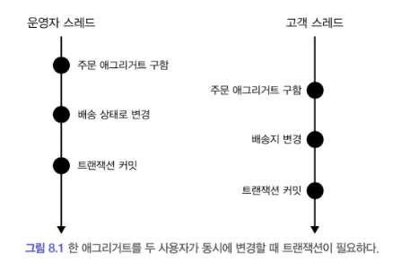

한 주문 애그리거트를 운영자와 고객이 **동시에** 수정하는 과정이다.<br>위 두 주문 애그리거트는 **개념적으로 동일한 애그리거트**지만,<br>트랜잭션마다 리포지토리는 새로운 애그리거트를 만들기 때문에 물리적으로 **서로 다른 애그리거트 객체**를 사용하게 된다.<br><br>따라서 운영자 스레드가 고객 스레드에 영향을 주지않는다.<br>즉, 운영자가 주문을 배송 중 상태로 변경하더라도 고객은 여전히 배송지를 변경할 수 있는 상태라는 것<br>→ 이는 애그리거트의 일관성이 깨진다고 표현

일관성이 깨지지 않도록 하려면 아래 두가지 중 하나를 해야한다.

- 운영자가 배송지 정보를 조회하고 상태를 변경하는 동안, 고객이 애그리거트를 수정하지 못하게 막는다.
- 운영자가 배송지 정보를 조회한 후에 고객이 정보를 변경하면, 운영자가 애그리거트를 재 조회하고 수정한다.

이 두가지를 행하기 위해서는 트랜잭션이 필요하다.

## 📔 8.2 선점 잠금

: **<code>선점 잠금</code>**은 먼저 애그리거트를 구한 스레드가 애그리거트 사용이 끝날 때까지 다른 스레드가 해당 애그리거트를 수정하지 못하게 막는 방식이다.

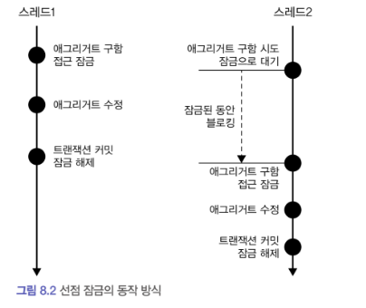

이처럼 스레드1이 먼저 작업 후 잠금해제한 후에서야 <br>스레드2에서 스레드1이 수정한 애그리거트를 확인하고 조치할 수 있는 형태

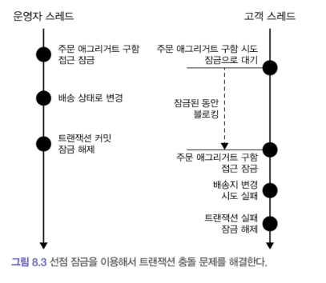

> 운영자 스레드에서 배송상태로 변경했기 때문에 잠금 해제후에 고객스레드에서 상태가 변경된 것을 확인 후 배송지 변경에 실패하게 된다.

선점 잠금은 보통 DBMS가 제공하는 행단위 잠금을 사용해서 구현한다.<br>특정 레코드에 한 커넥션만 접근할 수 있는 잠금 장치를 많은 DBMS에서 제공하고 있다.

### 📔 8.2.1 선점 잠금과 교착 상태

: 선점 잠금을 사용할 때는 잠금 순서에 따른 교착 상태가 발생하지 않도록 주의해야한다.

1. 스레드1 : <code>A 애그리거트</code>에 대한 점유
2. 스레드2 :<code> B 애그리거트</code>에 대한 점유
3. 스레드1 : <code>B 애그리거트</code>에 대한 선점 잠금 시도
4. 스레드2 : <code>A 애그리거트</code>에 대한 선점 잠금 시도

위와 같은 경우에는 스레드1은 <code>B 애그리거트</code>에 영원히 선점 잠금을 할 수 없다. 왜냐하면 스레드2에서 <code>B 애그리거트</code>를 점유하고 있기 때문이다.

(반대의 경우도 마찬가지)

이렇게 다른 스레드가 먼저 특정 애그리거트를 선점하고 있을 때, 그 애그리거트에 선점 잠금을 할 수 없는 상태를 **<code>교착상태</code>**라고 한다.

> 선점에 따른 교착 상태는 상대적으로 사용자 수가 많을 때 발생할 가능성이 높고, 사용자 수가 많아지면 교착상태에 빠지는 스레드는 더 빠르게 증가한다. 더 많은 스레드가 교착상태에 빠질수록 시스템은 아무것도 할 수 없는 상태가 된다.

이러한 교착상태가 발생하지 않도록 하기 위해서는 애그리거트에 대한 잠금에 **최대 대기 시간**을 지정해야 한다.

## 📔 8.3 비선점 잠금

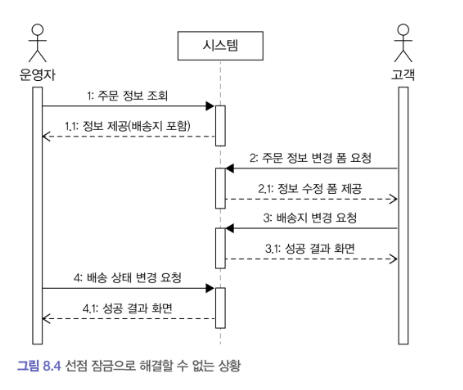

1. 운영자가 배송상태로 바꾸기 위해 시스템으로 부터 정보를 받아옴.<br>(변경하기전)
2. 고객이 시스템으로 부터 배송지 변경 요청
3. 운영자가 1번에서 제공받은 화면에서 배송 상태를 변경
4. 성공

여기서 문제는 운영자가 배송지 정보를 조회하고 배송 상태로 변경하는 사이에 고객이 배송지를 변경한다는 것이다.<br>즉, 배송 상태 변경 전에 배송지를 한번 더 확인하지 않으면 위와 같은 문제가 발생하게 된다.

**<code>비선점 잠금</code>**은 동시에 접근하는 것을 막는 대신 변경한 데이터를 실제 DBMS에 반영하는 시점에 변경 가능 여부를 확인하는 방식이다.

비선점 잠금을 구현하기 위해서는 애그리거트에 <code>버전</code>으로 사용할 property를 추가해야한다. <br>애그리거트를 수정할 때마다 버전을 증가 시키며 수정할 애그리거트와 매핑되는 테이블의 버전 값이 현재 애그리거트와 동일한 경우에만 데이터를 수정할 수 있도록 한다.

```sql
UPDATE aggtable SET version = version+1, data = 변경할 다른 컬럼들..
WHERE aggid = ? and version = 현재버전
```

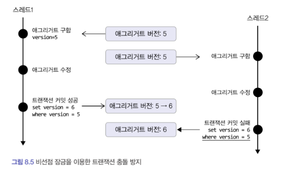

이때 응용 서비스는 버전에 대해 알 필요가 없다.<br>리포지터리에서 필요한 애그리거트를 구하고 알맞은 기능만 실행하면 된다. (JPA에서 version에 대한 어노테이션 제공)<br>

```java
public class ChangeShippingService {

		@Transactional
		public void changeShipping(ChangeShippingRequest changeReq) {
				Order order = orderRepository.findById(new OrderNo(changeReq.getNumber()));
				checkNoOrder(order);
				order.changeShippingInfo(changeReq.getShippingInfo());
		}
...
}

///// 표현 영역
@Controller
public class OrderController{
	private ChangeShippingService changeShippingService;

	@PostMapping("/changeShipping")
	public String changeShipping(ChangeShippingRequest changeReq){
		try{
					changeShippingService.changeShipping(changeReq);
					return "success";
				}catch(OptimisticLockingFailureException ex) {
					// 누군가 먼저 같은 주문 애그리거트를 수정했으므로
					// 트랜잭션이 충돌했다는 메세지를 보여준다.
					return "Fail, Conflict";
				}
		}
	}
}
```

위의 코드를 그림 8.4의 상황으로 보면 시스템은 사용자에게 수정 폼을 제공할 때, 애그리거트 버전을 함께 제공하고, <br>폼을 서버에 전송할 때, 이 버전을 함께 전송한다.<br>이때 사용자가 전송한 버전과 애그리거트의 버전이 동일한 경우(폼을 제공할 때 이후로 수정된적이 있는 지)<br>애그리거트가 수정 가능하게 한다.<br>

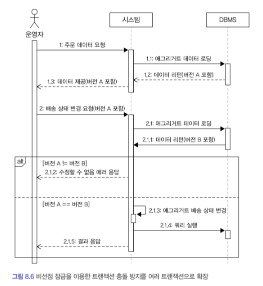

```java
@Controller
public class OrderAdminController {
	private StartShippingService startShippingService;
	@PostMapping("/startShipping")
	public String startShipping (StartShippingRequest startReq) {
		try {
			startShippingService.startShipping (startReq);
			return "shippingStarted";
		} catch (OptimisticLockingFailureException | VersionConflictException ex) {
			// 트랜잭션 충돌
			return "startShippingTxConflict";
		}
}
```

### 📔 8.3.1 강제 버전 증가

애그리거트에 애그리거트 루트 외에 다른 엔티티가 존재하는데, <br>기능 실행 도중 루트가 아닌 다른 엔티티의 값만 변경될 때가 있다고 하자.<br>이경우 JPA는 루트 엔티티의 버전 값을 증가시키지 않는다.<br>→ 이런 경우에는 애그리거트 관점에서 볼 때, 문제가 된다. 애그리거트의 구성요소 중 일부 값이 바뀌면 논리적으로 그 애그리거트는 바뀐 것이다.<br>따라서 애그리거트의 구성요소의 상태가 바뀌면 루트 애그리거트의 버전값이 증가해야 비선점 잠금이 올바르게 작동한다.<br><br>이런 경우를 처리할 수 있도록 JPA는 강제로 버전 값을 증가시키는 잠금 모드를 지원한다.

```java
@Repository
public class JpaOrderRepository implements OrderRepository {
	@PersistenceContext
	private EntityManager entityManager;
	@Override
	public Order findByIdOptimisticLockMode(OrderNo id) {
			return entityManager.find(
								Order.class, id, LockModeType.OPTIMISTIC_FORCE_INCREMENT);
}
```

## 📔 8.4 오프라인 선점 잠금

> 사내 wiki를 보면 누군가 먼저 편집을 하는 중이면 그 사용자의 커서 위치에 그사람의 아이콘이 뜬다.<br>이런 안내 아이콘을 통해 여러 사용자가 동시에 한 문서를 수정할 때 발생하는 충돌을 사전에 방지할 수 있도록 해준다.

→ 하지만 동시에 수정하는 것을 wiki는 막지는 않는다. 더 엄격하게 데이터 충돌을 막고싶다면 같은 문서를 동시에 수정하는 화면을 제공하지 않으면 된다.<br><br>한 트랜잭션 범위에서만 적용되는 선점 잠금 방식이나 나중에 버전 충돌을 확인하는 비선점 잠금 방식으로는 이를 구현할 수 없다.<br>이때 사용하는 방식이<code> </code>**<code>오프라인 선점 잠금 방식</code>**이다.

단일 트랜잭션에서 동시 변경을 막는 선점 잠금 방식과는 달리<br>오프라인 선점 잠금은 여러 트랜잭션에 걸쳐 변경을 막는다.

첫 번째 트랜잭션을 시작할 때, 오프라인 잠금을 선점하고<br>마지막 트랜잭션에서 잠금을 해제한다. <br>잠금을 해제하기 전까지 다른 사용자는 잠금을 구할 수 없다.(점유 불가)

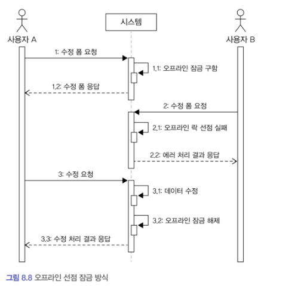

위 그림에서 보면

1. 사용자 A가 수정화면을 요청할 때, 그 수정화면은 잠금 상태가 되어<br>다른 사용자가 동시에 수정 화면에 접근할 수 없게 된다.
2. 사용자 A가 수정요청을 해서 데이터가 변경되고 나서야 잠금이 해제되어<br>사용자 B가 수정화면에 접근할 수 있게됨을 말하는 것 같다.

→ 이때 <code>잠금 유효 시간</code>을 설정하지 않으면 사용자 A가 수정을 안하고 프로그램을 종료하면 영원히 잠금 상태가 된다. <br>잠금 유효시간을 설정하여 처음 잠금을 요청한 사용자 A가 유효시간이 지난뒤 수정요청을 하면 사용자 A는 잠금이 풀려 수정에 실패하게 된다.

### 📔 8.4.1 오프라인 선점 잠금을 위한 LockManager 인터페이스와 관련 클래스

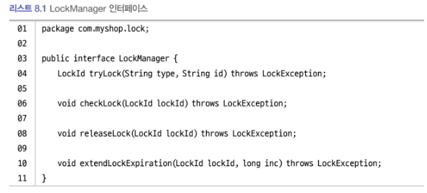

1. <code>tryLock(String type, String id)</code> : 잠금을 시도<br>@param type : 각각 잠글 대상 타입 → 잠글 애그리거트<br>@param id : 애그리거트 식별자(seq)<br>@return LockId : 잠금 식별자 → 어딘가에 보관했다가 데이터 수정 요청때 다시 전송
2. <code>checkLock(LockId lockId)</code> : 잠금 확인
3. <code>releaseLock(LockId lockId)</code> : 잠금 해제
4. <code>extendLockExpiration(LockId lockId, long inc)</code> : 잠금 유효시간 연장

잠금을 해제하는 코드

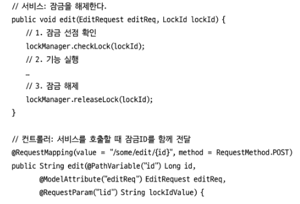

### 📔 8.4.2 DB를 이용한 LockManager 구현

: 잠금에 대한 정보를 DB에 저장하여 구현하는 방식이다.<br>이 잠금 정보의 필드로는

1. 잠금 대상 - type
2. 대상 식별자 - id
3. 잠금의 식별자 - lockId (식별자로써 사용하기 때문에 유니크 인덱스)
4. 유효 시간 - expirationTime

와 같은 데이터가 들어간다.<br><br>구현 코드

```java

@Component
public class Spring LockManager implements LockManager {
	private int lockTimeout = 5 * 60 * 1000;
	private JdbcTemplate jdbcTemplate;

	// lock 테이블 조회 값 -> LockData 맵핑
	private RowMapper<LockData> lockDataRowMapper = (rs, rowNum) ->
				new LockData(rs.getString(1), rs.getString(2),
										 rs.getString(3), rs.getTimestamp (4).getTime());

	// type과 id에 대한 잠금 시도
	@Transactional (propagation Propagation.REQUIRES_NEW)
	@Override
	public LockId tryLock (String type, String id) throws LockException {
			// type과 id에 이미 잠금이 되어있는 지 확인
			checkAlreadyLocked (type, id);
			// lockId 생성
			LockId lockId= new LockId (UUID.randomUUID().toString());
			// 잠금 생성
			locking(type, id, lockId);
			return lockId;
	}

	// 잠금이 존재하는 지 검사
	private void checkAlreadyLocked(String type, String id) {
			List<LockData> locks = jdbcTemplate.query(
							"select * from locks where type = ? and id = ?",
							lockDataRowMapper, type, id);
			// 잠금이 존재하되 유효시간이 지난 잠금인지 확인
			Optional<LockData> lockData = handleExpiration (locks);
			// 유효시간이 지나지 않은 잠금이 있으면 잠금이 겹치는 것이니 에러
			if (lockData.isPresent()) throw new AlreadyLockedException();
	}

	/**
	 * 잠금 유효시간이 지나면 해당 데이터를 삭제하고 값이없는
	 * Optional을 반환.
	 * 유효시간이 지나지 않았으면 LockData를 가진 Optional 반환
	 */
	private Optional <LockData> handleExpiration (List<LockData> locks) {
		//
		if (locks.isEmpty()) return Optional.empty();
		LockData lockData = locks.get(0);
		if (lockData.isExpired()) {
				jdbcTemplate.update(
						"delete from locks where type = ? and id = ?",
						lockData.getType(), lockData.getId());
				return Optional.empty();
		} else {
				return Optional.of (lockData);
		}
	}

 // lock 테이블에 데이터 삽입
	private void locking(String type, String id, LockId lockId) {
		try {
				int updatedCount = jdbcTemplate.update(
							"insert into locks values (?, ?, ?, ?)",
							type, id, lockId.getValue(), new Timestamp (getExpirationTime()));
				// 삽입 결과가 없으면 Exception
				if (updatedCount == 0) throw new LockingFailException();
			// 같은 lock이 존재하면 LockingFailException
		} catch (DuplicateKeyException e) {
				throw new LockingFailException(e);
		}
	}

	// 유효시간 만들기
	private long getExpiration Time() {
			return System.currentTimeMillis() + lockTimeout;
	}
```

나머지 구현 코드

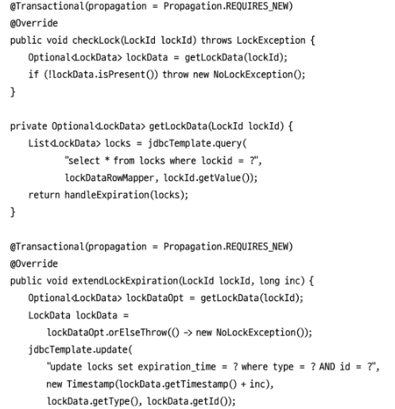

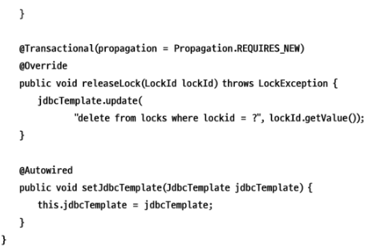
