# 9장. 도메인 모델과 바운디드 컨텍스트

> 작성: 2024-01-31 · 태그: DDD · [노션 원본](https://app.notion.com/p/f6267c475da348dd9d4f6b5453f88f93)

## 목차 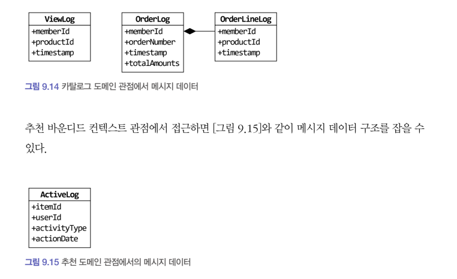

# 9.1 도메인 모델과 경계 ( 배경 )

처음 도메인 모델을 만들 때 빠지기 **쉬운 함정**이 도메인을 완벽하게 표현하는 단일 모델을 만드는 시도를 하는 것이다.

그런데 1장에서 말한 것처럼 한 도메인은 다시 여러 하위 도메인으로 구분되기 때문에 **한 개의 모델로 여러 하위 도메인을 모두 표현하려고 시도하면 오히려 모든 하위 도메인에 맞지 않는 모델**을 만들게 된다.

논리적으로 같은 존재처럼 보이지만 하위 도메인에 따라 다른 용어를 사용하는 경우있기 때문에 한 개의 모델에 여러 하위 도메인을 표현하면 안된다.

예를들면 시스템을 사용하는 사람을 회원 도메인에서는 회원, 주문 도메인에서는 주문자라고 부른다. 배송 도메인에서는 보내는 사람이라고도 부르기 때문에 각 도메인에서 표현하고있는 하위 도메인이 다른샘이다.

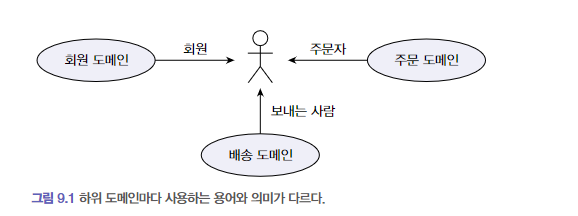

이렇게 하위 도메인마다 같은 용어라도 의미가 다르고 같은 대상이라도 지칭하는 용어가 다르기 때문에 하나의 도메인에서 모든 하위 도메인을 표현하려는 시도는 올바른 방법이 아니다.

결론, 각 모델은 명시적으로 구분되는 경계를 가져서 섞이지 않도록 해야 한다.

모델은 특정한 컨텍스트(문맥) 하에서 완전한 의미를 갖는다.

같은 제품 이라도 카탈로그 컨텍스트와 재고 컨텍스트에서 의미가 서로 다르다.

이렇게 구분되는 경계를 갖는 컨텍스트를 DDD에서는 바운디드 컨텍스트라고 부른다.

# 9.2 바운디드 컨텍스트

바운디드 컨텍스트는 **모델의 경계를 결정**하며 한 개의 바운디드 컨텍스트는 **논리적으로 한 개의 모델**을 갖는다.

이상적으로 하위 도메인과 바운디드 컨텍스트가 일대일 관계를 가지면 좋겠지만 현실은 그렇지 않을 때가 많다.

바운디드 컨텍스트는 기업의 팀 조직 구조에 따라 결정되기도 한다.

예를 들면 주문 하위 도메인이 있는데 주문을 처리하는 팀과 결제 금액을 계산하는 로직을 구현하는 팀이 따로 있다면 주문 도메인안에 바운디드 컨텍스트가 2개가 존재하게 되는것이다.

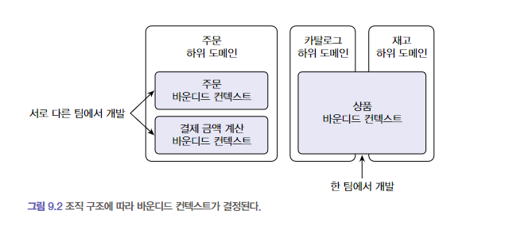

이런 경우가 있고 규모가 작은 기업은 전체 시스템을 한 개 팀에서 구현할 때도 있다.

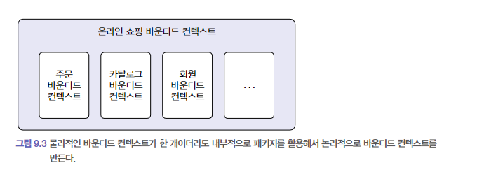

바운디드 컨텍스트가 한 개이더라도 내부적으로 패키지를 활용해서 구분하여 만듦

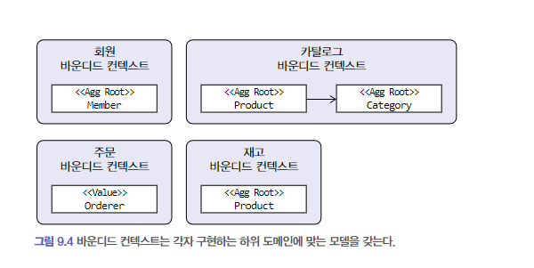

모델을 구분하는 경계가 되느게 바운디드 컨텍스트이기에 하위 도메인에 알맞은 모델을 포함해야한다.

회원에서는 Member를 주문에서는 Orderer를 갖는다.

카탈로그 바운디드 컨텍스트에서는 제품과 카탈로그가 연관을 맺지만

재고 바운디드 컨텍스트에서는 카탈로그와 연관을 맺지 않는다.

# 9.3 바운디드 컨텍스트 구현

바운디드 컨텍스트가 도메인 모델만 포함하는 것은 아니다.

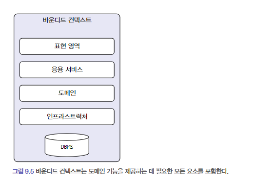

바운디드 컨텍스트는 도메인 기능을 사용자에게 제공하는 데 필요한 표현 영역, 응용 서비스, 인프라스트럭처 영역을 모두 포함한다.

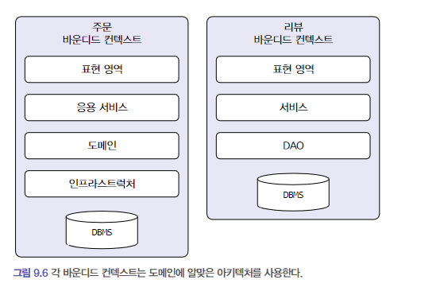

또한 위 처럼 모든 바운디드 컨텍스트는 반드시 도메인 주도로 개발할 필요는 없다.

한 바운디드 컨텍스트에서 두 방식을 혼합해서 사용할 수도 있다. → CQRS

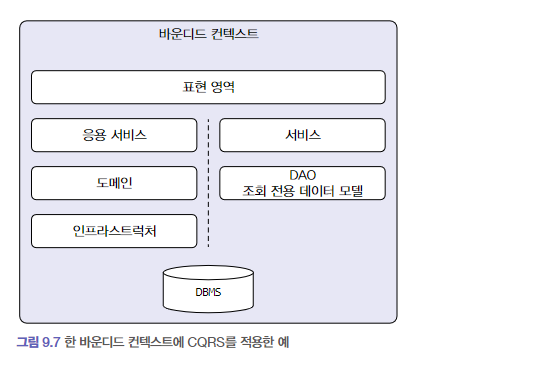

# 9.4 바운디드 컨텍스트 간 통합

온라인 쇼핑 사이트에서 매출 증대를 위해 카탈로그 하위 도메인에 개인화 추천 기능을 도입하기로 했다고 하자.

기존 카탈로그 시스템을 개발하던 팀

별도 추천 시스템을 담당하는 팀

카탈로그 하위 도메인에는 기존 카탈로그를 위한 바운디드 컨텍스트와 추천 기능을 위한 바운디드 컨텍스트가 생긴다.

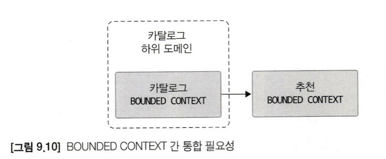

두 팀이 관련된 바운디드 컨텍스트를 개발하면 자연스럽게 두 바운디드 컨텍스트 간 통합이 발생한다.

카탈로그와 추천 바운디드 컨텍스트 간 통합이 필요한 기능은 다음과 같다.

- 사용자가 제품 상세 페이지를 볼 때, 보고 있는 상품과 유사한 상품 목록을 하단에 보여준다.

위를 구현하기 위해서 책에서는 아래와 같은 방식을 제시하였습니다.


제품 도메인안에 제품 상세를 볼 수 있는 Service가 있을것이고, 추천 데이터를 받아오기 위해 외부 추천 시스템을 사용하였습니다.

여기서 RecSystemClient는 외부 API를 읽어와 카탈로그 도메인에 맞는 상품 모델로 변환한다.

```java
class RecSystemClient(private val productRepository: ProductRepository): ProductRecommendationService {

    override fun getRecommendationOf(id: ProductId): List<Product> {
        val items = getRecItems(id.value)
        return toProducts(items)
    }

    private fun getRecItems(itemId: String): List<RecommendationItem> {
    	// externalRecClient는 외부 추천 시스템에 연결할 때 사용하는 클라이언트로 가정한다.
        return extenalRecClient.getRecs(itemId)
    }

    private fun toProducts(items: List<RecommendationItem>): List<Product> {
        return items.stream()
            .map { item -> toProductId(item.itemId) }
            .map { prodId -> productRepository.findById(prodId) }
            .collect(Collection::toList)
    }

    private fun toProductId(itemId: String): ProductId {
        return ProductId(itemId)
    }
}
```

두 모델 간의 변환 과정이 복잡하면 아래와 같이 변환 처리를 위한 별도 클래스를 만들고 이 클래스에서 변환 처리해도 된다.

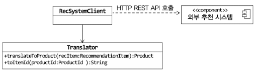

REST API를 호출하는 것은 두 바운디드 컨텍스트를 직접 통합하는 방식이고, 간접적으로 통합하는 방식도 있다.

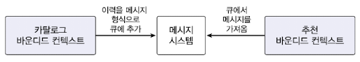

장점 : 메시지 큐는 비동기로 메시지를 처리하기 때문에 속도 증가

메시지 큐를 사용한다고 하면 어떤 도메인 관점에서 모델을 사용하느냐에 따라 두 바운디드 컨텍스트의 구현 코드가 달라짐 → 당연한 이야기…

1. 카탈로그 도메인 모델 기준으로 메시지를 전송
2. 추천 시스템 기준으로 큐에 데이터를 저장

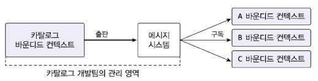

위 그림은 카탈로그 도메인 모델 기준으로 메시지를 전송하는 방법이다.

반대로 추천 시스템 기준이라면 그림이 달라진다.

NOTE.

“마이크로서비스 아키텍처가 단순 유행을 지나 많은 기업에서 자리를 잡아가고 있다.”

이런 마이크로서비스의 특징은 바운디드 컨텍스트와 잘 어울린다.

코드로 생각하면 마이크로서비스마다 프로젝트를 생성하므로 바운디드 컨텍스트마다 프로젝트를 만들게 된다.

# 9.5 바운디드 컨텍스트 관 관계

바운디드 컨텍스트는 어떤 식으로든 연결되기 때문에 두 바운디드 컨텍스트는 다양한 방식으로 관계를 맺는다.

REST API가 대표적이다.

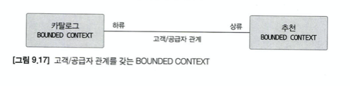

사용하는 쪽이 하류

제공하는 쪽이 상류

제공하는 쪽 API의 인터페이스가 바뀌면 카탈로그 시스템 코드도 바뀌게 된다.

두 시스템간의 상호협력은 필수적이다.

상류 시스템을 사용하는 하류 시스템이 다수 존재하면 하류 시스템의 요구사항을 수용할 수 있는 API를 만들고 이를 서비스 형태로 공개해서 서비스의 일관성을 유지할 수 있다.

이런 서비스를 가리켜 **오픈 호스트 서비스**(OPEN HOST SERVICE) 라고 한다.

→ OPEN API와 비슷한 느낌적인 느낌?

대표적인 예가 아래 그림이다.

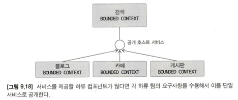

상류 컴포넌트의 서비스는 상류 바운디드 컨텍스트의 도메인 모델을 따른다.

따라서 하류 컴포넌트는 상류 서비스의 모델이 자신의 도메인 모델에 영향을 주지 않도록 보호해주는 완충 지대를 들어야한다.

아래 그림의 RecSystemClient 처럼 모델에 영향을 주지 않도록 보호해주는 역할을 하는 것을 안티코럽션 계층 역할(Anticorruption Layer)이라고 한다.

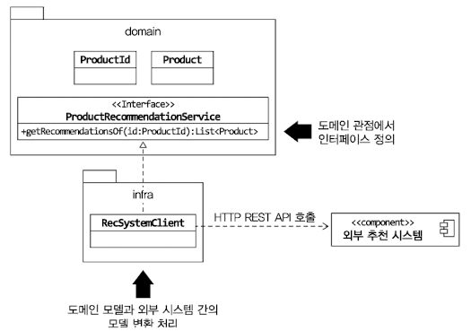

두 바운디드 컨텍스트가 같은 모델을 공유하는 경우도 있다.

예를 들어 운영자를 위한 주문 관리 도구를 개발하는 팀과 고객을 위한 주문 서비스를 개발하는 팀이 다를때 모델을 공유함으로써 중복 설계를 막을 수 있다.

이렇게 두 팀이 공유하는 모델을 **공유 커널**(SHARED KERNEL)이라고 부른다.

마지막으로 **독립 방식**이 있다.

서로 통합하지 않는 방식이다. 각자 따로 모델을 구현하는 방식인것이다.

쇼핑몰에서 판매가 발생하면 ERP에 데이터가 적재되야 한다.

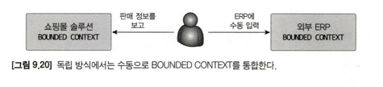

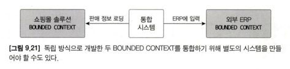

# 9.6 컨텍스트 맵

개별 바운디드 컨텍스트에 매몰되면 전체를 보지 못할 때가 있다.

그래서 전체 비즈니스를 조망할 수 있는 지도가 필요한데 그것이 바로 컨테스트 맵이다.

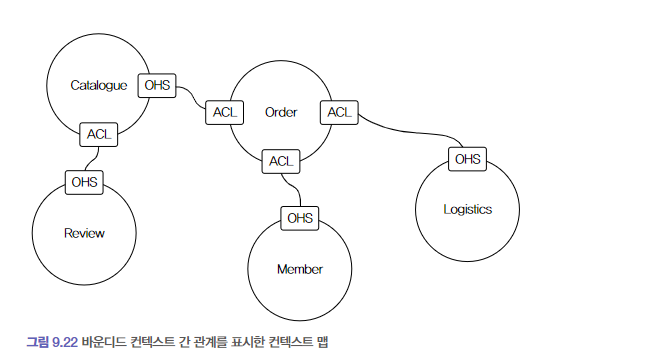

ACL : 안티코럽션 계층 → 자신의 모델에 영향을 주지 않도록 하는 완충!

OHS : 오픈 호스트 서비스 : 여러 하류 시스템(컨텍스트)가 사용할 수 있도록 만든 API

컨텍스트 맵을 그리는 규칙은 따로 없다. 위와 같이 간단한 도형과 선을 이용해서 관계를 이해할 수 있는 수준에서 그리면 된다.

컨텍스트 맵은 전체 시스템의 이해 수준을 보여준다.
