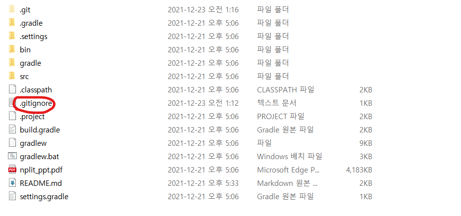
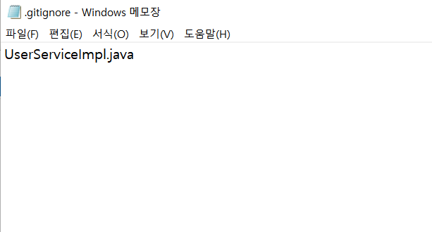
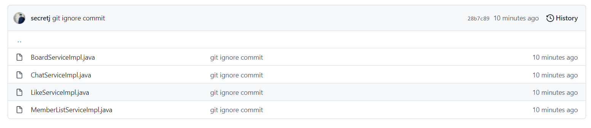
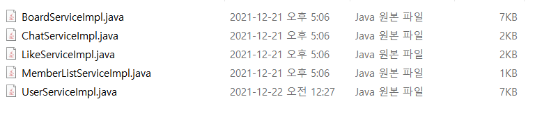
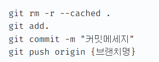

# .gitignore

: 숨기고 싶은 파일/폴더 숨기기

# gitignore이란?

- 프로젝트 작업시 로컬 환경의 정보나 빌드 정보등 원격 저장소에 관리하지 말아야되는 파일들에 대해서 지정하여 원격 저장소에 실수로 올라가지 않도록 관리하는 파일
- 정의한 정보들에 해당하는 파일들에 대하여 git track하지 않도록 설정하는 역할을 한다.
- **한마디로 숨기고 싶거나 숨겨야만 하는 파일을 숨길 수 있게 해주는 git의 기능**

N-PLIT 프로젝트를 만들 때 비밀번호 찾기 기능을 만들었는데, 이건 내 이메일 아이디와 패스워드를 SERVICEIMPL에 입력해놓고 내 메일을 활용해서 임시 비밀번호를 발급해주는 식이었다.

그래서 오픈소스로 공개하기에는 부담스러웠는데 그래서 찾게 된 기능 중 하나이다.

.gitignore **하는 법은 생각보다 간단했다**

- 프로젝트 최상단에 .gitignore 라는 파일을 생성한다. (메모장 생성해서 확장자 .txt 지우는 게 간단했음)

- 그리고 나서 파일안에 내가 지우고 싶은 파일의 명을 입력하면

- 이렇게 github에서는 사라진 것을 확인할 수 있다.

- 물론 내 로컬에는 남아있다.

이렇게 했는데 .gitignore가 적용되지 않으면 원격 저장소의 파일을 지우고 다시 push한다.

아래의 명령어 참고

