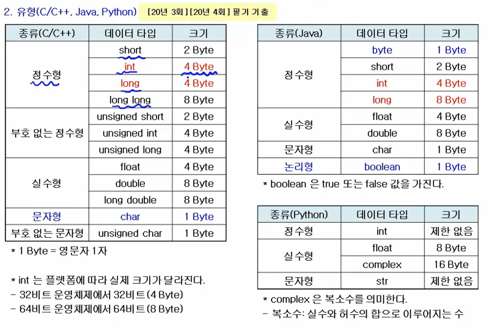

# 데이터 타입

- 한글은 3 Byte
- 1Byte = $2^8$( 256개 = 8bit) 로 이루어짐

### 변수

: 컴퓨터가 명령을 처리하는 도중 발생하는 값을 저장하기 위한 공간으로, 변할 수 있는 값을 의미한다. 저장하는 값에 따라 정수형, 실수형, 문자형등으로 구분한다.

### 변수 작성 규칙

1. 영문자, 숫자 , \_를 사용한다.
2. 첫 글자는 영문자 또는 \_을 사용하며, 숫자는 올 수 없다
3. 공백이나 \*, +, -, / 등의 특수문자를 사용할 수 없다.(gisa first X → gisa\_first O)
4. 대/소문자를 구분한다. (gisafirst와 Gisafirst는 다른 변수명)
5. 예약어를 사용할 수없다.
6. 변수 선언 시 문장 끝에 반드시 세미콜론(;)을 붙여야한다.
7. 글자 수에 제한이 없다.

- 예약어 : 프로그래밍 언어에 있어서, 어느 정해진 의미를 가지고, 그 이외의 의미로 사용해서는 안되는 언어

### const(상수)

: 프로그램이 시작되어 값이 한 번 결정되면 프로그램이 종료될 때까지 변경되지 않는 값을의미

→ 자바의 finlal과 같음
