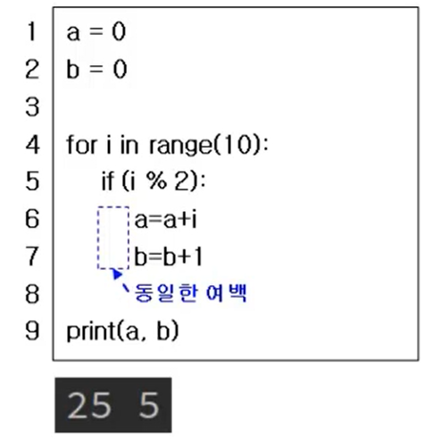

# 파이썬 기본 구조

## Python

: 파이썬은 배우기 쉽고, 강력한 프로그래밍 언어로써 플랫폼에 독립적이며 <ins>인터프리터식</ins>, <ins>객체지향적</ins>, <ins>동적 타이핑 대화형 언어</ins>이다.

- **인터프리터** 식 : 한 줄씩 번역하는 시스템
- **컴파일러** 식  :  통째로 번역하는 시스템
- **자료형 검사** : 프로그램이 자료형의 제약 조건을 지키는지 검증하는 것
- 자료형 검사는<ins> 컴파일 타임(정적 검사, 정적 타이핑) 또는 런타임(동적 검사, 동적 타이핑)에 실행</ins>된다.

  - **동적 타이핑(dynamic typing) : 실행 시간에 자료형을 검사한다.**

### 특징

- 프로그램을 실행하면 자동 실행되는 main함수가 없다.
- 변수의 형(데이터 타입)은 실행 시 결정
- 변수의 자료형에 대한 선언이 없다.
- 실행 시 변수에 저장된 값에 따라 자동으로 자료형이 지정된다.
- 문장 끝에 세미콜론(;) 입력할 필요 없다.
- for등 코드 블록을 포함하는 명령문 작성 시 코드 블록은 콜론(:)과 여백으로 구분한다.

⇒ 자료형도 선언안했고, 세미콜론을 쓰지 않으며 콜론으로 블록을 구분하는 것을 볼 수 있음 여백으로 블록이 구분됨. → print는 for문안에 포함되지 않는다.
