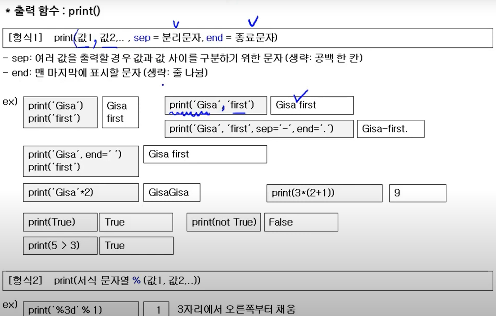
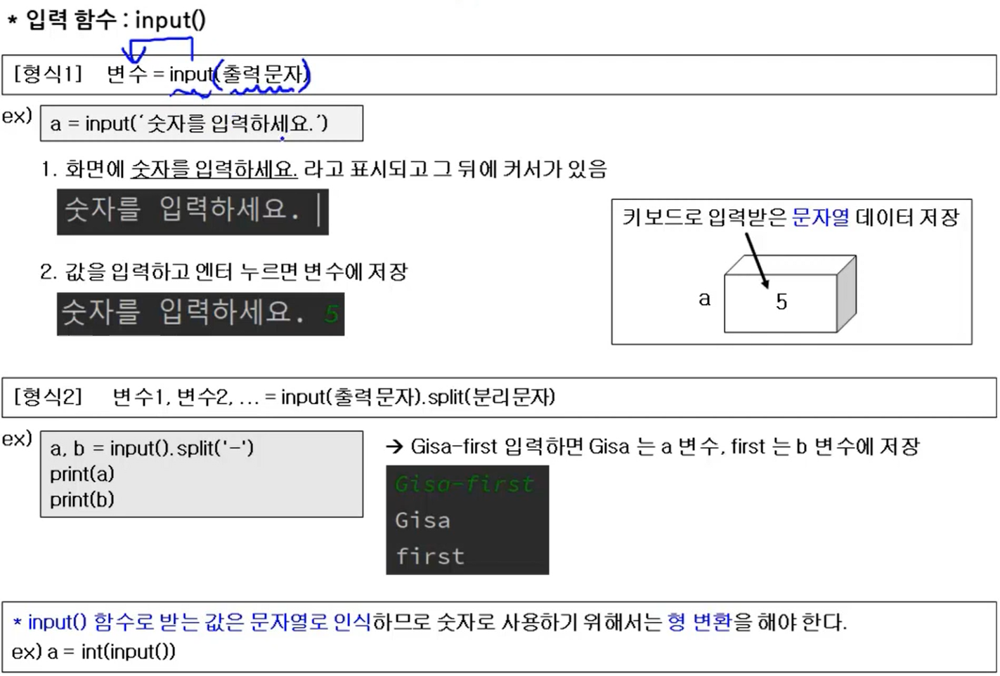
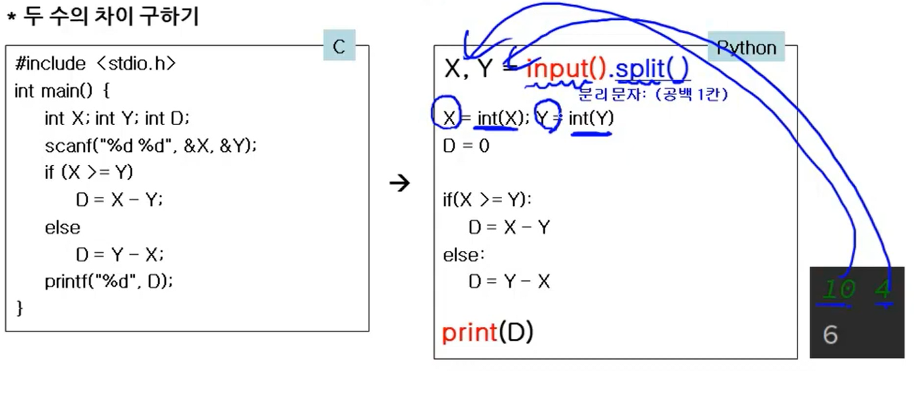

# 파이썬의 입/출력 함수

> 작성: 2022-01-26 · 태그: Python, 정보처리기사 · [노션 원본](https://app.notion.com/p/6e15567ad7a24175aa812197885a2d81)

## 출력 함수

- sep(분리문자) 를 생략하면 자동으로 공백이 한 칸 생성된다.
- end(종료문자)를 생략하고 줄을 바꿔서 print하면 자동으로 줄 바꿈이 된다.
- 문자열을 곱(\*)할 수 있고, 더(+)해서 연결할 수 있다

## 입력 함수

- 입력 함수로 받는 값은 문자열로 인식한다.  ⇒ 형 변환해줘야함 int(input())
- a,b = input(출력문자).split(분리문자)로 동시에 변수 저장이 가능하다. → 분리문자 이전의 값은 a에 이후의 값은 b에 저장

### 예제

