# 파이썬의 자료형

> 작성: 2022-01-26 · 태그: Python, 정보처리기사 · [노션 원본](https://app.notion.com/p/e8c6fa15bd7c477e9d8ba348bace61e6)

## 숫자형(Number)

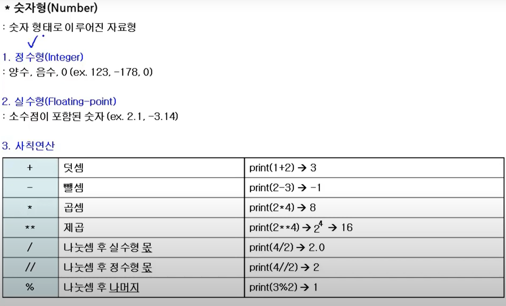

연산을 할 때 print를 사용해서 연산이 가능 !

- 나누기를 하면 소수점이 생성됨

### 문자형(String)

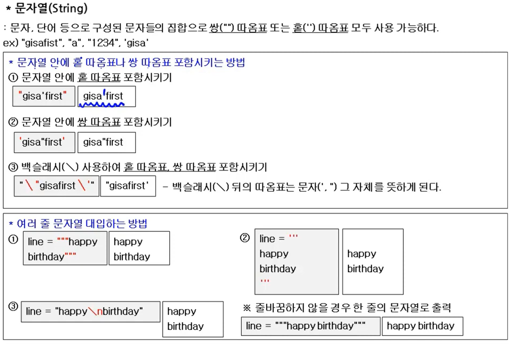

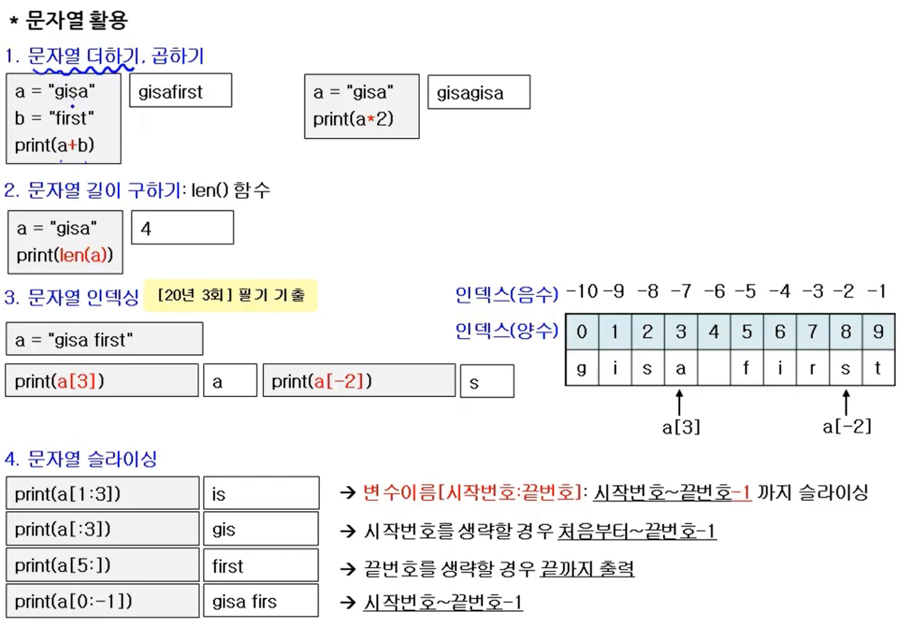

- 문자열 길이 구하기 : len() 함수
  ```py
  /*문자열 길이 구하기*/
  a = "gisa"
  print(len(a))
  
  //출력 : 4
  
  /*문자열 인덱싱*/
  a = "gisa first"
  print(a[2]+", ", end="")
  print(a[-3])
  
  //출력 : s, r               => 인덱스는 0부터 시작, -1부터 시작
  ```
- 문자열 슬라이싱

```py
/*문자열 슬라이싱*/
a = "gisa first"
print(a[1:3]) //is 끝번호-1 까지 출력
print(a[:3]) //gis 처음부터 끝번호-1 까지 출력
print(a[5:]) //first 시작번호부터 끝까지 출력
print(a[0:-1]) //gisa firs 시작부터 끝번호-1 까지 출력
```

### 문자열 증가값

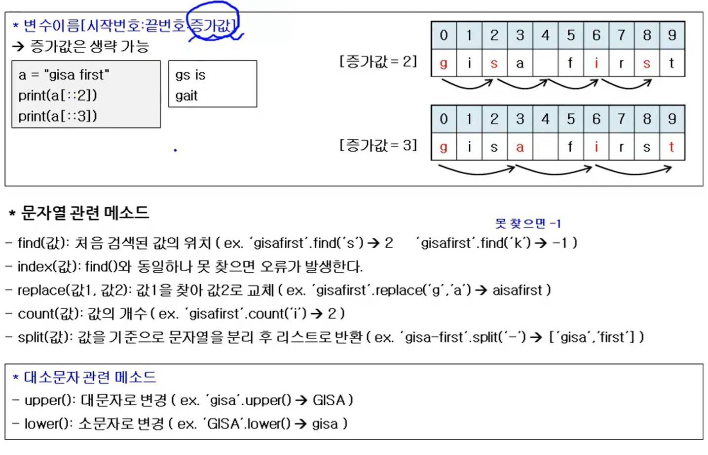

## 리스트

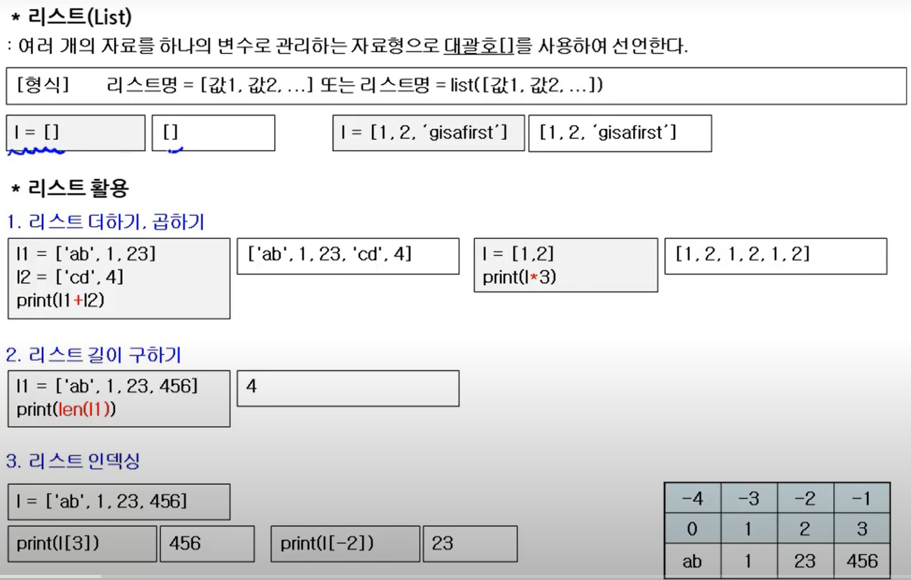

## 리스트 응용

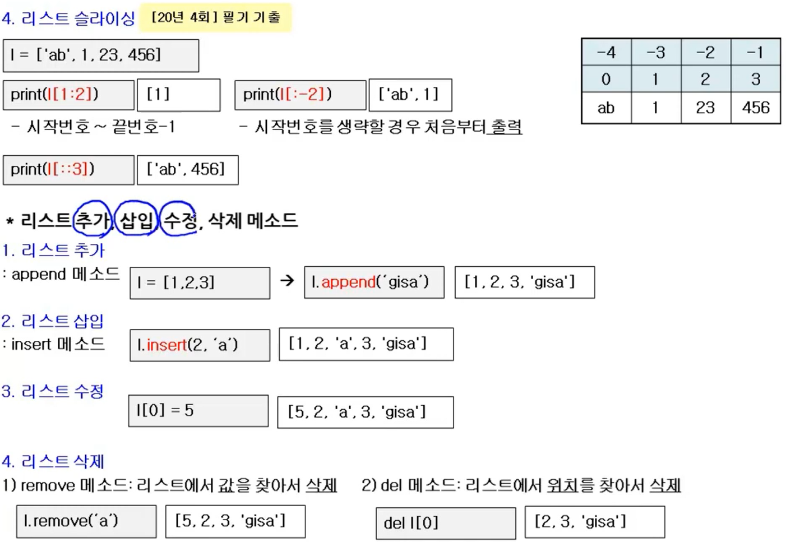

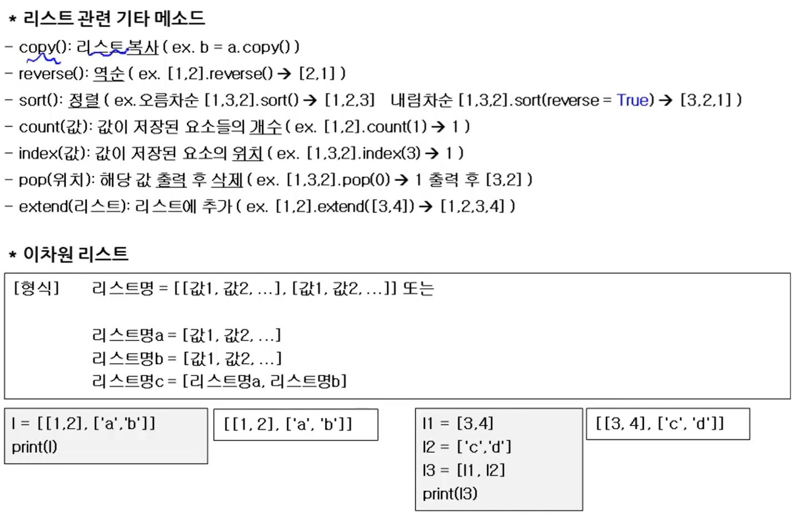

## 튜플

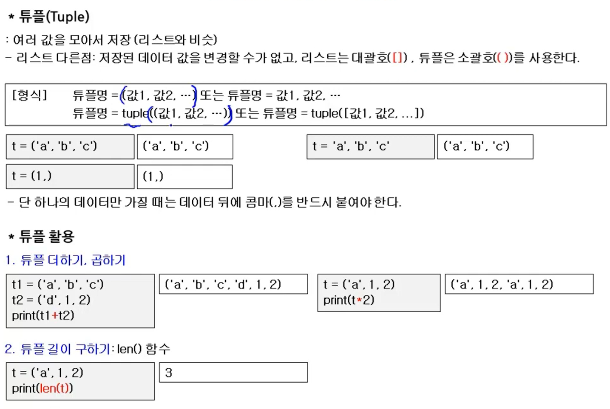

- 리스트와 비슷하나 저장된 데이터를 변경할 수 없다.
- 단 하나의 데이터만 가질 때 콤마(,)를 꼭 붙여써야 한다.

  - t=(1,) →(1,)

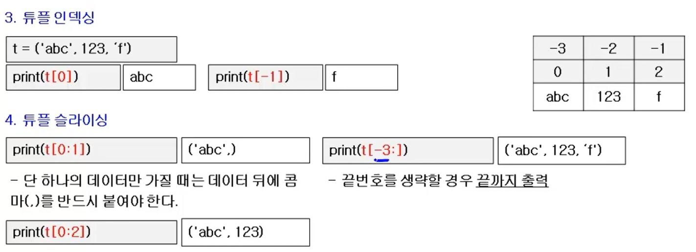

## 딕셔너리

: Key와 Value를 한 쌍(Key:Value)으로 저장할 수 있는 자료형으로 중괄호 \[key:value\]를 사용하여 선언한다.

- 키와 밸류를 콜론(:)으로 연결한다
- 다음 쌍은 콤마(,)로 연결

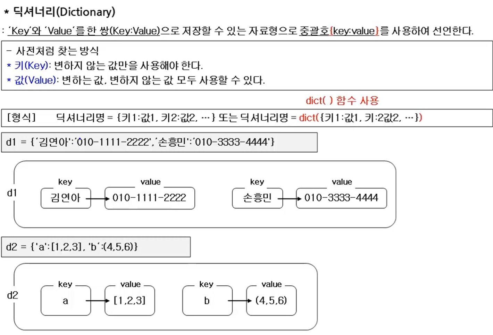

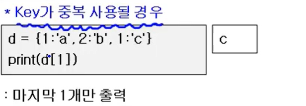

- Key가 중복된 경우 마지막 1개만 출력한다.

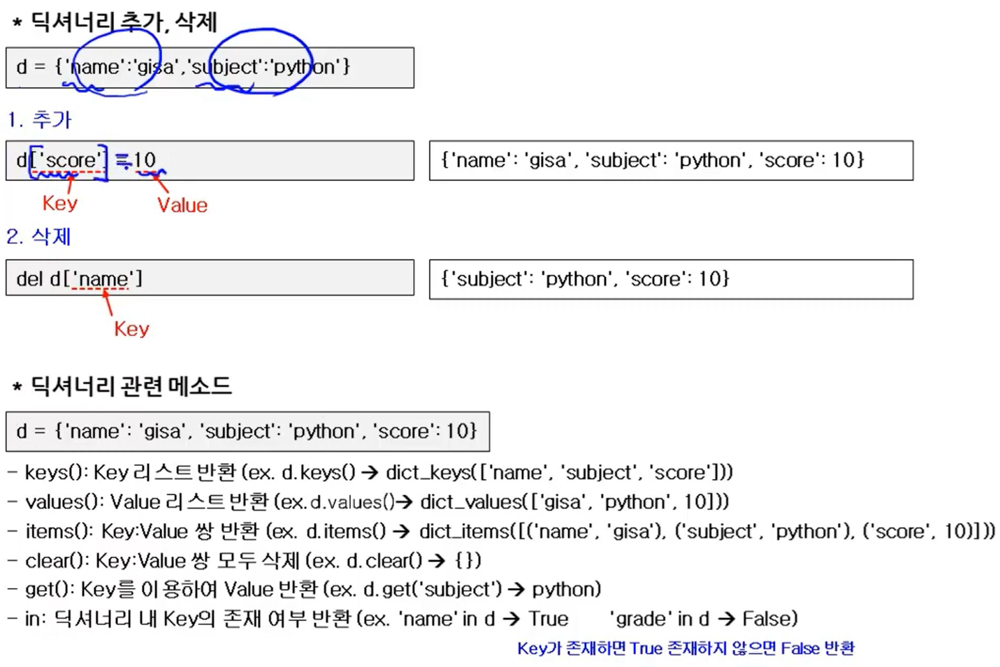

## 집합

: **<ins>중복을 허용하지 않고</ins>**, **<ins>순서가 없는 자료형으로 중괄호\{\}를 사용</ins>**하여 선언한다.

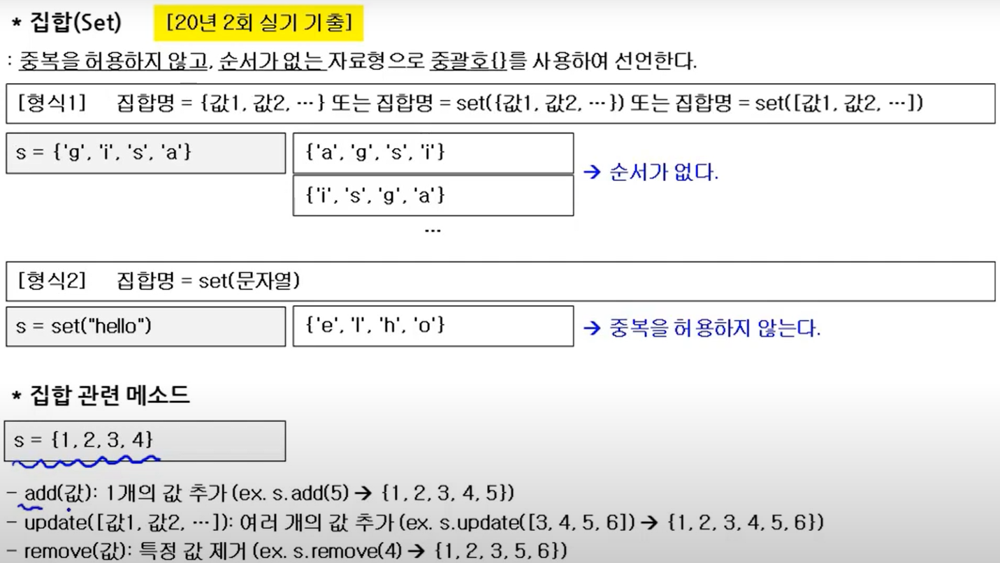

### 집합 활용

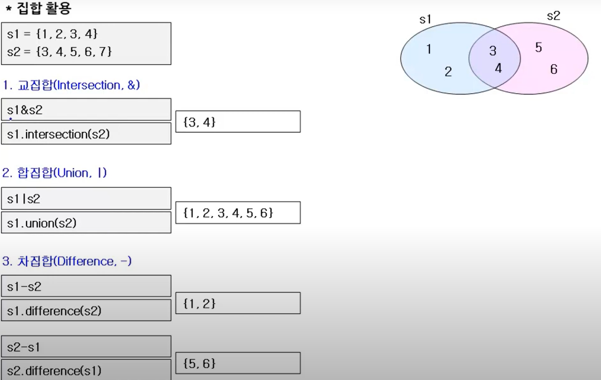
