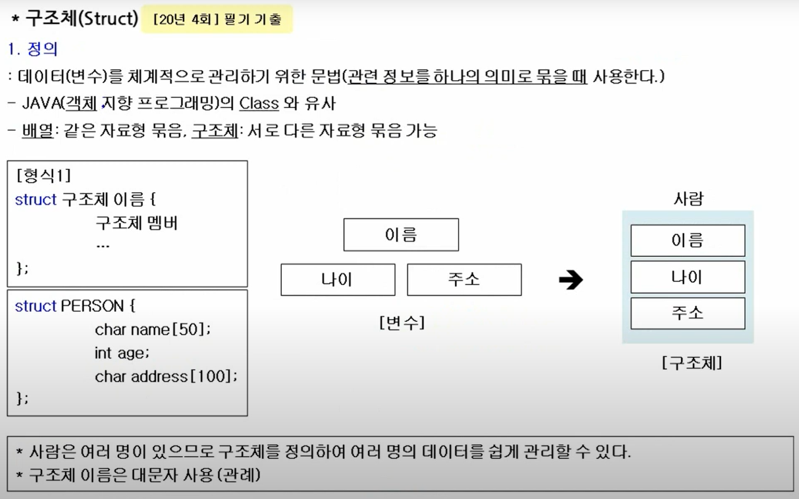
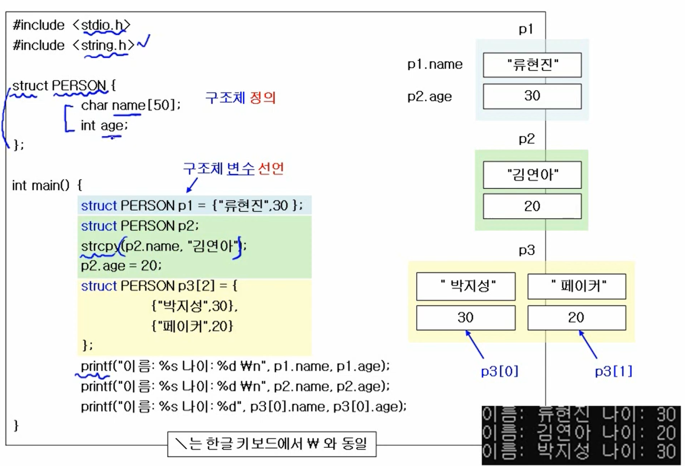
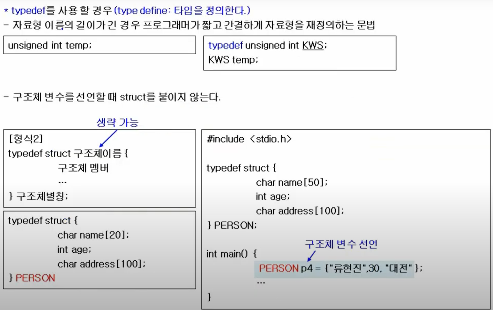

# C언어의 구조체

> 작성: 2022-01-26 · 태그: C, 정보처리기사 · [노션 원본](https://app.notion.com/p/02306131194f402eaf668e1d0e12e3d6)

- class와 유사하다
- struct 구조체 이름 \{필드...\} 식으로 사용한다.

- string.h는 strcpy(스트링카피)를 사용하기 위해 include 했다.
- struct PERSON p3\[2\] 이렇게 배열로 선언해서 사용할 수 있다.

### typedef

- 같은 구조체를 여러번 사용해야 할 때, 선언시에 struct를 생략할 수 있게 한다.
