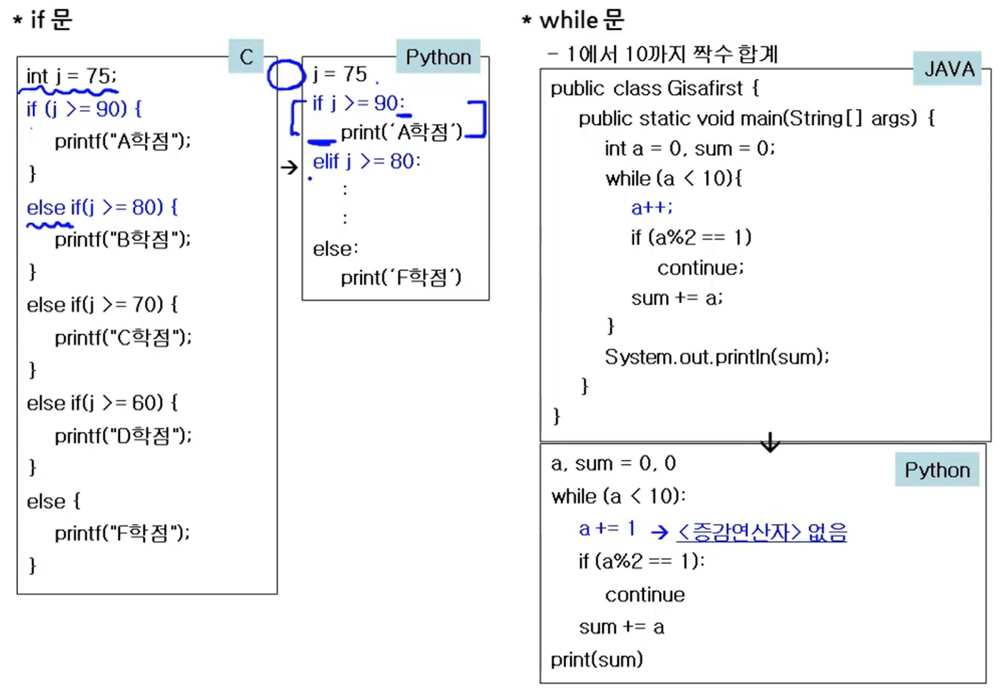
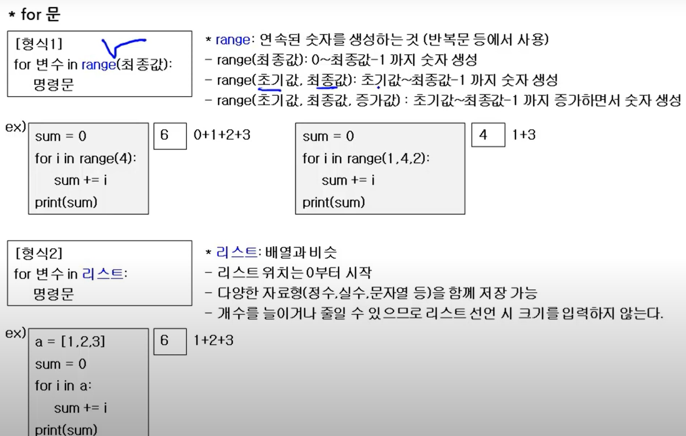

# 파이썬의 제어문

> 작성: 2022-01-26 · 태그: Python, 정보처리기사 · [노션 원본](https://app.notion.com/p/9e781826d4b240f093396c87390a8c4b)

## 조건, 반복문 JAVA랑 차이점

### IF문

- 콜론(:)과 들여쓰기를 통해 블록 구분이 가능하다.
- else if문을 elif로 사용한다.
- 변수의 자료형을 선언하지 않아도 된다.

### while문

- 콜론(:)과 들여쓰기를 통해 블록 구분이 가능하다.
- 파이썬에는 증감연산자가 없다.

### for문

- range는 반복할 연속된 숫자를 생성하는 것 ⇒ 몇번 반복할 지 정의
