# 1과목 : 소프트웨어 설계 CBT 오답정리

### 2021년 03월 7일 4번

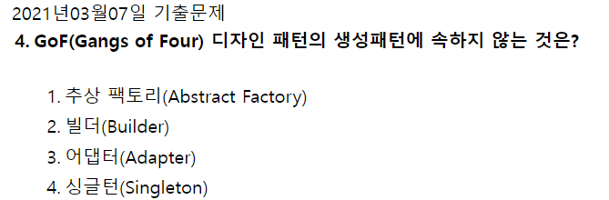

- 생성패턴
  - **추상 팩토리** 패턴 : 동일한 주제의 다른 팩토리를 묶어 준다.
  - **빌더 패턴** : 생성과 표기를 분리해 복잡한 객체를 생성
  - **싱글턴 패턴** : 한 클래스에 한 객체만 존재하도록 제한한다.
- 구조패턴
  - 어댑터 패턴 : 인터페이스가 호환되지 않는 클래스들을 함께 이용할 수 있도록, 타 클래스의 인터페이스를 기존 인터페이스에 덧씌운다.

### 2021년 8월 14일 9번

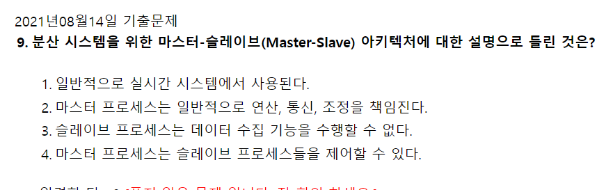

- 마스터-슬레이브 패턴 ( Master-Slave pattern)
  - 마스터 : 작업을 분리, 배포
  - 슬레이브 : 요청 작업 처리

  : 슬레이브는 마스터의 작업 요청을 처리하고, 처리된 결과를 되돌려준다.

  마스터는 슬레이브가 반환한 결과값으로부터 최종 결과값을 계산한다.

  

### 2021년 5월 15일 16번

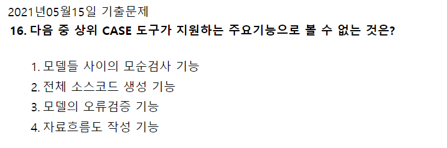

- CASE
  : 시스템 개발 과정의 일부 또는 전체를 자동화시킨 것

  - 소프트웨어 생명주기의 전체 단계를 연결해 주고 자동화해주는 통합된 도구를 제공
  - 소프트웨어, 하드웨어, 데이터베이스, 테스트 등을 통합하여 소프트웨어를 개발하는 환경을 제공
- 상위 CASE
  : 요구 분석과 설계 단계를 지원

  - 모델들 사이의 모순검사 기능
  - 모델의 오류 검증 기능
  - 자료흐름도 작성 기능
- 하위 CASE
  : 코드를 작성하고 테스트하며 문서화하는 과정 지원

  - 원시코드 생성 가능
- 통합 CASE
  : 소프트웨어 개발 주기 전체과정을 지원

### 2020년 09월 26일 17번

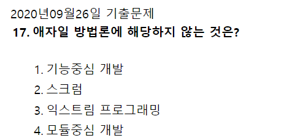

- 애자일 방법론의 종류
  - 익스트림 프로그래밍
  - 스크럼
  - 익스트림 모델링
  - 크리스털 패밀리
  - 기능 중심 개발(FDD, Feature-Driven Devleopment)

### 2021년 5월 15일 2번

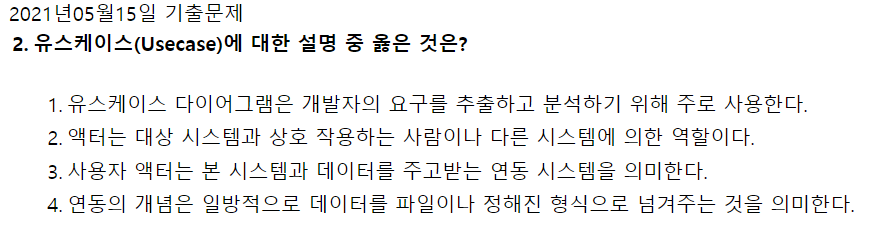

- **<ins>유스케이스</ins>** : 시스템이 액터에게 제공해야 하는 기능, 시스템의 요구사항이자 기능을 의미
- **<ins>유스케이스 다이어그램</ins>** : 사용자의 요구를 추출하고 분석하기 위해 주로 사용. 여기서 액터는 시스템 외부에서 시스템과 상호작용하는 사람 혹은 시스템을 말함
- **<ins>사용자 액터</ins>** : 기능을 요구하는 대상이나 시스템의 수행결과를 통보받는 사용자 혹은 기능을 사용하게 될 대상으로 시스템이 제공해야하는 기능인 유스케이스의 권한을 가지는 대상, 역할
- **<ins>시스템 액터</ins>** : 사용자 액터가 사용한 유스케이스를 처리해주는 외부 시스템, 시스템 기능 수행을 위해서 연동이 되는 또 다른 시스템 액터를 의미

### 2021년 3월 7일 12번

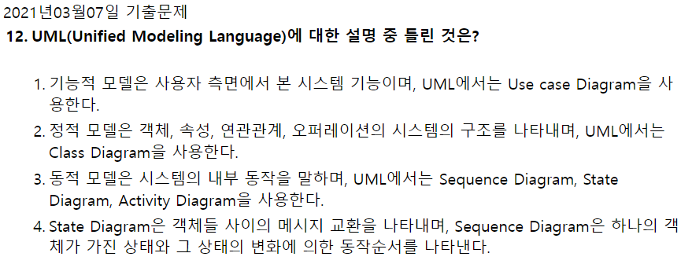

- State Diagram : 객체가 가진 상태와 상태 변환을 나타냄
- Sequence Diagram : 객체 사이에 오가는 메시지를 시간순으로 나타냄

### 2021년 5월 15일 13번

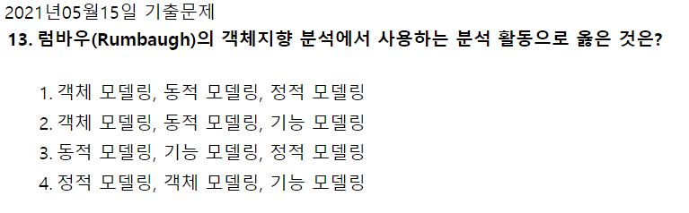

- **<ins>럼바우</ins>** : 객체 모델링, 동적모델링, 기능 모델링  ⇒ ‘**<ins>객동기</ins>**’
  - 동적 모델링 - 상태도,  기능 모델링- 자료 흐름도 ⇒’**<ins>동상기자</ins>**’ 로 암기

  

### 2020년 8월 22일 1번

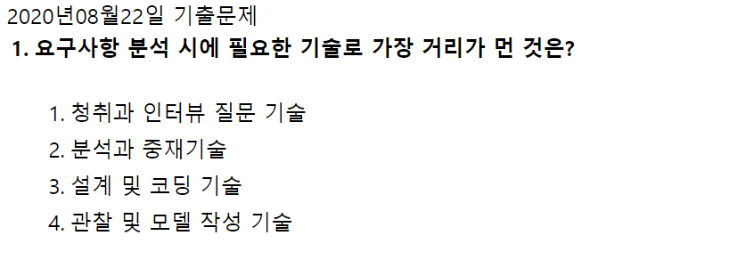

- 요구사항 개발 프로세스 :  도출 → 분석 → 명세 → 확인
  - 요구사항 도출 단계 주요 기법 : 인터뷰, 설문, 브레인스토밍등
  - 요구사항 분석 단계 주요 기법 : 개념 모델링(관찰 및 모델 작성 기술 필요)

  답 : **<ins>3번</ins>**

  

### 2021년 5월 15일 8번

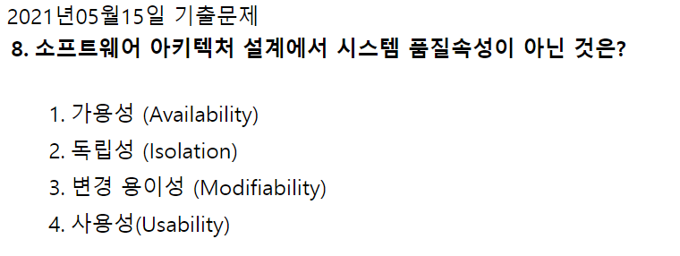

- **<ins>시스템 품질 속성 </ins>**
  - 가용성
  - 변경용이성
  - 성능
  - 보안성
  - 사용편의성
  - 시험용의성

### 2020년 6월 6일 9번

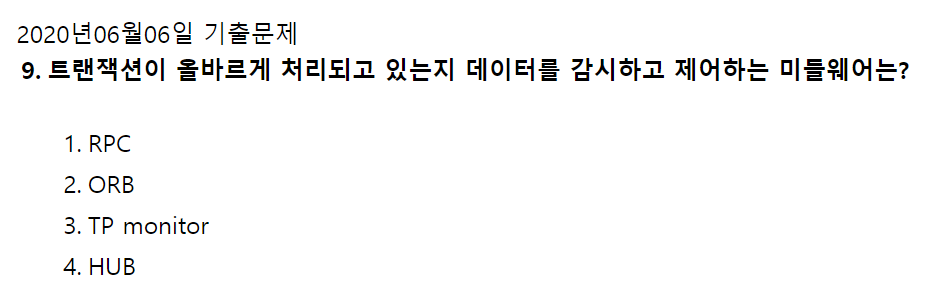

- RPC : remote procedure call,  원격 절차 호출 또는 원격 프로시저 호출
- ORB : object request broker, 객체 간 메시지 전달을 지원하는 미들웨어
- **<ins>TP monitor</ins>** : 트랜잭션 처리를 감시/제어하는 미들웨어

### 시스템 구성요소

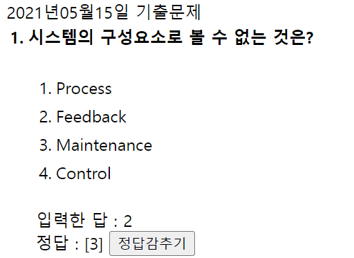

**<ins>시스템 구성요소</ins>**

- 입력 (Input) : 처리 방법, 처리할 데이터, 조건을 시스템에 투입하는 것
- 처리 (Process) : 입력된 데이터를 처리 방법과 조건에 따라 처리하는 것
- 출력 (Output) : 처리된 결과를 시스템에서 산출하는 것
- 제어 (Control) : 자료를 입력하여 출력될 때까지의 처리 과정이 올바르게 진행되는지 감독하는 것
- 피드백 (Feedback) : 출력된 결과가 예정된 목표를 만족시키지 못할 경우 목표 달성을 위해 반복 처리하는 것

Maintenance는 **유지보수**로서, 시스템 구성요소에는 포함되지 않음.

### 2020년 8월 22일 기출 13번

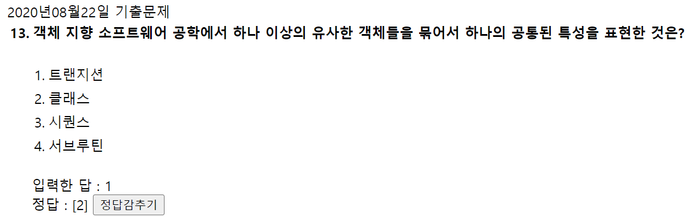

클래스는 공통된 속성과 연산(행위)를 갖는 객체의 집합, 객체의 일반적인 타입을 의미한다.

### 2020년 9월 26일 기출

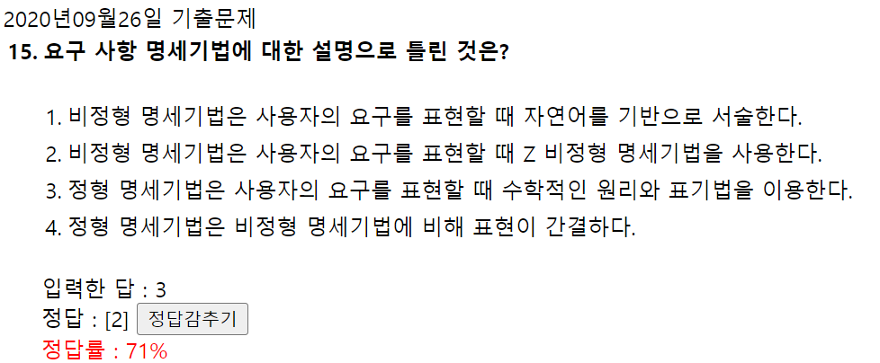

정형 명세법

- 수학적 기반/모델링 기반
- Z, VDM, Petri-Net(모형기반)
- CSP, CCS, LOTOS(대수적 방법)
- 시스템 요구특성이 정확하고 명세가 간결하다.
- 이해도가 낮으며 이해관계자의 작성 부담 가중

비정형 명세법

- 상태, 기능, 객체 중심 명세법
- FSM(Finite state machine)
- Decision Table, ER모델링
- State chart(SADT)
- UseCase : 사용자 기반 모델링
- 명세 작성이 간편하고 의사전달 방법이 다양하다.
- 불충분한 명세가능성, 모호성

### UML 다이어그램 종류

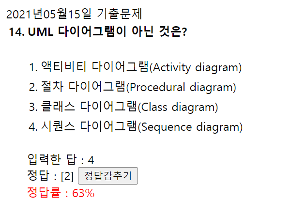

- 액티비티 다이어그램 : 업무의 흐름을 모델링하거나 객체의 생명 주기를 표현한다.
- 시퀀스 다이어그램 : 객체간의 메세지 전달을 시간의 흐름에서 분석한다.
- Deployment 다이어그램 : 기업 환경의 구성과 컴포넌트들 간의 관계를 그린 다이어그램
- Collaboration 다이어그램 : 객체와 객체가 주고받는 메시지 중심의 작성 동적 다이어그램
- Component 다이어그램 : 소프트웨어 구조가 그린다.
- 클래스 다이어그램 : 시스템의 구조적인 모습
