# 2과목 : 소프트웨어 개발 CBT 오답 정리

### 2021년 3월 7일 24번

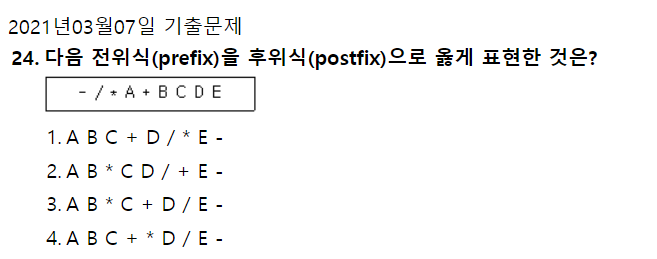

**전위 표기법(prefix)-연산자가 앞에**

중위 표기법(infix)-연산자가 안에

후위 표기법(postfix)-연산자가 뒤에

1.연산자에 따라 묶는다 (-(/(\*A(+BC))D)E)

2.연산자를 각 괄호 뒤로 뺀다(후위식) (((A(BC)+)\*D)/E)-

3.괄호를 제거한다. ABC+\*D/E-

### 2020년 9월 26일 23번

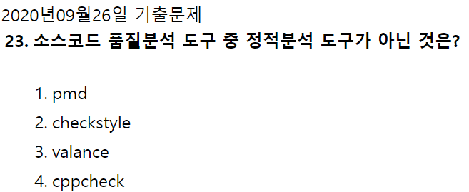

- 정적 분석 도구
  - pmd : 코드 결함 분석
  - checkstyle : java코드 표준 준수 검사
  - cppcheck : c/c++ 오버플로우 검사
  - ccm : 다양한 언어의 코드 복잡도를 분석
  - SonarQube : 중복 코드 복잡도 코딩 설계 등을 분석하는 소스 분석 통합 플랫폼
  - cobertura : 자바 언어의 소스코드 복잡도 분석 및 테스트 커버리지 측정
- 동적 분석 도구
  - valance
  - Avalanche : Valgrind 프레임워크 및 STP기반 / 프로그램 결함 및 취약점 분석
  - valgrind : 프로그램 내에 존재하는 메모리 및 쓰레드 결함 분석

  

### 2021년 8월 14일 25번

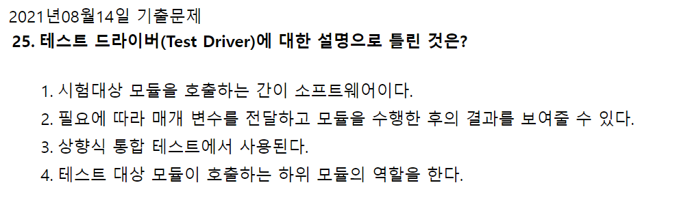

- <ins>테스트 드라이버</ins>
  - 테스트 대상 하위 모듈을 호출하고, 파라미터 전달, 모듈 테스트 수행 후의 결과 도출
  - **상향식 테스트**에 사용됨
- <ins>테스트 스텁</ins>
  - 제어 모듈이 호출하는 타 모듈의 기능을 단순히 수행하는 도구
  - **하향식 테스트**에 사용됨

  

  

### 2020년 8월 22일 40번

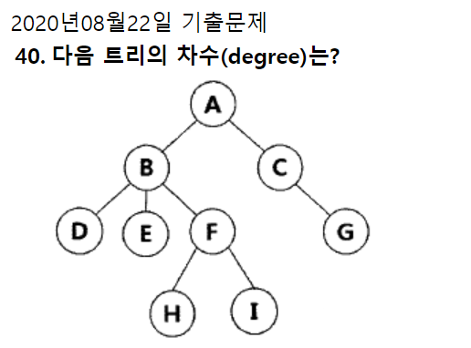

- 트리의 차수 : 전체 트리중에서 가장 많은 차수, 최상단은 루트로 차수로 포함되지 않는다.
  - 즉, B가 세개의 최대차수를 가지고 있으므로 3개다.

  

### 2020년 8월 22일

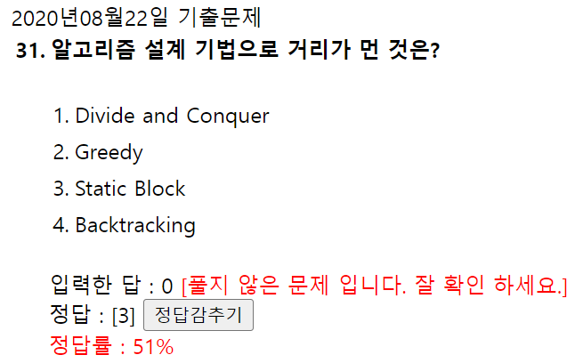

- Divide and Conquer(분할 정복 알고리즘) : 그대로 해결할 수 없는 문제를 작은 문제로 분할하여 해결하는 알고리즘
- Greedy(탐욕 알고리즘) : 현재 시점에서 가장 최적의 방법을 선택하는 알고리즘
- Backtracking : 해를 찾는 도중 해가 아니어서 막히면, 되돌아가서 다시 해를 찾아가는 기법

### 2020년 6월 6일 기출

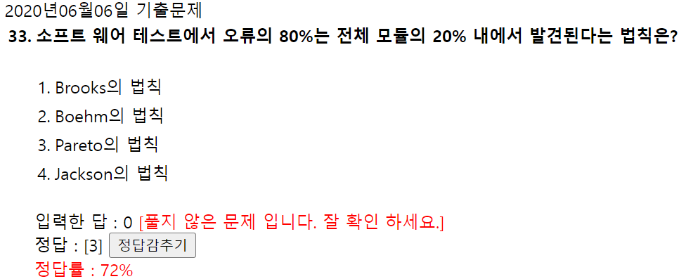

- 파레토(Pareto)의 법칙 : 오류의 80%는 전체의 20%내에서 발견된다는 법칙
- 브룩스(Brooks)의 법칙 : 지연되는 프로젝트에 인력을 더 투입하면 오히려 더 늦어진다.
- 살충제 페러독스 : 동일 테스트 케이스로 동일 테스트 반복 시 더 이상 결함이 발견되지 않는 현상
- 오류 - 부재의 궤변 : 결함을 모두 제거해도 사용자 요구사항을 만족시키지 못하면 해당 소프트웨어는 품질이 높다고 말할 수 없다.

### 2020년 8월 22일 기출

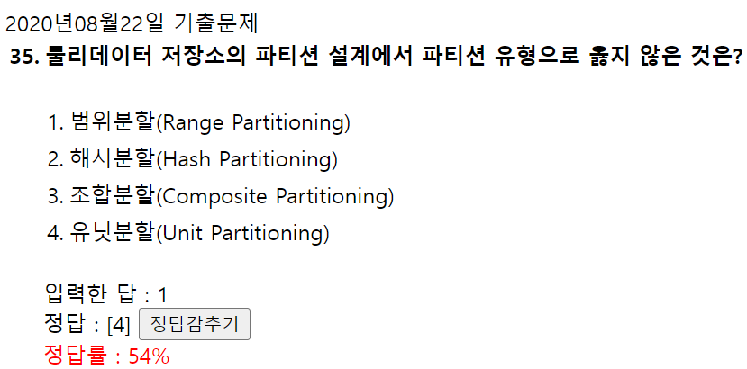

물리 데이터 저장소의 파티션 유형

- 범위분할
- 해시분할
- 조합분할

→**<ins>범해조</ins>**

### 2021년 8월 14일 기출

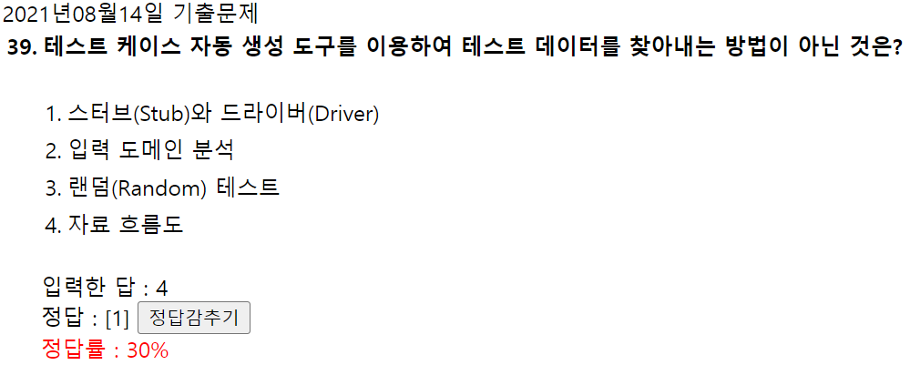

- **<ins>테스트 수행 도구</ins>**
  - 자료 흐름도
  - 기능 테스트
  - 입력 도메인 분석
  - 랜덤 테스트

  → **<ins>자기입덤</ins>**

스터브와 드라이버는 통합식 테스트 시 사용되는 것

**스터브는 하향식, 드라이버는 상향식**

### 2020년 9월 26일 기출

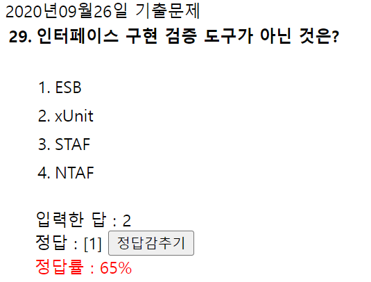

인터페이스 구현 검증 도구

- xUnit
- STAF
- NTAF
- FitNesse
- Selerium
- Watir

### 2020년 9월 26일 기출

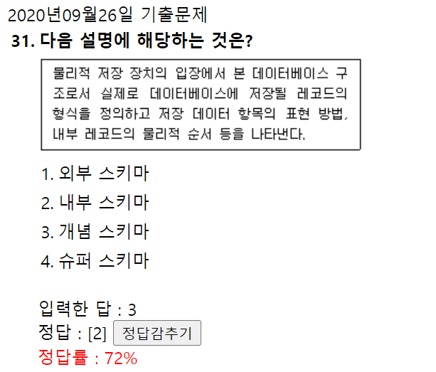

- **외부 스키마** : 개인 또는 응용 개발자 입장에서 보는 데이터베이스
- **개념 스키마** : 모든 응용 프로그램 또는 사용자들이 필요로 하는 조직 전체 데이터베이스로 단 하나만 존재한다.

### 퀵정렬

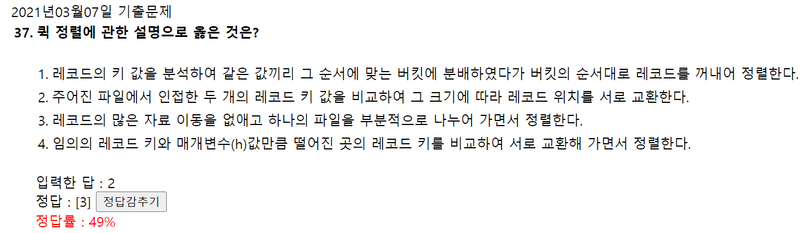

- **<ins>퀵정렬</ins>** : 레코드의 많은 자료 이동을 없애고 하나의 파일을 부분적으로 나누어 가면서 정렬하는 방식

### 반정규화 유형중 중복테이블을 추가하는 방법

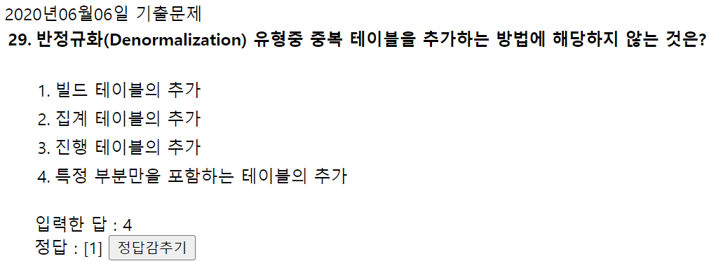

- **반 정규화 유형 중 중복테이블 추가 방법**
  - 진행 테이블 추가
  - 집계 테이블 추가
  - 특정 부분만을 포함하는 테이블의 추가
