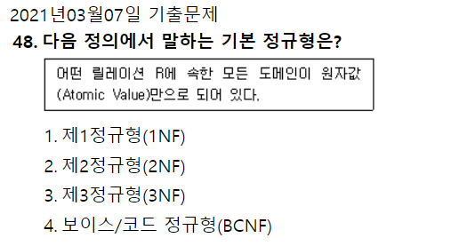
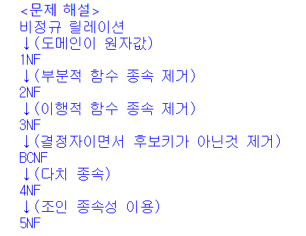
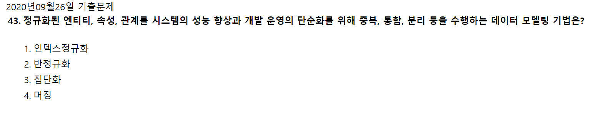
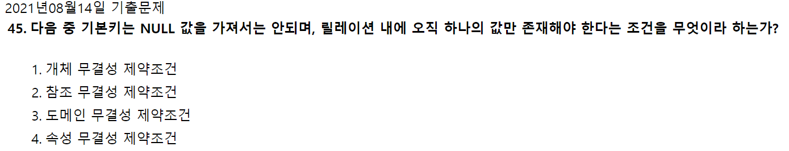
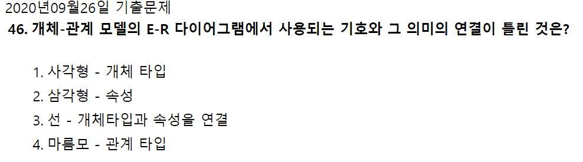
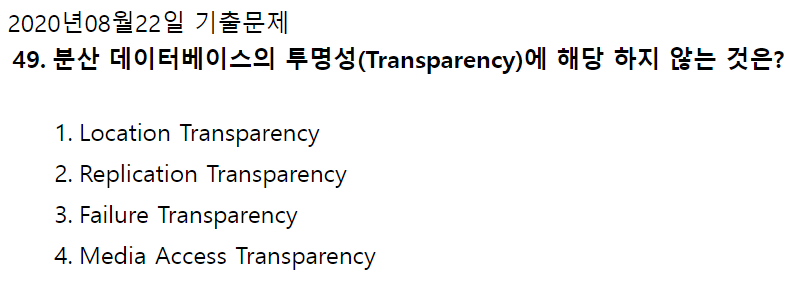
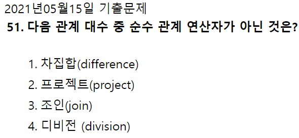
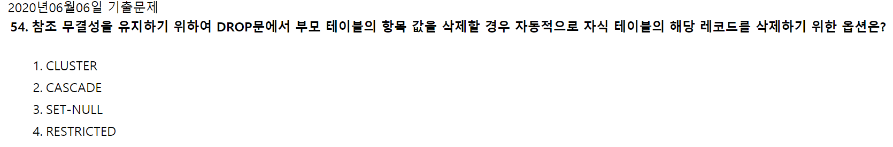
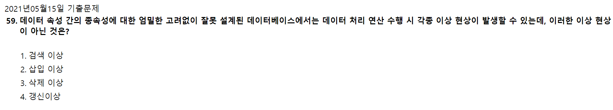

# "3과목 : 데이터베이스 구축 CBT 오답 정리"

> 작성: 2022-01-27 · 태그: 데이터베이스 구축, 정보처리기사 · [노션 원본](https://app.notion.com/p/fc52e84ec37b4a70bf2cbd5d2ca082f2)

### 2021년 3월 7일 48번

- **<ins>기본 정규형</ins>**
  : 도부이결다조 ⇒ **<ins>두부이걸다줘?</ins>** 로 외울것

  

  - 제 1 정규형  : 반복그룹을 제거
  - 제 2 정규형  : 부분 함수적 종속 제거
  - 제 4 정규형  : 다치종속 제거
  - 보이스/코드 : 모든 결정자가 후보키인 상태

  

### 2020년 9월 26일 43번

- 인덱스 정규화 : 인덱스는 키 값으로 행 데이터의 위치를 식별하는데 사용하는 기능
- 반정규화 : 정규화된 엔티티, 속성, 관계를 시스템의 성능 향상과 개발 운영의 단순화를 위해 중복, 통합, 분리 등을 수행하는 데이터 모델링 기법
- 집단화 : 속성들의 세트로 구성되는 새로운 속성을 정의하는데 사용되는 개념
- 머징 : 둘 이상의 데이터 세트를 단일 데이터 세트로 결합 또는 공통된 컬럼명 또는 행 이름에 따라 데이터 프레임을 병합

### 2021년 8월 14일 45번

- 개체 무결성 : 기본키는 NULL이 될 수 없음
- 참조 무결성 : 외래키는 참조할 수 없는 값을 가질 수 없음
- 도메인 무결성 : 특정 속성값은 그 속성이 정의된 도메인에 속한 값이어야 함
  - 도메인 : 속성이 가질 수 있는 값
    - 예) 성별에서 가질 수 있는 도메인은 남성/여성이다.

  

### 2020년 9월 26일 46번

- E-R 다이어그램
  - 역삼각형으로 주로 사용되며 ISA 관계(상하관계)를 표현한다.
  - 관계 실선으로 연결하여 표현한다.
  - 상위 개체 타입 : 슈퍼 클래스, 역삼각형의 위에 위치
  - 하위 개체 타입 : 서브 클래스, 역삼각형 아래에 위치
  - 속성  - 타원형

  

### 2020년 8월 22일 49번

- **<ins>분산 데이터베이스란?</ins>**
  : 여러 곳으로 분산되어있는 데이터베이스를 하나의 가상 시스템으로 사용할 수 있도록 한 데이터베이스.

  논리적으로 동일한 시스템에 속하나, 네트워크를 통해 물리적으로 분산되어 있는 데이터의 모임

  

  분산 데이터베이스가 되기 위해선 **6가지 투명성**을 만족해야 한다.

  - 분할 투명성 : 하나의 논리적 Relation이 여러 단편으로 분할되어 각 단편의 사본이 여러 사이트에 저장
  - 위치 투명성 : 사용하려는 데이터의 저장장소를 명시가 필요하지 않음. 위치정보는 System Caltalog에 유지어야 함
  - 지역사상 투명성 : 지역 DBMS와 물리적 DB 사이의 Mapping 보장. 각 지역시스템 이름과 무관한 이름 사용가능
  - 중복 투명성 : DB 객체가 여러 사이트에 중복되어 있는지 알 필요가 없는 성질
  - 장애 투명성 : 구성요소(DBMS, Computer)의 장애에 무관한 트랜잭션의 원자성유지
  - 병행 투명성 : 다수 트랜잭션 동시수행시 결과의 일관성 유지, Time Stamp, 분산 2단계 Locking을 이용하여 구현

  

  **<ins>분산데이터베이스의 목표</ins>**

  - 위치투명성(Location Trasparency) 데이터 베이스의 실제 위치를 알 필요 없이 단지 데이터베이스의 논리적인 명칭만으로 엑세스할 수 있음
  - 중복투명성(Replication Transparency) 데이터가 여러 곳에 중복되어 있더라도 사용자는 마치 하나의 데이터만 존재하는 것 처럼 사용 가능, 시스템은 자동으로 여러 자료에 대한 작업 수행
  - 병행투명성(Concurrency Transparency) 다수의 트랜잭션이 동시에 실현되더라도 그 결과는 영향을 받지 않음
  - 장애투명성(Failure Transparency) 트랜잭션, DBMS, 네트워크, 컴퓨터 장애에도 트랜잭션을 정확히 처리함.

  

### 2021년 5월 15일 51번

- **<ins>순수 관계 연산자</ins>**
  - SELECT (σ) : 수평단절, 행을 다 가져옴
  - PROJECT (π) : 수직단절, 열을 다 가져옴
  - JOIN (▷◁) : 공통 속성을 이용해 두개의 릴레이션 튜플을 연결 → 만들어진 튜플을 반환
  - DIVISION (÷) : 릴S의 모든 튜플과 관련있는 릴R의 튜플 반환

차집합은 집합 연산자에 속함(INTERSECTION, UNION, DIFFERENCE, CATESIAN PRODUCT)

### 2020년 6월 6일 54번

- DDL
  - PRIMARY KEY : 기본키 정의
  - FOREIGN KEY : 외래키 정의
  - UNIQUE : 지정 속성은 중복값 가질 수 없음
  - NO ACTION : 변화가 있어도 조취를 취하지 않음
  - CASCADE : 참조 테이블 튜플 삭제 시 관련 튜플 모두 삭제 및 속성 변경 시 속성값 모두 변경
  - RESTRICTED : 타 개체가 제거할 요소를 참조중이면 제거를 취소
  - SET NULL : 참조 테이블 변화 시 기본 테이블 관련 속성값 NULL로 변경
  - SET DEFAULT : 참조 테이블 변화 시 기본 테이블의 관련 튜플 속성값을 기본값으로 변경
  - CONSTRAINT : 제약 조건 이름 지정
  - CHECK : 속성값에 대한 제약 조건 정의

  

### 2021년 5월 15일 59번

- 갱신 이상 : 반복된 데이터 중에 일부를 갱신 할 시 데이터의 불일치 발생
- 삽입 이상 : 불필요한 정보를 함꼐 저장하지 않고서는 어떤 정보를 저장하는 것이 불가능하다.
- 삭제 이상 : 필요한 정보를 함께 삭제하지 않고서는 어떤 정보를 삭제하는 것이 불가능하다.
