# 4과목 : 프로그래밍 언어 활용 CBT 오답 정리

### 2020.09.26 기출 78번

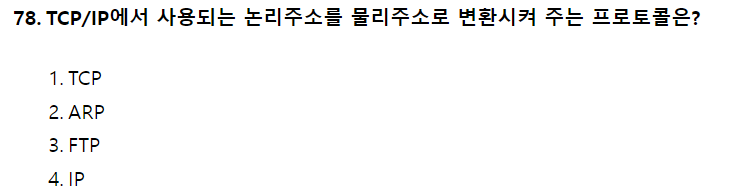

- 인터넷 계층의 프로토콜

  - IP : 데이터 주소를 지정하고 경로 설정
  - ICMP : IP와 조합하여 통신 중의 오류처리와 전송 경로 변경등을 위한 제어 메세지 관리
  - IGMP : 멀티캐스트를 지원하는 호스트나 라우터 사이에서 그룹유지를 위해 사용
  - ARP : 호스트의 IP주소를 네트워크 접속 장치의 **<ins>물리적 주소</ins>**로 변환
  - RARP : ARP 반대 → 물리적 주소를 **IP주소로 변환**
- TCP는 전송계층 프로토콜
- FTP는 응용계층 프로토콜

### 2020.09.26 기출 76번

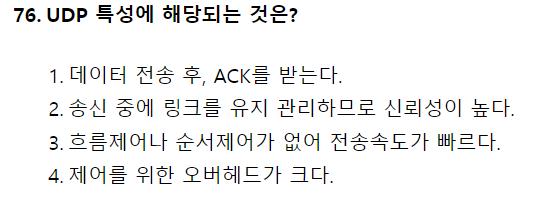

- UDP (User Datagram Protocol) - TCP/IP의 전송계층 프로토콜
  - 비연결성 서비스 제공
  - 단순한 헤더구조로 오버헤드 적음
  - 실시간 전송에 유리하다.   ⇒ 신뢰성보다는 **속도가 중요한 네트워크**에 사용된다.
  - 사용하는 예
    - 빠른 속도로 전송을 요구할 때
    - 동시에 여러 사용자에게 데이터 전달시
    - 반복적인 전송을 할 때

### 2021년 8월 14일 62번

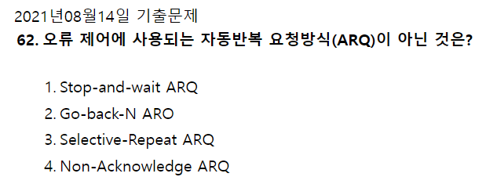

- 자동반복 요청방식(ARQ : Automatic Repeat reQuest)
  - **<ins>Stop-and-Wait</ins>** : 송신 측이 하나의 블록을 전송한 후 수신 측에서 에러의 발생을 점검한 다음, 에러 발생 유무 신호를 보내올 때까지 기다리는 방식
  - **<ins>Go-Back-N</ins>** : 여러 블록을 연속적으로 전송하고, 수신 측에서 부정 응답을 보내오면 송신 측이 오류가 발생한 블록부터 모두 재전송
  - **<ins>Selective-Reapeat(선택적 재전송)</ins>**
  - **<ins>Apaptive(적응적)</ins>** : 전송 효율을 최대로 하기 위해서 데이터 블록의 길이를 채널의 상태에 따라 동적으로 변경하는 방식

  

### 2021년 5월 15일 75번

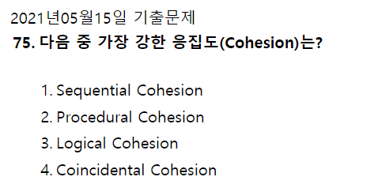

- 응집도 : 모듈내부의 기능적인 응집정도를 나타냄
  - **<ins>응집도의 순서</ins>**
    - 우연적(Coincidental) \< 논리적(Logical) \< 시간적(Temporal) \< 절차적(Procedural) \< 교환적(Communication) \< 순차적(Sequential) \< 기능적(Functional) ⇒ **<ins>우논시절교순기</ins>**

  

### 2021년 8월 14일 76번

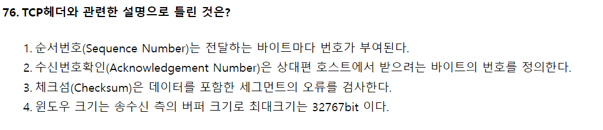

- TCP 헤더에 있는 Window size는 16비트로 2\^16 = 65535byte =64KB이다.
- 순서번호는 전달하는 바이트마다 번호가 부여된다.
- 수신번호확인은 상대편 호스트에서 받으려는 바이트의 번호를 정의한다.
- 체크섬은 데이터를 포함한 세그먼트의 오류를 검사한다.

### 2021년 5월 15일 77번

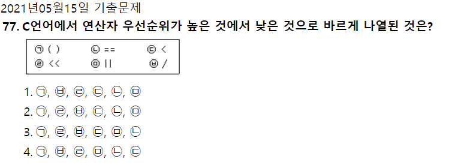

- 연산자의 우선순위
  - **<ins>우선순위 높음</ins>** 증감 연산자( ++ -- )  → 산술 연산자( \* / % )  → 산술 연산자( + - )  → 시프트 연산자( \<\< >> )  → 관계 연산자(=\< => \< > )  → 관계 연산자( == != )  → 비트 연산자( & \^ \| )  → 논리 연산자( && \|\|)  → 조건연산자(?:)  → 대입연산자(= += \*= /= %= \<\<= >>=)  → 순서 연산자( , )     **<ins>우선순위 낮음</ins>**

### 2021년 5월 15일 66번

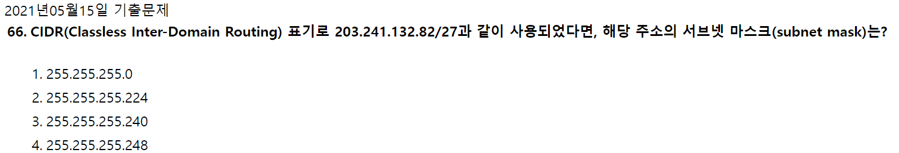

Ipv4는 32bit로 이루어져 있습니다

**ip주소/서브넷마스크**로 표기합니다

⇒82/27 이니까 1은 27개

서브넷마스크숫자대로 앞에서부터 1을채워서 8개씩 끊어 계산하시면됩니다(2진수)

1의 개수가 27개

11111111 11111111 11111111 11100000

8                8              8               3

11100000 은 128 + 64 + 32 = 224

### 2021년 8월 14일 71번

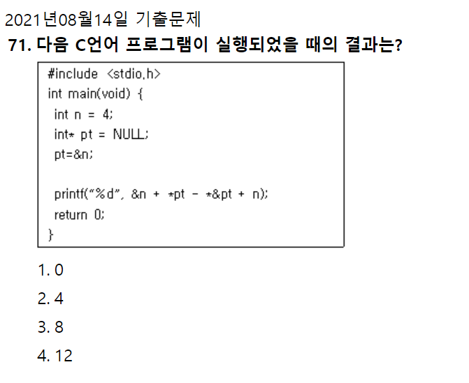

&n= 변수 n의 주소값 \*pt= 포인터 pt가 가리키고 있는 주소에 저장된 값 = 변수 n \*&pt = \*(포인터 pt의 주소값)= 포인터 pt의 주소가 가리키고 있는 주소에 저장된 값 = 변수 n의 주소

즉, &n + \*pt - \*&pt + n = \*pt + n = 4 + 4 = 8

### 2020년 6월 6일 73번

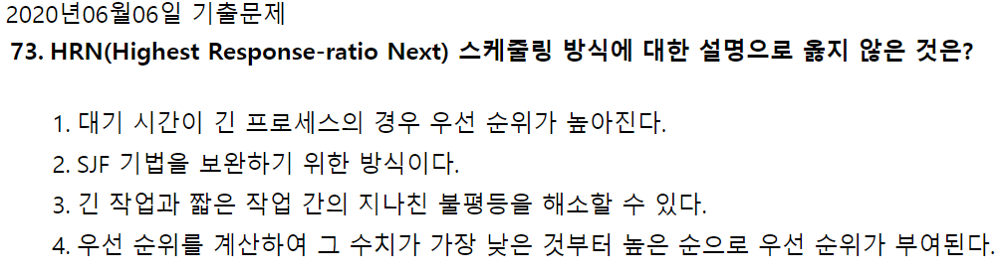

- HRN 스케줄링 방식
  - 비선점 스케줄링
    - 실행시간이 긴 프로세스에 불리한 SJF을 보완하기 위해 대기시간 및 서비스 시간을 이용 우선순위를 계산 숫자가 높은것부터 낮은순으로 순위 부여 대기시간 + 서비스시간 / 서비스시간 = 우선순위값

### 2020년 6월 6일 74번

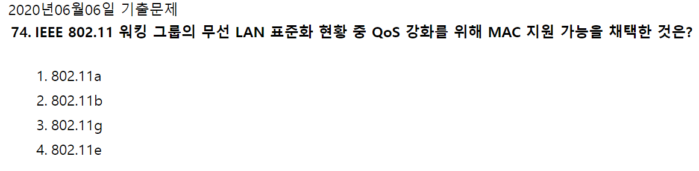

IEEE 802.11 - 워킹 그룹 무선 LAN 표준화. 2.4GHz. CSMA/CA

IEEE 802.11a - 5GHz 대역의 전파를 사용하는 규격으로, OFDM 기술을 사용해 최고 54Mbps까지의 전송 속도를 지원

IEEE 802.11b - Wi-Fi. 11의 스루풋 확장. 11mbps

IEEE 802.11d - 지역 간 로밍용 확장 기술

**IEEE 802.11e - QoS. MAC구현 수정. Voice over WLAN, 스트리밍을 위한 기술.**

IEEE 802.11f - 인터 엑세스 포인트 프로토콜

IEEE 802.11g - 11b의 스루풋 확장. 54mbps

IEEE 802.11h - DFS, TPC. 5GHz 타장비(레이다) 간섭 해결.

IEEE 802.11i - WPA2

IEEE 802.11j - 일본용 전송 방식

IEEE 802.11k - 전파 자원 측정 확장 기술

IEEE 802.11n - 40MHz대역"폭". g의 스루풋 확장. 600mbps.

IEEE 802.11p - 빠르게 움직이는 운송 수단을 위한 무선 접속 기술

IEEE 802.11r - 빠른 로밍

IEEE 802.11s - ESS 메쉬 네트워킹

IEEE 802.11t - 무선 성능 예측 (WPP)

IEEE 802.11u - 802.11 기반이 아닌 네트워크와의 상호 연동

IEEE 802.11v - 무선 네트워크 관리

IEEE 802.11w - 보호된 관리 프레임

### 2020년 6월 6일 76번

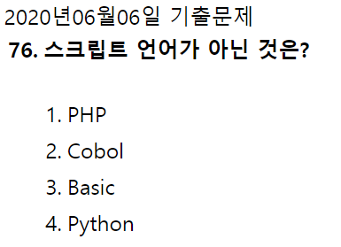

스크립트 언어는 크게 두가지로 분류 됩니다.

1. 서버 스크립트 언어
2. 클라이언트 스크립트 언어

스크립트 언어의 종류

- javascript
- ASP
- JSP
- PHP
- Python
- basic

### 2020년 6월 6일 기출

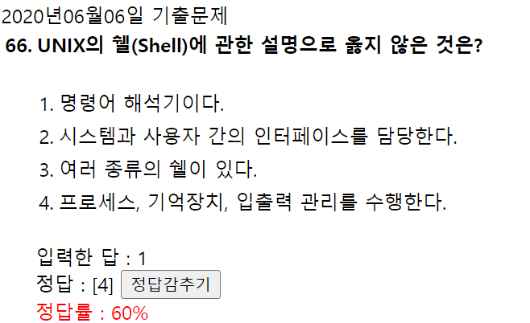

- 쉘(Shell) : 사용자의 명령어를 인식하여 프로그램을 호출하고 명령을 수행하는 **명령어 해석기**이다. 주기억장치에 상주하지 않고 명령어가 포함된 파일 형태로 존재하며 보조 기억 장치에서 교체 처리가 가능하다. 공용 Shell이나 사용자 자신이 만든 Shell을 사용할 수 있다.
- 커널(Kernel) : UNIX의 가장 핵심적인 부분. 컴퓨터 부팅시 주기억장치에 적재된 후 상주하며 실행된다. 하드웨어를 보호하고 프로그램과 하드웨어 간의 인터페이스 역할을 한다.
