# "5과목 : 정보시스템 구축관리 CBT 오답 정리"

> 작성: 2022-01-27 · 태그: 정보시스템 구축관리, 정보처리기사 · [노션 원본](https://app.notion.com/p/ffc4235b65284dfe96b20c8dceb420ab)

### 2020년 09월 26일 81번

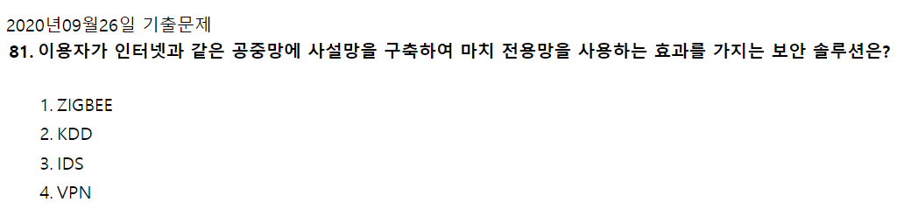

- VPN : 가상 사설 통신망 (네트워크 암호화)

### 2021년 03월 07일 82번

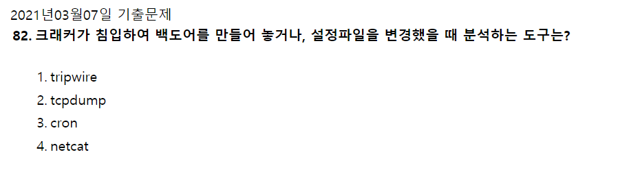

- **<ins>tripwire</ins>** : 자신의 리눅스 시스템을 외부의 크래커 공격과 내부의 악의적인 사용자의 공격으로부터 **시스템을 지켜내는 마지노선**과 같은 역할을 하는 프로그램  
- **<ins>tcpdump</ins>** : 컴퓨터에 부착된 **네트워크를 통해 송/수신되는 기타 패킷을 가로채고 표시할 수 있**게 도와주는 소프트웨어
- **<ins>cron</ins>** : 스케쥴러를 실행시키기 위해 작업이 실행되는 시간 및 주기 등을 설정하게 되는데 ()표현식을 통해 배치 수행시간을 설정
- **<ins>netcat</ins>** : TCP 또는 UDP를 사용하여 **네트워크 연결을 읽고 쓰는 데 사용**되는 컴퓨터 네트워킹 유틸리티

### 2021년 03월 07일 84번

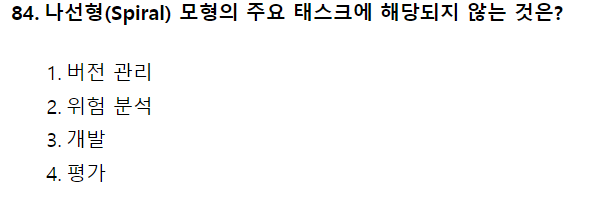

- 나선형 모형 : 계획 및 정의 → 위험 분석 → 공학적 개발 → 고객평가

### 2021년 03월 07일 85번

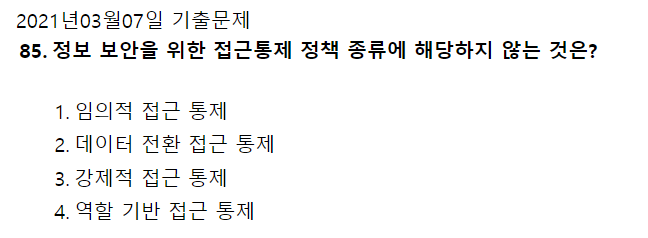

**정보보안을 위한 접근통제 정책 종류**

1\. 임의적 접근통제정책(DAC : Discretionary Access Control)

2\. 강제적 접근통제정책(MAC : Mandatory Access Control)

3\. 역할기반 접근통제정책(RBAC : Role-based Access Control)

### 2020년 09월 26일 87번

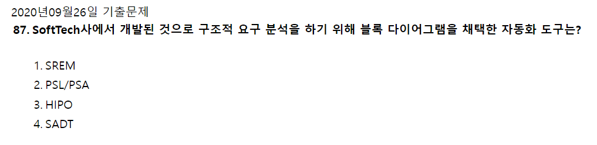

- SREM( Software Requirements Enginering Methdology) : **실시간 처리 소프트웨어 시스템에서 요구사항을 명확히 기술하도록 할 목적으로 개발한**,  RSL과 REVS를 사용하는 자동화 도구
- PSL/PSA : PSL과 PSA를 사용하는 자동화 도구
- HIPO(Hieracgy Input Process Output) : **하향식 소프트웨어 개발을 위한 문서화 도구**
- SADT( Structure Analysis and Design Technique ) : **구조적 요구 분석을 위해 블록 다이어그램을** **채택**한 자동화 도구

### 2020년 09월 26일 89번

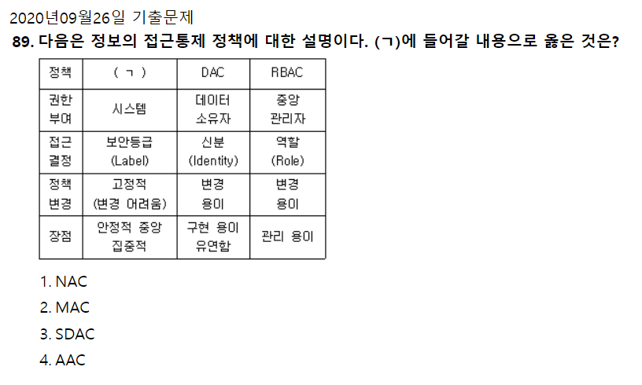

- DAC, RBAC 모두 접근 통제 기술이다
- 그러므로 나머지 하나는 MAC : 강제 접근 통제
  - 주체와 객체의 등급을 비교하여 권한 부여

  

### 2021년 03월 7일 95번

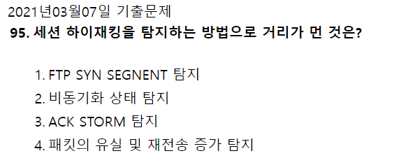

- 세션 하이재킹 탐지 방법
  - 비동기화 탐지 : 서버와 시퀀스 넘버를 주기적으로 탐지, 비동기 상태 탐지
  - Ack Storm 탐지 : 급격한 ACK 비율 증가시 탐지
  - 패킷의 유실 및 재전송 증가 탐지 : 공격자가 중간에 끼어서 작동하므로 패킷의 유실과 서버와의 응답이 길어짐

  

### 2020년 09월 26일 97번

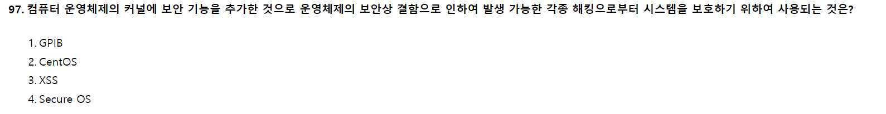

- GPIB : 단거리 디지털 통신 버스
- CentOS : 컴퓨터 운영 체제
- XSS : 웹 클라이언트가 제공하는 HTTP 쿼리 매개 변수에서 적절하지 않고, 구문 분석 및 해당 사용자에 대한 결과의 페이지를 표시하는 공격 기법

### 2020년 09월 26일 98번

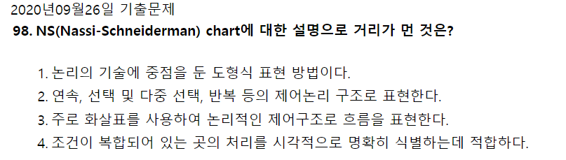

- NS (Nassi-Schneiderman) chart

  - 논리의 기술에 중점을 둔 도형을 이용한 표현 방법
  - 그리기가 어렵다
  - 순차, 선택, 반복으로 표현
  - 임의의 제어 이동이 어렵다
  - goto 구조가 어렵다.
  - 그래픽 설계 도구이다.
  - 상자 도표라고도 한다.
  - 프로그램으로 구현이 쉽다.
  - 조건이 복합되어 있는 곳의 처리를 명확히 식별하기에 적합하다.

### 20201년 8월 14일 81번

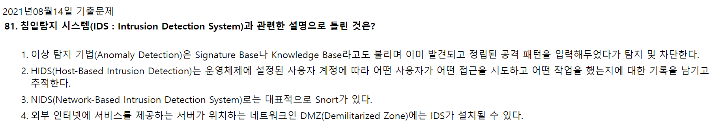

- **<ins>HIDS</ins>**  : 내부 시스템의 변화를 실시간으로 감시하여 누가 접근해서 어떤 작업을 수행했는지 기록하고 추적한다.

### 2020년 8월 22일 82번

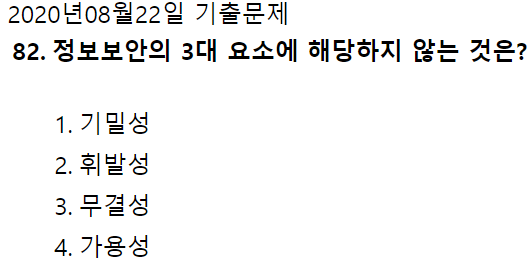

- 정보보안 3대 요소

  - 기밀성 : 허락된 사용자에 의해서만 접근 가능하도록 하는 것
  - 무결성 : 허락된 사용자에 의해서만 변경, 수정이 가능하도록 하는 것
  - 가용성 : 허락된 사용자가 필요로 하는 시점에 접근이 가능하도록 하는 것

### 2021년 5월 15일 83번

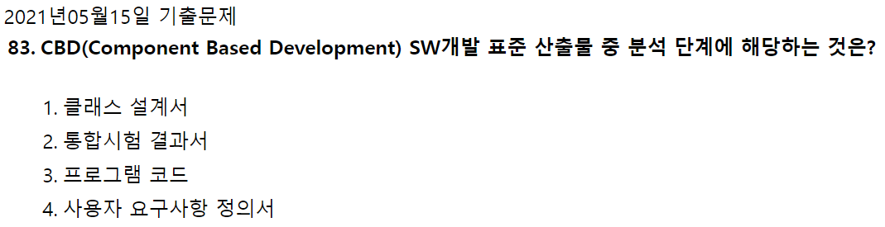

CBD Component-Based Development의 약자, 컴포넌트 기반 방법론

- 기존의 시스템이나 소프트웨어를 구성하는 "컴포넌트를 조합"하여 하나의 새로운 어플리케이션을 만드는 방법론

**<ins>CBD 방법론의 개발 공정</ins>**

1\. 요구파악 단계 → 요구사항 기술서, 용어 사전, 개념 모델, 유즈케이스 모델

2\. 분석 및 설계 → 객체 모델, UI 설계서, 아키텍처 기술서, 인터페이스 명세서, 컴포넌트 명세서, 컴포넌트 설계서, 데이터베이스 설계서

3\. 구현 → 개발 표준 정의서, 플랫폼 종속적 코드

4\. 테스트 → 테스트 계획서, 컴포넌트 테스트 보고서, 통합 테스트 보고서, 인수테스트 보고서

### 2021년 5월 15일 84번

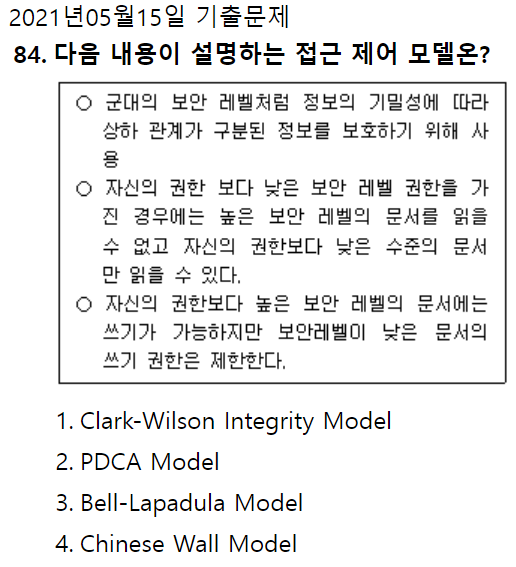

- **<ins>BLP 기밀성 모델</ins>** : 정보의 불법적인 파괴나 변조보다는 불법적인 비밀 유출 방지에 중점 - 기밀성 강조
- **Clark-Wilson 무결성 모델** : 비밀 노출 방지보다 자료의 변조 방지가 더 중요함(금융, 회계관련 데이터, 기업 재무재표 등)
- **Chinese Wall** : 충돌을 야기시키는 어떠한 정보의 흐름도 없어야 한다. 이익의 충돌 금지, 최근 일을 한 적 있는 파트너는 동일 영역에 있는 다른 회사 자료에 접근해서는 안된다.

### 2021년 8월 14일 87번

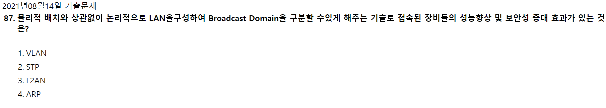

답은 1번 해설없음.

### 2021년 5월 15일 89번

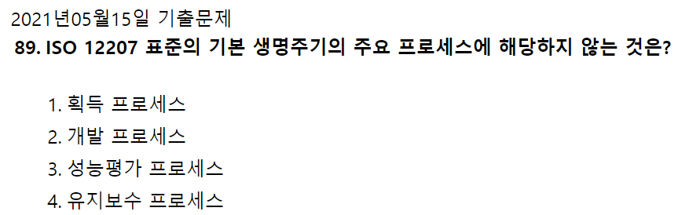

- **<ins>기본</ins>**<ins> 생명 주기 프로세스</ins> : 획득, 공급, 개발, 운영, 유지보수 프로세스
- **<ins>지원</ins>**<ins> 생명 주기 프로세스</ins> : 품질 보증, 검증, 확인, 활동 검토, 문제 해결 프로세스
- **<ins>조직</ins>**<ins> 생명 주기 프로세스</ins> : 관리, 기반 구조, 훈련, 개선 프로세스

### 2020년 9월 26일 96번

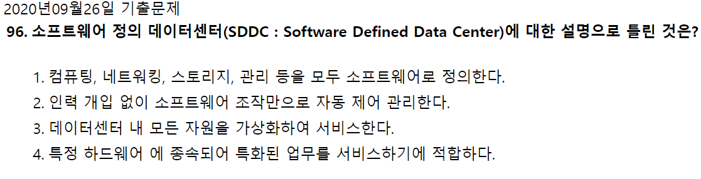

- 네트워크 관련 신기술
- 소프트웨어 정의 데이터 센터
  - 데이터 센터의 모든 자원을 가상화
  - 다양한 소프트웨어 정의 기술이 사용된다.
  - 유연한 제어가능/비용절감가능/ 운영이 편리하다.
  - 하드웨어와 독립적이다.

### 2021년 8월 14일 90번

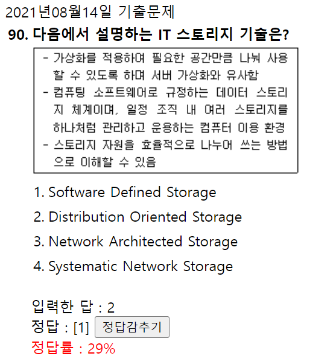

두번째 단락의 **<ins>'컴퓨팅 소프트웨어로(Software) 규정하는(Defined) 데이터 스토리지</ins>** 체계이며,

### 2021년 5월 15일 기출 93번

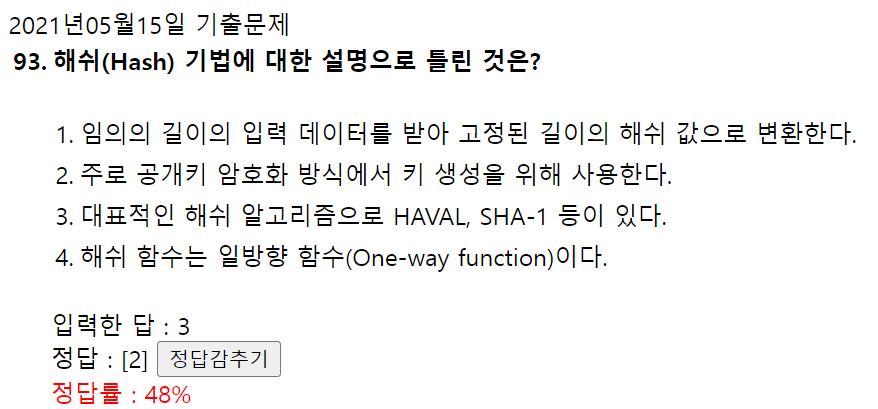

- 단방향
  - 종류
    - SHA, MD5, N-NASH, SNEFRU 등
  - 특징 : 임의의 길이의 입력 데이터나 메시지를  고정 길이의 값이나 키로 변환 암호화, 무결성 검증을 위하여 사용
- 양방향
  - 종류
    - Stream 방식 (평문과 동일한 길이의 스트림을 생성하여 비트 단위로 암호화) : LFSR, RC4
    - Block 방식 (한 번에 하나의 데이터 블록을 암호화) : DES, SEED, AES, ARIA
  - 특징 : 암호화/복호화 속도가 빠르며, 알고리즘이 단순, 공개키 암호 기법보다 파일 크기가 작음.   사용자의 증가에 따라 관리해야 할 키의 수가 상대적으로 많아진다
- 공개키  (암호화 시 사용자에게 공개되는 공개키 사용, 복호화 시 비밀키 사용, 비대칭 암호 기법이라고도 함)
  - 종류 : RSA
  - 특징 : 키의 분배가 용이하고, 관리해야 할 키 수가 적음.           암호화/복호화 속도가 느리며 알고리즘이 복잡, 개인키 암호화 방법보다 파일의 크기가 크다.

  

### 2020년 9월 26일 기출

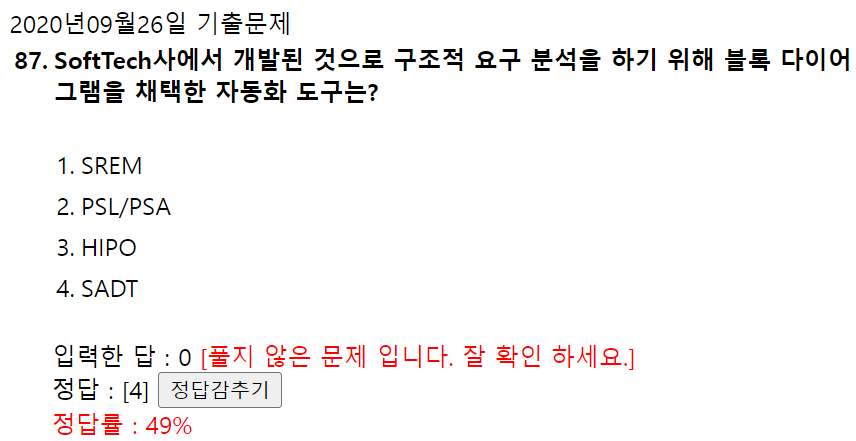

- SREM(Software Requirements Enginering Methdology):TRW사가 우주 국방 시스템 그룹에 의해 실시간 처리 소프트웨어 시스템에서 요구사항을 명확히 기술하도록 할 목적으로 개발한 것으로,RSL과 REVS를 사용하는 자동화 도구이다.(RSL/REVS)
- PSL/PSA:미시간 대학에서 개발한 것으로 PSL과 PSA를 사용하는 자동화 도구입니다.
- HIPO(Hieracgy Input Process Output):**하향식 소프트웨어 개발**을 위한 문서화 도구입니다.
- SADT(Structure Analysis and Design Technique): SoftTech사에서 개발된 것으로 구조적 요구 분석을 위해 **블록 다이어그램**을 채택한 자동화 도구입니다.

### 2020년 9월 26일 기출

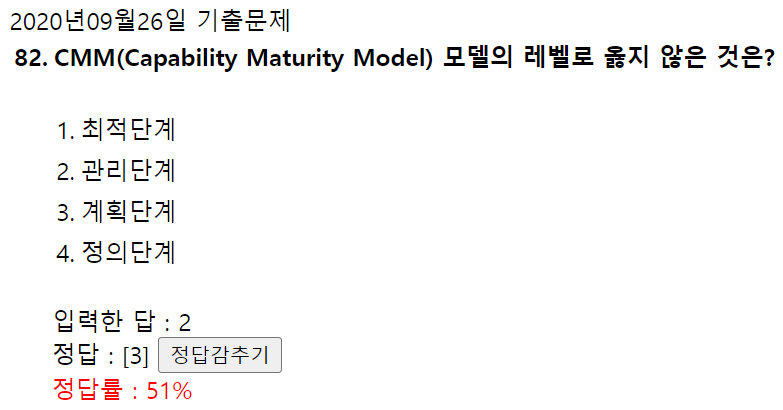

CMM(Capability Maturity Model ) 모델의 레벨

- 초기 단계
- 관리 단계
- 정의 단계
- 정량적 관리 단계
- 최적화 단계

### 2020년 8월 22일 기출

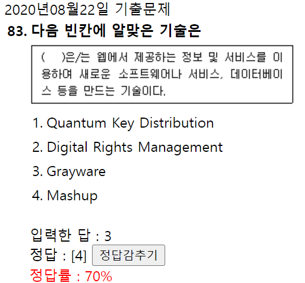

Quantum Key Distribution : 양자암호관련

Digital Rights Management : DRM 이라고도 하며, 저작권 관리 기술

Grayware : 바이러스, 트로잔등 악성프로그램과는 다르게 사용자 동의를 받아 설치하는 프로그램

Mashup : 웹에서 제공하는 정보 및 서비스를 이용하여 새로운 소프트웨어나 서비스, 데이터베이스 등을 만드는 기술이다.

### 2020년 8월 22일 기출

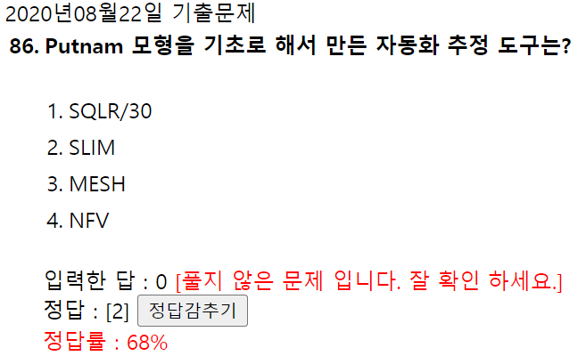

- Putnam : 소프트웨어 생명주기 전 과정 동안 사용될 곡선의 노력 분포를 가정해주는 모형               /Rayleigh-Norden 곡선의 노력 분포도를 기초로 한다.
- SLIM : Putnam 기법 모형을 기초로 개발된 자동화 추정 도구

→ <ins>훈남(Putnam)이 노력(노력 분포도)해서 슬림(SLIM)해졌네 </ins>

### 2021년 5월 15일 기출

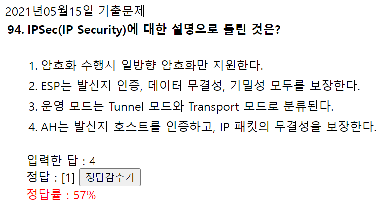

일방향 암호화는 해시암호화

### 2020년 9월 26일 기출

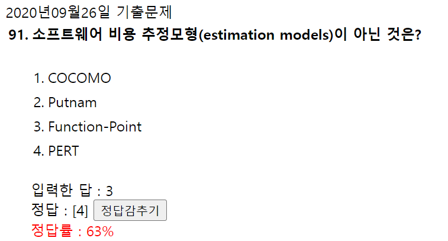

- **PERT**는 프로젝트 일정관리기법이다.

### 2020년 9월 26일 기출

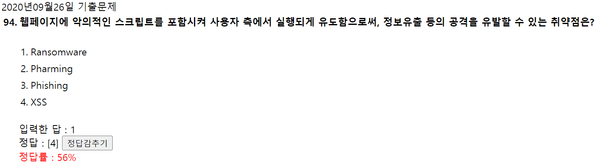

- **<ins>Ransomeware(랜섬웨어)</ins>** : 임의로 시스템을 잠그거나 혹은 데이터를 암호화하여 사용할 수 없게 한 다음 이를 빌미로 돈을 요구하는 기법
- **<ins>Pharming</ins>** : 홈페이지 주소를 바꿔 사용자가 진짜 사이트로 오인하게 하여 접속하게 한 다음 개인정보를 탈취하는 기법
- **<ins>Phishing</ins>** : 메일 등으로 공공기관이나 금융기관에서 보낸 것처럼 위장하여 사용자에게 계좌번호, 카드번호의 비밀번호를 빼내는 기법. 대표적으로 스미싱이 있음
- **<ins>XSS</ins>** : 웹페이지에 악의적인 스크립트를 포함시켜 사용자 측에서 실행되게 유도함으로써, 정보유출 등의 공격을 유발하는 기법

### 2020년 9월 26일 기출

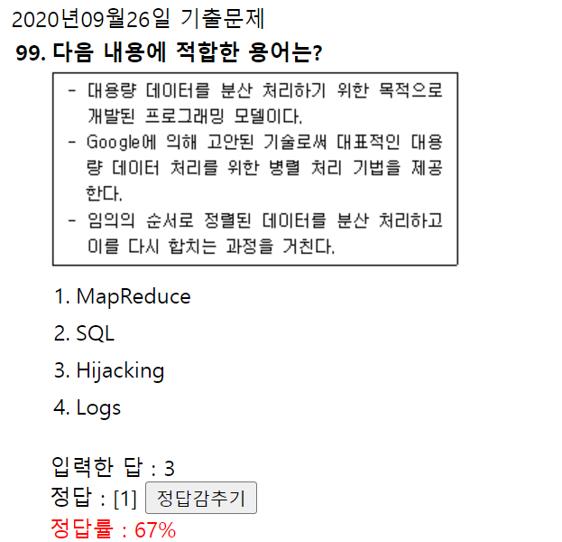

- 맵리듀스(MapReduce)
  - 맵(map) : 데이터가 텍스트 형태로 입력되면 64KB 분할한다. 텍스트 안에 단어를 분류하여 카운트한다.
  - 리듀스(Reduce) : 각 텍스트에서 정리된 맵들을 결합하여 동일한 단어를 카운트한다.
