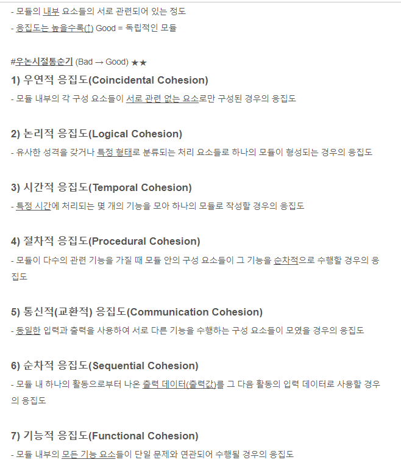
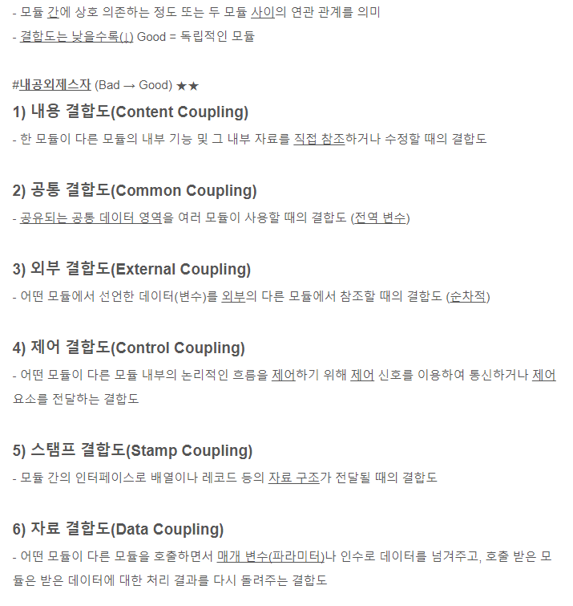
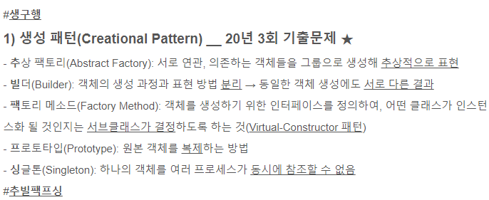
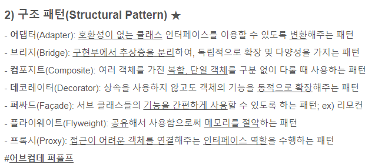
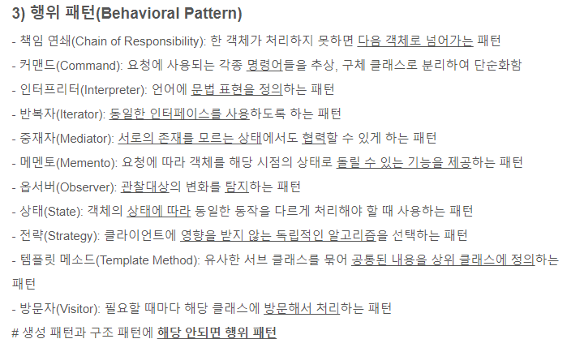
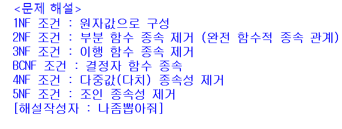

# 암기노트

> 작성: 2022-02-04 · 태그: 정보처리기사 · [노션 원본](https://app.notion.com/p/ac686b82fd69413f9ce37242bba2ee0e)

### 응집도

**<ins>우>논>시>절>통>순>기 </ins>**

→응집도는 높을수록 모듈의 독립성 증가

### 결합도(Coupling)

**<ins>#내>공>외>제>스>자</ins>**

→ 결합도는 낮을수록 독립적인 모듈

## 디자인 패턴

### 생성 패턴

#**<ins>추빌팩프싱</ins>**

### 구조패턴

### 행위패턴

### 정규화 과정

**<ins>도부이걸다조 </ins>**
