# 실기 CBT 오답정리

> 작성: 2022-03-11 · [노션 원본](https://app.notion.com/p/649654269d414f0b9e271da91770be3f)

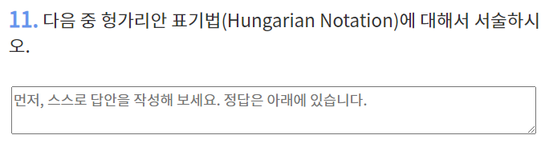

- **헝가리안 표기법** : 식별자 표기 시 접두어에 자료형을 붙이는 표기법

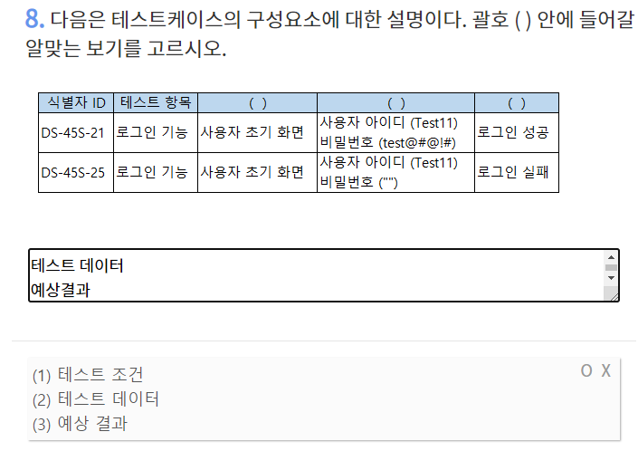

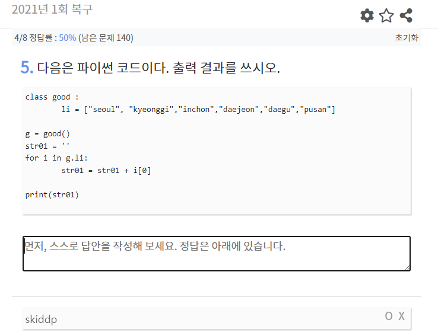

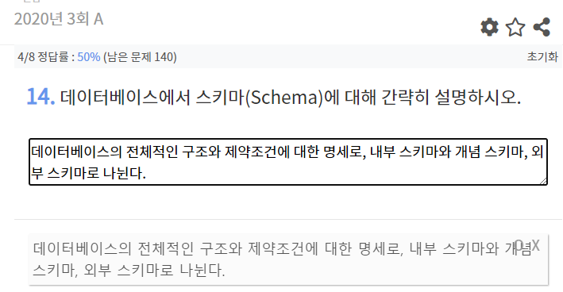

- **스키마(Schema) :** 데이터 베이스의 전체적인 구조와 제약조건에 대한 명세로, 내부 스키마와 개념 스키마, 외부 스키마로 나뉜다.

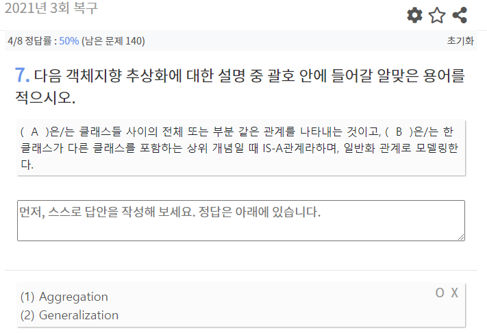

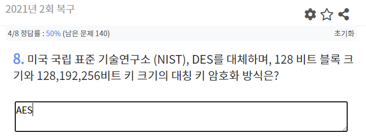

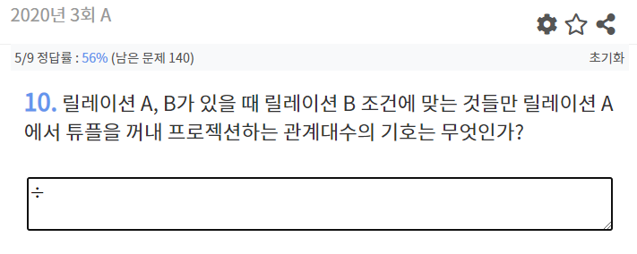

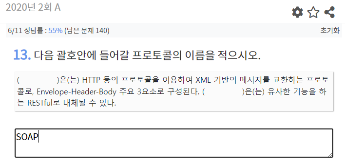

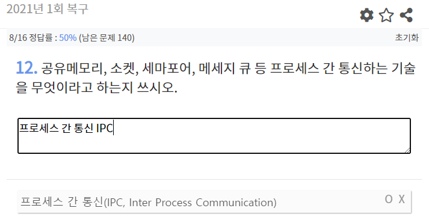

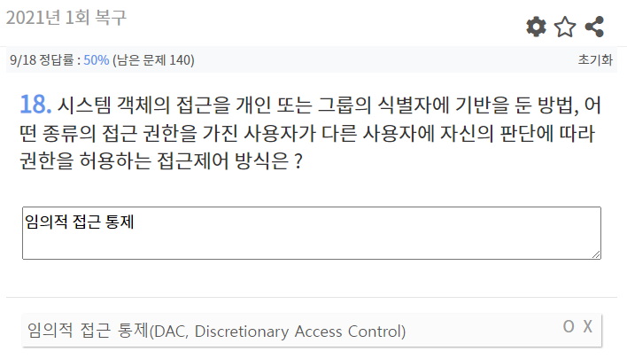

- 임의적 접근 통제(DAC) : 객체의 접근을 개인 또는 그룹의 식별자에 기반을 둠
- 강제적 접근 통제(MAC) : 모든 주체 및 객체에 대하여 일정하다. 어느 하나의 주체나 객체 단위로 접근 제한을 설정할 수 없다.
- 역할기반 접근 통제(RBAC) : 권한을 사용자가 아닌 그룹에 부여하고 그룹이 수행하여야 할 역할을 정의한다.

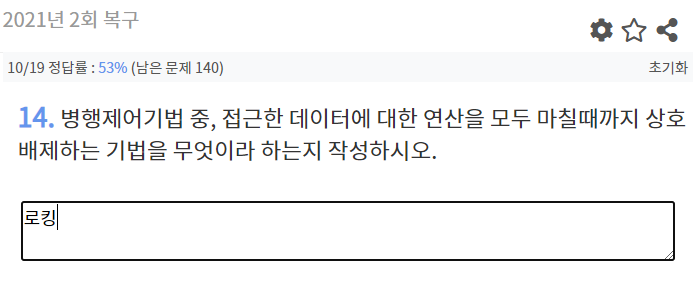

- **로킹** : 접근한 데이터에 대한 연산을 모두 마칠때까지 상호배제하는 기법

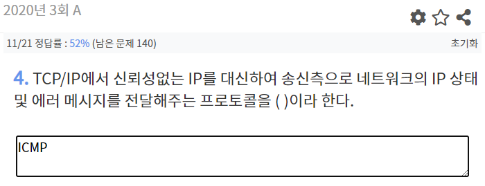

- **<ins>ICMP </ins>**: TCP/IP에서 신뢰성없는 IP를 대신하여 송신측으로 네트워크의 IP 상태 및 에러 메시지를 전달해주는 프로토콜

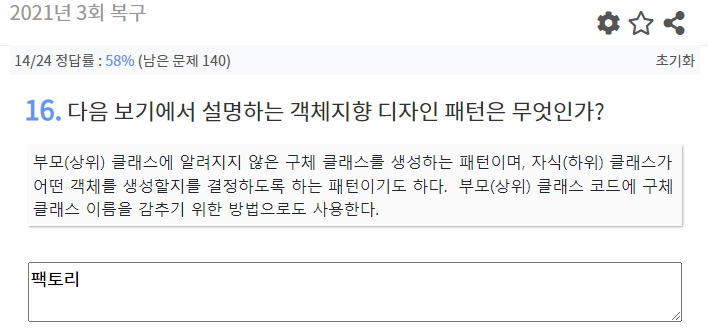

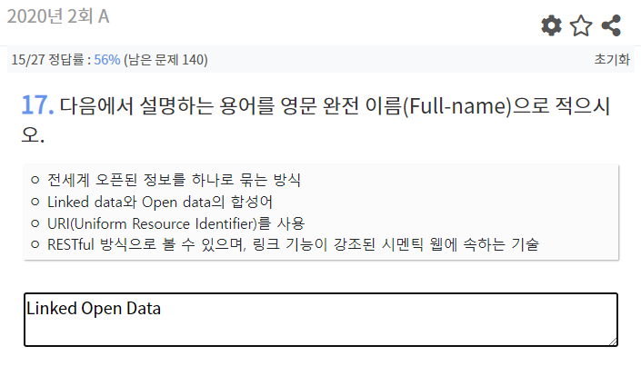

- **Linked Open Data**
  - 전세계 오픈된 정보를 하나로 묶는 방식
  - Linked data와 Open data의 합성어
  - URI를 사용
  - RESTful 방식으로 볼 수 있음
  - 링크 기능이 강조된 시멘틱 웹에 속하는 기술

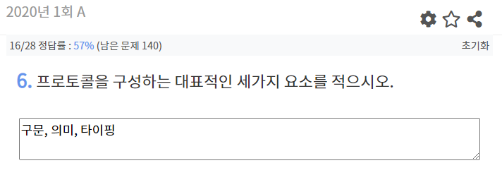

- **프로토콜을 구성하는 대표적인 세가지 요소**
  - 구문
  - 의미
  - 타이핑

  

  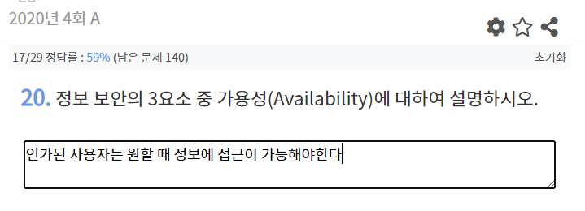

  - **가용성** : 인가된 사용자는 원할 때 정보에 접근이 가능해야한다.

  

  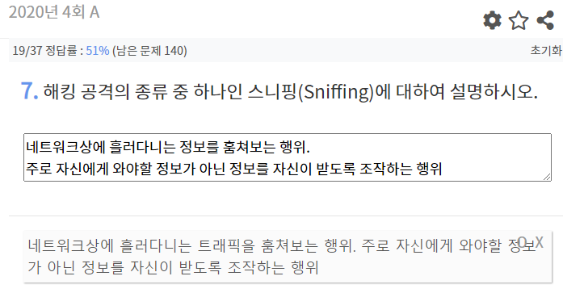

  - **스니핑(Sniffing)** : 네트워크 상에 흘러다니는 트래픽을 훔쳐보는 행위.                              주로 자신에게 와야할 정보가 아닌 정보를 자신이 받도록 조작하는 행위
