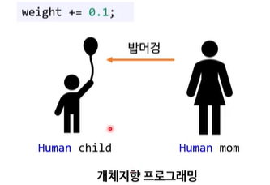
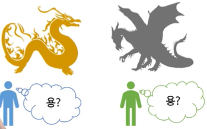

# 객체지향프로그래밍(OOP)

> 작성: 2022-01-13 · [노션 원본](https://app.notion.com/p/93cd5d88f8694d52894c43cd86bce8b9)

### 객체란?

: 객체란 물리적으로 존재하거나 추상적으로 생각할 수 있는 것 중에서 자신의 속성을 가지고 있고 다른것과 식별이 가능한 것

객체는 속성과 동작으로 구성되어있고, JAVA에서는 속성을 필드, 동작을 메소드라고 부름

### OOP는 기계처럼이 아니라 사람처럼 생각하자는 것

## 객체지향프로그래밍의 특징

1. **<ins>캡슐화</ins>**
   : **캡슐화란 객체의 필드(데이터), 메소드(동작)를 하나로 묶고**, 실제 구현 내용을 감추는 것을 말함 → 내부의 데이터를 외부로부터 보호한다.

   외부 객체는 객체내부의 구조를 알지 못하며, 객체가 노출해서 제공하는 필드와 메소드만 이용할 수 있음

   외부로부터의 데이터 접근을 최대한 불허(=private)

  

   **왜 할까?**

   :  외부의 잘못된 사용으로 객체가 손상되지 않도록 하기 위함

   접근제한자로 캡슐화된 것을 숨길 지 노출시킬 지 결정함

  
2. **<ins>상속</ins>**
   : 상속이란 부모역할의 상위 객체가 자기가 가지고 있는 필드와 메소드를 자식역할의 하위 객체에게 물려주어 하위객체가 사용할 수 있도록 해주는 것

   ⇒ 상속보다는 유전에 가까움 → 부모의 특징을 물려받는 자식

  

   **이미 존재하는 클래스를 기반으로 새 클래스를 만드는 방법**

   - 새 클래스(자식)는 기존 클래스(부모)의 동작과 상태를 그대로 물려 받음(유전)
   - 그 외에 새 클래스만의 동작과 상태를 추가 가능(진화)
   - 물론 이 새 클래스를 상속해서 또 다른 클래스를 만들 수 있다.

   단, 상속을 할때 부모 클래스는 부모 클래스의 생성자로 초기화해주고

   자식 클래스는 자식 클래스의 생성자로 초기화를 해준다.(부모가 먼저 초기화된다.)

  

   **왜 할까?**

   : 하위객체에서 상위객체를 재사용함으로써 설계 시간을 줄여주고 반복된 코드의 중복을 줄여준다.

  

  
3. **<ins>다형성</ins>**
   : 같은 타입이지만 실행결과가 다양한 객체를 이용할 수 있는 성질

   다형성은 하나의 타입에 여러 객체를 대입함으로써 다양한 기능을 이용할 수 있도록 해줌

4. **<ins>(데이터)추상화</ins>**
   : **OOP에서 추상화란** **어떤 구체적인 것(데이터)에 직접 손대지 않겠다****는 의미**

   private 멤버 변수와 setter/getter가 데이터 추상화

   → 캡슐화는 추상화를 이루는 방법 중 하나

- 추상 자료형쪽 관점
  - 사용자는 클래스를 자료형으로 사용할 수 있음
  - 그 클래스 안에 들어있는 멤버 변수가 정확히 뭔지 몰라도 된다.
  - 그냥 클래스로부터 객체 생성 가능
- 절차적 데이터 추상화쪽 관점
  - 데이터를 직접 조작하는 대신 메소드를 호출
  - 이게 OOP라는 용어를 처음 주장했다는 소수설의 관점과 유사

**추상화의 단점**

- 동작 없이 데이터만 있는 클래스는 쓸데없는 코드만 늘어남
  - 예 : DTO(data transfer object)
- 어떻게 추상화를 해야 하는지 뚜렷한 객관적 기준이 없음

