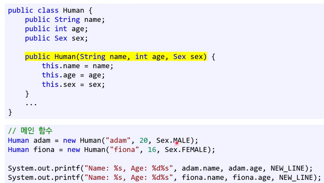
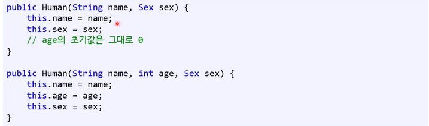
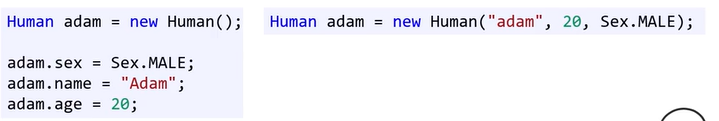
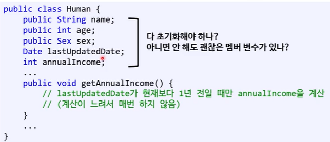
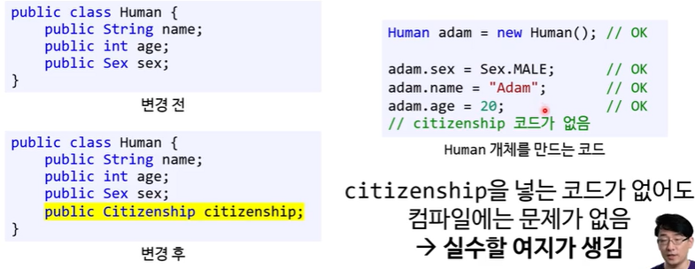

# 생성자

### 생성자라는 특별한 메서드가 담당하는 것

- 개체 생성 시에 자동으로 호출되는 특이한 함수
- 반환형이 없다 (void가 아님)
- 함수명은 클래스명과 동일

### 오버로딩도 가능함

→ 중복된 코드가 보인다

### 기본 생성자(default constructor)

- **프로그래머가 생성자를 하나도 안 만들 경우** 자동으로 생기는 생성자
- **컴파일러가 알아서 매개변수 없는 생성자를 만들어 줌**
- 기본 생성자의 함수 바디는 비어있다.
- 단, **프로그래머가 생성자를 만들어주면 기본 생성자는 생기지 않는다.**
  - 위에 오버로딩 예시처럼 만들면 Human jin = new Human(); 은 컴파일 오류가 발생한다. 왜? 매개변수가 없는 타입을 만들어주지 않았기 때문에  오히려 생성자를 아예 만들어주지 않으면 오류가 발생하지 않는다. 기본 생성자를 컴파일러가 만들어주기 때문에 ! 실수하지 말것 !

### 어떤 값을 개체 생성 직후에 바꿔주나 생성자에서 처음부터 초기화 해주나 결과는 같지 않나 ?

실수가 생길 수 있다. 나중에 멤버 변수가 추가될 때 기존의 초기화 코드들을 업데이트 안 하면?

- 어떤 멤버 변수를 초기화해야 하는지 모른다. 클래스 파일을 열어서 확인하고 추가해줘야함
- 어떤 멤버 변수를 초기화해줘야 하는지 모를 수도 있음

- 나중에 멤버 변수가 추가되는 것에 대응하기 어렵다.

### 생성자로 초기화를 해야 하는 이유

: 외부에서 클래스 내부의 데이터를 알 필요가 없음

→ 데이터 추상화(캡슐화의 일부이기도 함)
