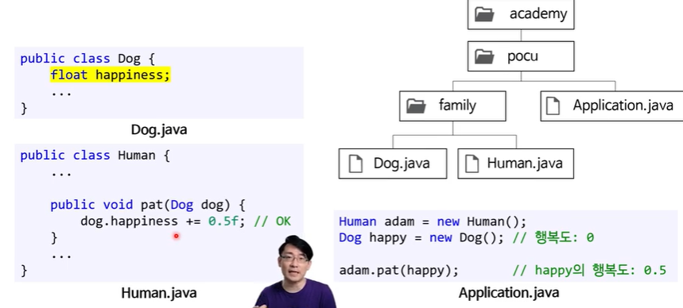

# 패키지 접근 제어자

## 접근 제어자를 안 붙일 경우

- 기본(default) 또는 패키지 접근 권한
- 같은 패키지 안에 있는 클래스끼리 서로 접근 가능
  - 같은 패키지 : public처럼 작동
  - 다른 패키지 : private처럼 작동

Dog과 Human 클래스는 같은 패키지 안에 있기 때문에

dog.happiness로 호출이 가능하지만

다른 패키지 클래스인 Application에서 pat 메소드를 호출하기 위해서는

Dog클래스와 Human클래스의 객체를 생성해줘야한다.

**하지만**

이렇게 public으로 안에 데이터를 공개하는 건 좋지 못하다.

private로 캡슐화해서 사용하는 게 좋다.
