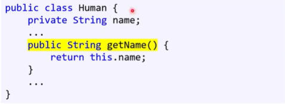
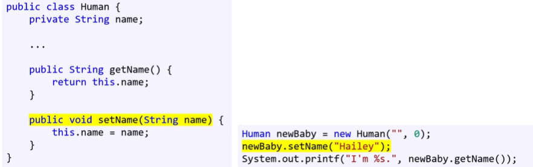

# getter/setter

> 작성: 2022-01-18 · 태그: JAVA · [노션 원본](https://app.notion.com/p/d6f112e206c1463aa38fd5af66551ce8)

### 남이 읽을 수 있게 해주려면 getter를

전체 내 멤버 정보를 보여주긴 싫고 특정한 정보만 노출하고 싶으면

- getter라는 생성해서 public 함수를 만들어서 보여주면 된다.
- 반환형이 필요하다. (return)

### 변경을 허락하고 싶은 정보가 있을 때는? setter

setter는 매개변수를 받는다. → 변경할 정보

- public함수로 만들어줌 접근해서 수정해야 하니까!
- return값이 없다. 보여주는 게 아니라 정보 저장을 위해서니까

### getter와 setter는 메소드로 만드는 게 맞다는 게 OOP진영의 입장

**함수를 통한 데이터 접근의 객관적인 장점**

1. 멤버 변수를 저장하지 않고 필요할 때 마다 getter에서 계산 가능
   1. 예 : 질량과 중력 멤버 변수로부터 무게를 계산
2. setter에서 추가적인 로직을 실행할 수 있음
   1. 예 : 음수의 나이가 인자로 들어올 경우 무시
3. 상속을 통한 다형성 구현 가능
   1. 메소드가 아닌 멤버 변수면 다형성 구현이 안된다.
