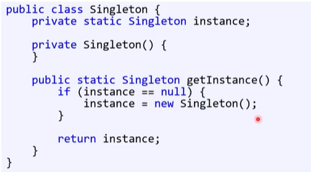
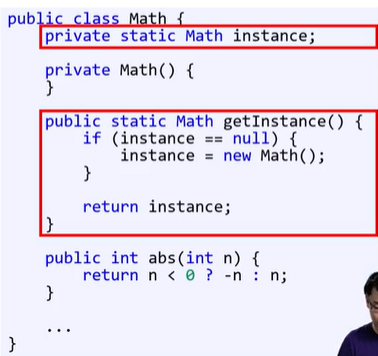
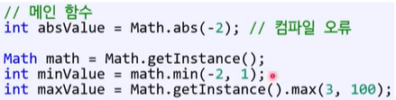

# 싱글턴 패턴

: 어떤 클래스에서 만들 수 있는 **인스턴스 수를 하나로 제한**하는 패턴

다음과 같은 조건을 충족하는 개체에 적합

1. 프로그램 실행 중에 최대 하나만 있어야 함
   1. 프로그램 설정, 파일 시스템 등
2. 이 개체에 **전역적으로 접근이 가능**해야 함

→ 딱 하나(single)만 존재해야 하니 이름도 싱글턴(singleton)

**getInstance()**로 싱글턴 객체를 호출하는데(이건 public static)

- 아직 객체가 없는 경우
  - 객체를 생성 후 static 변수에 저장
  - static 변수에 저장된 객체를 반환한다.
- 이미 객체가 있는 경우
  - static 변수에 저장되어 있는 객체를 반환한다.

  

  

### 싱글턴 Math 클래스

싱글턴을 만드는 데 필요한 것만 static으로 만들고 나머지는 일반 메소드다

고로 객체를 생성하지 않고 사용할 수 없다.

### 프로그램 설정 싱글턴(Configuration)

- 설정은 프로그램 실행 중 하나만 존재
- 프로그램 창의 위치와 크기를 기억
- 파일에 저장하거나 파일로부터 로딩 가능

## 싱글턴 vs static

### static으로는 못 하는 일

1. 다형성을 사용할 수 없다.
2. 시그내처를 그대로 둔 채 멀티턴 패턴으로 바꿀 수 없다.
3. 객체의 생성 시점을 제어할 수 없다.
   1. JAVA의 static은 프로그램 실행 시에 초기화됨
   2. 단, 싱글턴을 사용해도 제어의 어려움이 있음
