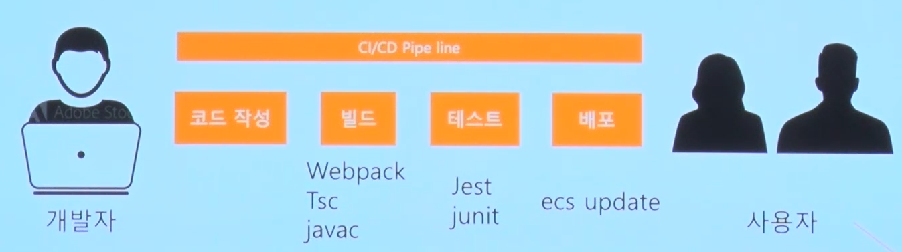

# CI/CD란 ?

## CI/CD 란?

### Continuous Integration ⇒ 뭘 통합한다는 거야?

: **<ins>여러 개발자들의 코드베이스를 계속해서 통합하는 것</ins>**

continuous integration (CI) is the practice of merging all developers’ working copies to a shared mainline several times a day

### Continuous Delivery ⇒ 무엇을 배달한다는 거야?

: 사용자에게 제품(서비스)를 지속적으로 배달한다!

**<ins>코드베이스가 항상 배포가능한 상태를 유지하는 것</ins>**

### Continuous Deployment

: 코드베이스를 사용자가 사용가능한 환경에 배포하는 것을 자동화함

⇒ 즉, 개발자들이 코드를 짜면 자동으로 통합해주고 서비스 배포해주는 것 !

## CI가 왜 필요한가요 ?

통합을 지속적으로 해주지않으면 한번에 통합하게 되는데 이때

굉장히 복잡해짐 !

그래서 자동적으로 통합해주는 젠킨스 KINGGOD

## CD는 왜 필요한가요?

1. 백엔드 코드 개발
2. 프론트와 협업해야하니 배포를 해볼까?
3. 저기 배포 좀 해주세요..
4. 앗 버그 ...! 다시 배포 좀 해주세요..

⇒ 즉시 즉시 배포함으로써 배포의 어려움을 없앰
