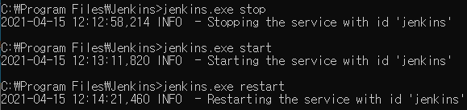

# 젠킨스 종료하기, 재실행하기

명령프롬프트에서 cd 명령어를 통해 젠킨스 설치 폴더로 이동합니다.

cd \[jenkins 폴더\]

젠킨스 종료하기

jenkins.exe stop

젠킨스 실행하기

jenkins.exe start

젠킨스 재실행하기

jenkins.exe restart

**\[출처\]** [\[Jenkins\]젠킨스 종료하기, 재실행하기 for Windows](https://blog.naver.com/hj_kim97/222310756910)\|**작성자** [로그](https://blog.naver.com/hj_kim97)
