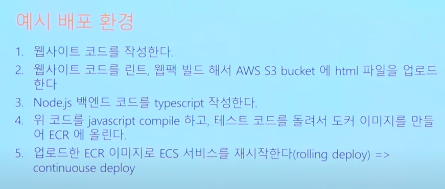
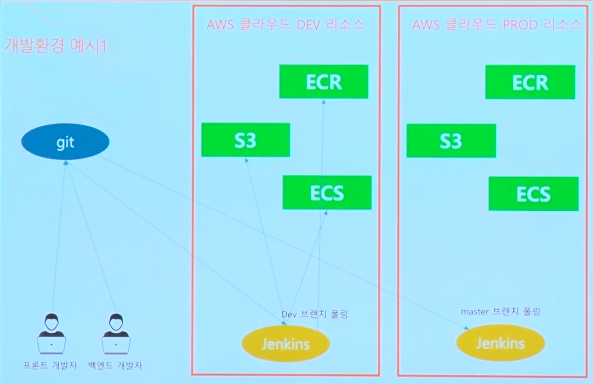

# 개발 환경 및 CI/CD의 기본 동작 이해

## ❔ 개발 환경의 종류에는 무엇이 있을까?

- 개발자가 개발을 하는 Local 환경(자신의 workspace 안에서 일을 함)
- 개발자들끼리 개발 내용에 대한 통합 테스트를 하는 Development 환경
- 개발이 끝나고 QA 엔지니어 및 내부 사용자들이 사용해 보기 위한 QA환경
- 실제 유저가 사용하는 Production 환경
- 쉽게 DEV, QA, PROD 환경으로 부르자

## 개발 프로세스

1. 개발자가 자신의 PC에서 개발을 진행한다.
2. 다른 개발자가 작성한 코드와 차이가 발생하지 않는지 내부 테스트를 진행한다.
3. 진행한 내용을 다른 개발자들과 공유하기 위해 git과 같은 SCM에 올린다.

   1. 흔히 dev 브랜치
4. Dev브랜치의 내용을 개발 환경에 배포하기 전에 테스트와 Lint 등 코드 포맷팅을 한다.
5. 배포하기 위한 빌드 과정을 거친다.
6. 코드를 배포한다.
7. 테스트를 진행한다.
8. 위 모든 과정을 DEV, AQ, PROD 환경에서 모두 하고 각각에 맞는 환경에 배포한다.

## AWS 리소스

### S3

- Simple Storage Service의 약자로 그냥 클라우드 스토리지
- 정적 웹사이트 코드배포에 용이
- 정적 웹사이트 호스팅에 필요한 다양한 기능 제공
- AWS Cloudfront와 함께 사용해서 최적화 가능하고 DNS 관리도 가능

⇒ 개발자가 쓰는 네이버 클라우드 라고 생각하면 쉬움

### ECR

- Elastic Container Registry
- 도커 이미지를 저장하는 프라이빗 레포지토리

### ECS

- Elastic Contatiner Service
- 도커 컨테이너 기반으로 서비스 운용을 가능하게 해주는 간단한 서비스
- 무중단 배포를 제공하며 scale up이 가능한 것이 특징
- 백엔드 서비스를 스케일업 가능한 형태로 배포하는데 최적화
- 수많은 도커 컨테이너 서버를 띄우고 LB가 이들 사이에 밸런싱을 해줌
- fargate, ec2 모드가 있어서 docker container 리소스만 띄우거나 혹은 물리적인 EC2 instance 클러스터로 구성 가능
  - fargate는 그냥 AWS에 내가 인스턴스 관리하기 싫어 너가 몇개 알아서 해줘 느낌 → ec2보다 추상화 레벨이 높다고 볼 수 있음
  - ec2는 눈에 보이게 대시보드에서 보면서 서버 몇개고 어떻게 관리할건지 사용자가 설정해서 사용하는 느낌

## 실제 개발 구조

물리적으로 프로덕트 환경과 개발 환경을 분리를 해놓음 → AWS 계정 자체를 여러개를 씀
