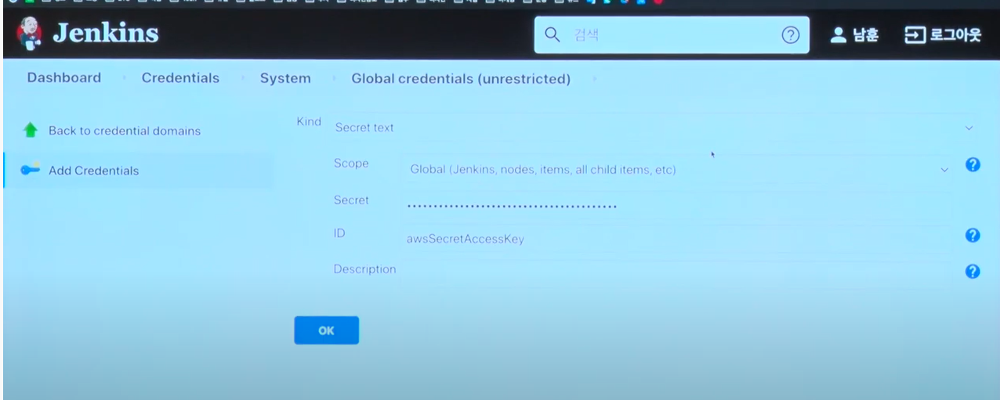
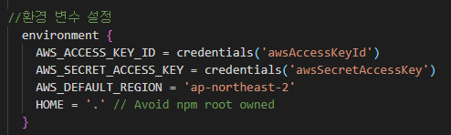

# 젠킨스 git등록

### 젠킨스에서는 git을 등록해서 사용할 수 있다.

그 방법의 순서는

1. github settings에서 토큰 발급
2. Jenkins → Add Credentials에서 등록
3. AWS → I AM → 사용자 에서 사용자등록
4. Jenkins → Add Credentials 에서 등록한 사용자의 엑세스키와 시크릿 엑세스키 등록

5. 파이프라인의 환경변수 설정에 등록

